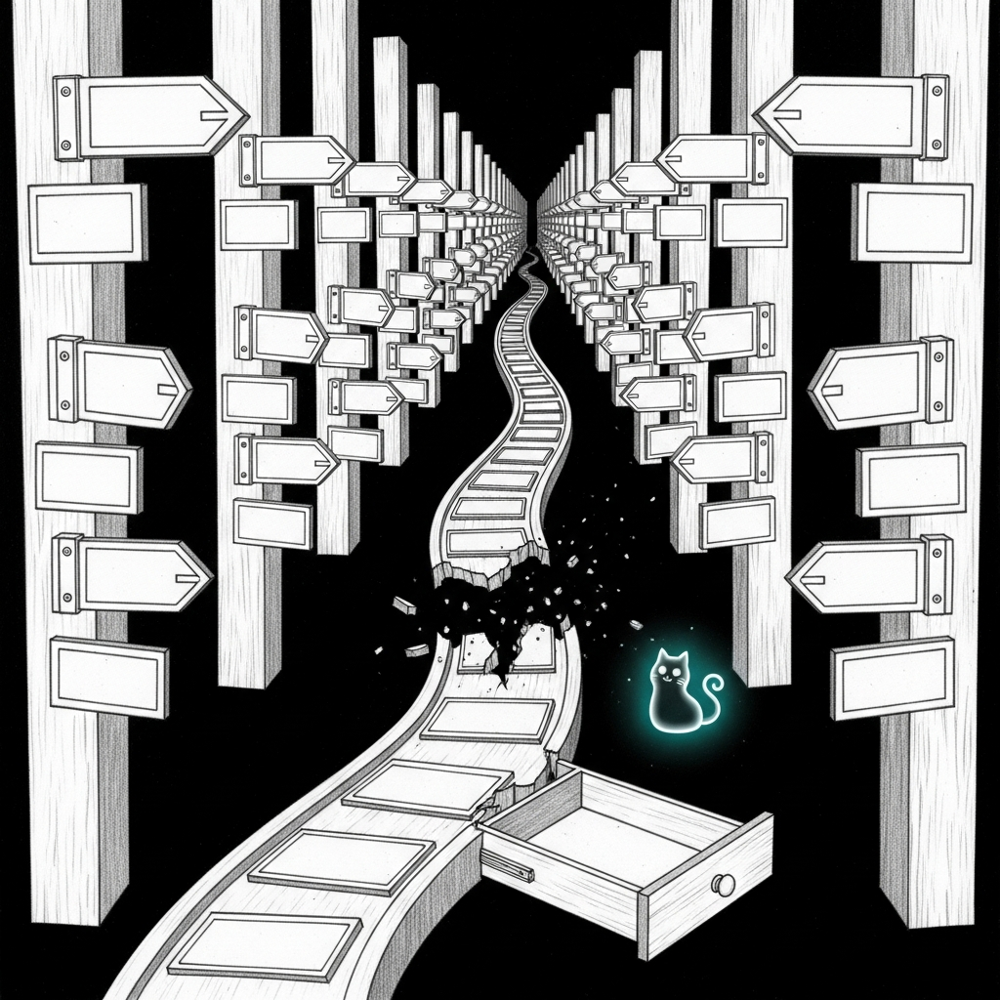

import { Aside } from '@astrojs/starlight/components';

Well, this is awkward. You walked straight into an empty hallway, the fourth wall is staring back at you, and the page you asked for is nowhere in the building. Either you typed the URL with your elbows, a route got refactored while nobody updated the signposts, or you just caught a live bug in our 450-page book — which is statistically inevitable and deeply humiliating for whoever merged that PR.

Good news: the rest of the haus is still standing, and Windu hasn't quarantined you yet. Try one of these doors instead:

- [Start at the docs home](/)
- [Read the architecture overview](/architecture/overview/)
- [Open the getting started guide](/getting-started/what-is-sanctum/)
- [Check operations and troubleshooting](/operations/troubleshooting/)

<Aside type="tip">
If one of *our* internal links dropped you into this void, you are completely innocent and our docs just embarrassed themselves in front of company. File an issue so we can hunt the broken slug down with extreme prejudice.
</Aside>
