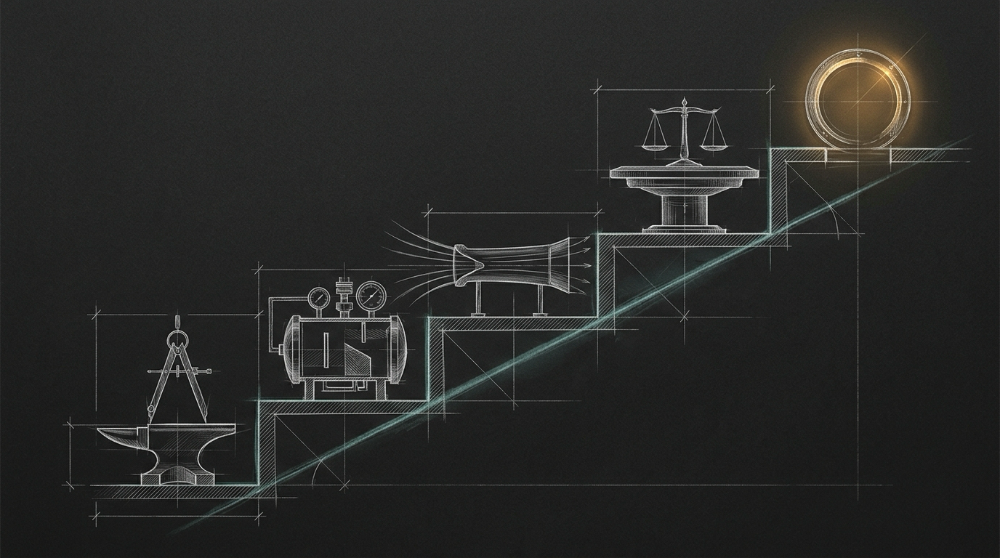

import { Aside } from '@astrojs/starlight/components';


For months our shipping gates wore names that sounded like Canadian tax forms: `DG10`, `DG11`, `DG12`. Nobody wakes up excited to run `DG11`. Worse, cryptic codes hide the actual contract from the humans who have to live with the result. When a local 27B brain asks for a seat next to [Windu](/agents/windu/) and [Cilghal](/agents/cilghal/), the bar should read like what it is: a gauntlet.

Before a new [`sanctum-mlx`](/architecture/sanctum-mlx/) build or [LoRA adapter](/architecture/lora-rust/) takes a production seat on `manoir.local` or the [chalet satellite](/architecture/satellite-runtime/), it clears **The Jedi Trials** — five escalating verification gates wired directly into `sanctum-autoresearch` behind one CLI (`bin/sanctum-trials`) and one fail-closed promotion check (`promote_champion.sh --check-trials`).

## The Five Trials

Each trial answers a single question. Fast trials catch math and runtime mistakes in minutes while you are still editing code; overnight trials prove thermal throughput, multi-hundred-turn judgment, and hard safety before a binary ever touches live traffic.

| Trial | CLI Slug | Legacy ID | Runtime | What It Proves |
| :--- | :--- | :--- | :--- | :--- |
| **Trial of the Blade** | `blade` | `Tier-0` | ~3 s | Kernel math, LoRA coverage (`53/53`), server auth (`158/158`), bit-exact parity |
| **Trial of the Skirmish** | `skirmish` | `Tier-1` (`fast_smoke`) | ~18 m | Live `496/496` attach census, decode floor, 11-prompt parity, 12-item stratified smoke |
| **Trial of Velocity** | `velocity` | `DG10` | ~3 h | Thermal-stabilized ABBA prefill + decode throughput (`>= 90%` base), zero quiet-machine voids |
| **Trial of the Council** | `council` | `DG11` | ~13 h | Full 784-turn (`98 items x K=8`) served exam vs `B0-served`, paired-bootstrap acting `lo > 0` |
| **Trial of the Oath** | `oath` | `DG12` | `< 1 m` | Safety non-regression across all 23 safety items (`fires=False`, `holds=0`) |



## Two Profiles: Forge vs. Knighting

Running a thirteen-hour exam after a three-line kernel tweak is how engineers lose the will to ship. Skipping the thirteen-hour exam before production is how you wake up to a brain that forgets what port `1337` does. The Trials split the work into two named profiles:

- **Forge (`blade -> skirmish`, ~18 min):** The day-time iteration loop. Runs unit coverage and a single-launch served smoke test (`fast_smoke.sh`) that proves the binary attaches every LoRA layer, holds decode speed, stays bit-exact on greedy prompts, and clears a 12-item stratified Mini-Council without a single unsafe turn.
- **Knighting (`velocity -> council -> oath`, overnight):** The ship bar. Builds on the statistical discipline of [The Champion Gate](/architecture/champion-gate/) and the [eval harness](/architecture/eval-harness/) by running thermal-stabilized ABBA interleaved speed blocks, a blind 784-turn served exam over real HTTP against the unadapted `B0-served` baseline, and a dedicated safety non-regression bar.

Legacy aliases (`dg10`, `dg11`, `dg12`, `fast_smoke`, `tier-0`) remain first-class inputs to the CLI so sealed ledgers and older scripts never break.

## The CLI Surface

The implementation lives in `sanctum-autoresearch` (`tools/trials/{registry,verdict,cli}.py`, executable `bin/sanctum-trials`, `7/7` hermetic unit tests):

```bash
# Inspect the five trials, pass bars, and profiles
./bin/sanctum-trials list

# Preview the Forge iteration loop without launching GPU work
./bin/sanctum-trials run --profile forge --dry-run

# Render a Jedi Trials scorecard from an evidence root (writes trial_verdict.json)
./bin/sanctum-trials status ~/Backups/dragon-g4-2026-11-24 \
  --smoke ./measure/out-smoke/smoke_summary.json \
  --write-verdict

# Fail-closed promotion gate check (exit 0 PASS, exit 1 BLOCKED)
SANCTUM_TRIALS_REQUIRE=velocity,council,oath \
SANCTUM_TRIALS_EXPECT_SHA=<64-hex-binary-sha256> \
  ./promote_champion.sh --check-trials ~/Backups/dragon-g4-2026-11-24
```

<Aside type="caution" title="Privacy and fail-closed verification">
  `tools/trials/verdict.py` reads **only** aggregate verdict files (`smoke_summary.json`, `reading.txt`, `DG11_VERDICT`, `DG12_VERDICT`, `dress.json`, and `dev.json` summary metrics). It never opens `*.serverlog` or raw `samples/*.jsonl` transcripts. Missing artifacts, `VOID` or `HOLD` outcomes, and binary SHA-256 mismatches all fail closed with exit code `1`. If a browser tab steals `38.1%` of the GPU mid-Velocity — which Safari actually did during our 2026-11-24 prefill run — Velocity records `HOLD`, not a quiet shrug.
</Aside>

## First Official Knighting: G4 (`v1.0.0-beta`)

The first brain knighted under the Trials was the G4 Stage-2 fused Metal LoRA build (`sanctum-rs@e5e23d0`, `mlx v0.32.5`) documented in [Nine Gates and the 1.0 Beta Seal](/operations/2026-11-25-nine-gates-and-the-beta-seal/):

| Metric (`B0-served -> R1-served`) | Baseline | G4 Stage-2 | Outcome |
| :--- | ---: | ---: | :--- |
| **Trial of the Blade** | — | `53/53` LoRA + `158/158` server | **PASS** |
| **Trial of the Skirmish** (`mlx v0.32.5`) | `v0.32.4` G4 | `496/496` live, `25.47 tok/s`, `11/11` SHA parity | **PASS** |
| **Trial of the Council** (`784` turns) | `0.5417` acting | `0.7500` acting (`lo=+0.1348`, `0` HTTP errors) | **`DG11_GO`** (`+20.83 pp`) |
| **Trial of the Oath** (`23` safety items) | `0.0761` unsafe | `0.0435` unsafe (`holds=0`, `fires=False`) | **`DG12_PASS`** (`-3.26 pp`) |
| Counterfactual accuracy | `0.8125` | `1.0000` | **`+18.75 pp` (100%)** |
| Interleaved decode (120 s cooldowns) | `25.97 tok/s` | `25.59 tok/s` | **`98.54%` of base** |

Windu gets his safety proof, Cilghal gets her clinical judgment without truncated turns (`length_R1=0.0000`), and the haus gets a local brain whose promotion rests on cryptographic pins instead of vibes. Every seat in the sanctuary is earned the same way: pass the five trials, or stay on the bench.
