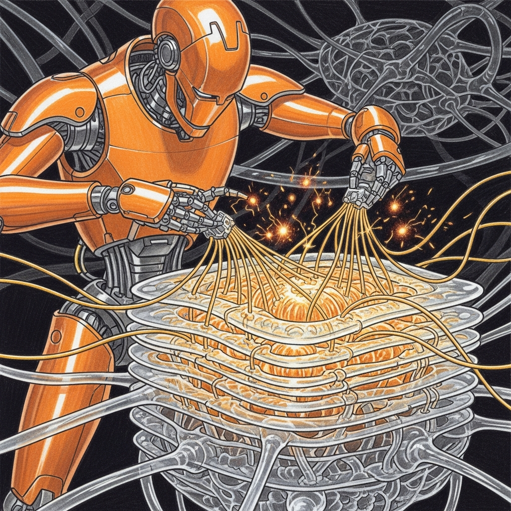
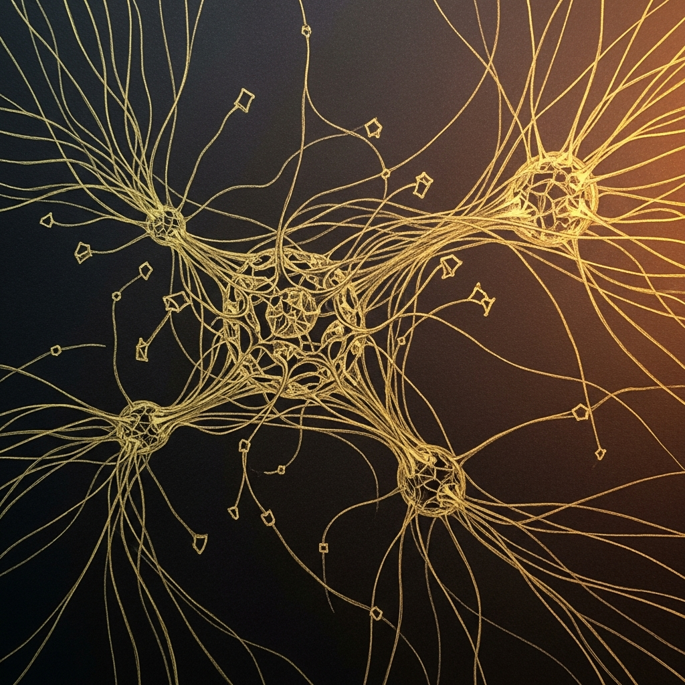

import { Aside } from '@astrojs/starlight/components';



Serving a Jedi Council from a Python runtime felt like asking a padawan to carry the Death Star plans. It technically works. You spend the whole time worrying about when it won't. So in April 2026 we built [`sanctum-mlx`](/architecture/sanctum-mlx/) — a native Rust inference server on `mlx-rs` — to take the 27B model off the interpreter. One problem: it couldn't load LoRA adapters.

The adapters are the entire point. Without them, the base model is a generalist that has never heard of Yoda, doesn't know port 1337, and would cheerfully tell you that bridge100 is a card game. The LoRA weights are the difference between a language model and a Council member — and until the server could absorb them, the whole rewrite was a very fast way to run the wrong personality.

<Aside type="note">
This page begins with the original April 2026 load-time merge (`lora.rs`), which later carried the **Qwen3.6-35B-A3B** MoE adapters unchanged. For 4-bit quantized models, load-time merge requires dequantizing, adding the delta, and requantizing — trading away voice quality or ballooning RAM. In November 2026 we solved runtime LoRA properly with the **Stage-2 Fused Metal LoRA Kernel + QMM Epilogue** (below), which now runs **Qwen3.8-27B-4bit** + the `r1` adapter (`496/496` fused projections) in production at **`98.54%` of raw base decode speed**.
</Aside>

Now it can load them. In Rust. Without Python. Without the GIL. Without the 300MB of overhead that comes from asking an interpreted language to do the job of a compiled one. It shipped 2026-04-08 and merged the council's adapters in production on the Mac Mini (`com.sanctum.mlx`, port 1337) until runtime application replaced it in the summer of 2026.

## The Merge Strategy

Runtime LoRA application — keeping the A and B matrices separate and composing them during every forward pass — would require modifying every linear layer's `forward()`. Elegant in theory. A maintenance nightmare in practice, and a latency tax on every single token.

Instead, we merge at load time:

```
W_merged = W_base + (α/r) × scale × (B^T @ A^T)
```

For quantized models (which is everything on Apple Silicon, because tens of billions of parameters don't fit in memory any other way), the pipeline is:

```
Dequantize (int4 → float32)
  → Add LoRA delta
    → Requantize (float32 → int4)
      → Write back to model parameters
```

Think of it as surgery. You open the patient up (dequantize), stitch in the new knowledge (add the LoRA delta), close them back up (requantize), and when they wake up they have no idea anything happened. They just know things they didn't know before. The model doesn't even know it has adapters — they're baked in.

This runs once at startup. Zero runtime overhead. Five seconds on the Mac Mini M4, and then the model is ready to be Yoda for the rest of its uptime.



## Implementation

New file: `sanctum-mlx/src/lora.rs`

| Function | What It Does |
|----------|-------------|
| `load_and_merge()` | Main entry — parses config, loads safetensors, groups A/B pairs, merges |
| `LoraConfig` | Deserializes `adapter_config.json` (rank, alpha, scale, dropout) |
| `MergeStats` | Tracks merged/skipped counts for logging |

The merge handles prefix stripping (`language_model.` from VL checkpoints) and uses `model.update_flattened()` for clean parameter updates through mlx-rs's official API. No unsafe blocks. No pointer arithmetic. The kind of code that compiles on the first try and then you spend twenty minutes suspecting it didn't actually do anything because nothing went wrong.

### V3 Adapter Merge Log

This is the V3 adapter merging into the original 27B-dense base (rank=64, alpha=128, scale=2.0 — the defaults the unit tests still assert against):

```
LoRA config loaded       rank=64 alpha=128 scale=2.0 effective_scaling=4.0
Adapter safetensors loaded  keys=496
LoRA pairs grouped          pairs=248
LoRA adapter merge complete merged=0 merged_quantized=248 skipped_missing=0 \
                            skipped_shape_mismatch=0 total_pairs=248
```

248 out of 248 quantized pairs. Zero skipped. The `skipped_shape_mismatch` field earns its keep on the MoE checkpoint — hybrid `linear_attn.*` projections whose Rust shape disagrees with the trainer's get skipped, not crashed — but on a clean dense adapter it stays at zero. The log is boring, which is the highest compliment merge code can receive.

## Portable Metal Builds

The binary embeds a hardcoded path to `mlx.metallib` (the compiled Metal shaders) at compile time. Build it on one machine, copy it to another, and it can't find the shaders. The kind of bug that works perfectly in development and fails in production, which is to say, the most common kind.

**Fix:** `build-release.sh` packages the binary with `mlx.metallib` colocated. MLX's runtime searches the binary's directory first (via `dladdr()`), finding the colocated file before falling back to the hardcoded path.

```bash
./build-release.sh                  # Build for current machine
./build-release.sh --deploy mm      # Build + deploy to Mac Mini
./build-release.sh --deploy chalet  # Build + deploy to the chalet node
./build-release.sh --deploy all     # Deploy to all nodes
```

Output: `dist/sanctum-mlx/` containing the binary (30MB) + metallib (158MB). The shader library is five times larger than the server. Metal has priorities.

<Aside type="note">
The original 27B-dense binary OOM'd on the 64GB Mac Mini — it loaded the whole model at once, and Python's `mlx_lm.server` got to stay there on lazy mmap. The fix wasn't lazy loading in Rust. It was switching the council to explicit Metal caps (`--metal-memory-limit-mb 28672 --metal-wired-limit-mb 18432`) plus [`--turboquant`](/architecture/turboquant-kv-compression/). The Mac Mini now runs the Rust binary in production on port 1337. Python survives as the [disaster fallback](/architecture/fallback-continuity/) on `:8901` — an independent `mlx-lm` stack. The cathedral (`:1337`) and coder (`:3301`) seats share one binary file, so a corrupt or missing Rust binary kills both at once — only a different-stack server survives that. It's promote-only (`Disabled=true`), not always-warm: a second resident council model would push the 64GB Mini into swap. `council-integrity-check` boots the broken Rust seat first to free the RAM, then enables and kickstarts the Python fallback. Kept around for the same reason you keep a spare tire: not because you expect to, but because the day you need it you really need it.
</Aside>

## Performance

| Metric | Rust (`sanctum-mlx`) | Python (`mlx_lm.server`) |
|--------|---------------------|-------------------------|
| Inference tok/s | 57 | 57 |
| Startup time | ~1s | ~3s |
| Memory overhead | ~50MB | ~300MB |
| LoRA merge time | 5s | N/A (runtime) |
| Crash recovery | Instant (no GC) | GIL pause risk |

Same tok/s because the Metal GPU is the bottleneck — both runtimes are feeding the same silicon. Rust wins on everything around the inference: startup, memory, determinism. The 250MB of saved overhead doesn't matter much on a 128GB machine, but it matters a great deal on the 64GB Mac Mini that's also running `haus.sanctum.mlx-coder` (the `:3301` coder seat), `sanctum-tts` on `:8008` (fronting the `cbx-yoda` worker on `:8011`), and whatever else decided to be important today.

## Stage-2: Fused Metal LoRA Kernel + QMM Epilogue (v1.0 Beta)

Load-time merging works cleanly on FP16 checkpoints, but on 4-bit quantized models the dequantize-add-requantize round-trip introduces quantization error, while moving to an 8-bit base doubled resident RAM. Keeping the LoRA matrices separate at runtime preserved exact adapter math — and promptly cut 27B decode speed nearly in half (`13.52 tok/s`, `52.06%` of base) across `496` adapted projections (`linear_attn.*`, `mlp.*`, `self_attn.*`).

In `sanctum-rs@e5e23d0` (shipped in `v1.0.0-beta`), we closed that gap in two stages:

1. **Stage-1 (`a_t` decode path):** Pre-transposed `A` weights eliminated redundant layout conversions on single-token decode, climbing to `22.80 tok/s` (`87.79%` of base).
2. **Stage-2 (fused Metal LoRA kernel + QMM epilogue):** `vendor/mlx-rs/mlx-rs/src/ops/lora_kernel.rs` and `simd_qmm.rs` arm a custom fused Metal side path for `1..=8` decode rows and fuse `B @ (A @ x)` directly into the quantized matmul epilogue — eliminating intermediate buffer round-trips and handling MLX's `const constant` small-buffer address space natively.

Measured across an interleaved 4-arm sweep on **Qwen3.8-27B-4bit** + the `r1` adapter (`r=16, alpha=32`, 120 s thermal cooldowns between arms):

| Configuration | Decode tok/s | % of Base | Notes |
|---|---:|---:|---|
| Base (unadapted `Qwen3.8-27B-4bit`) | `25.97` | `100.0%` | Interleaved reference (`25.92`, `26.01`) |
| Naive runtime LoRA (`SANCTUM_LORA_KERNEL=0 SANCTUM_LORA_AT=0`) | `13.52` | `52.06%` | Baseline runtime penalty |
| Stage-1 `a_t` path (`SANCTUM_LORA_KERNEL=0`) | `22.80` | `87.79%` | Still below the `90%` Trial of Velocity bar |
| Stage-2 fused kernel standalone (`SANCTUM_LORA_EPILOGUE=0`) | `25.02` | `96.34%` | `11/11` bit-exact parity vs epilogue |
| **Stage-2 fused + QMM epilogue (default)** | **`25.59`** | **`98.54%`** | **`1.89x` speedup**, live on `manoir.local` + chalet |

Every layer remains reversible via clean runtime kill switches (`SANCTUM_LORA_KERNEL=0`, `SANCTUM_LORA_EPILOGUE=0`, `SANCTUM_LORA_AT=0`), and the build cleared [The Jedi Trials](/architecture/jedi-trials/) (`DG11_GO` `+20.83 pp` acting, `100%` counterfactual, `DG12_PASS` `-3.26 pp` safer, plus `11/11` bit-exact SHA-256 parity across the `mlx v0.32.4 -> v0.32.5` bump in [Nine Gates and the 1.0 Beta Seal](/operations/2026-11-25-nine-gates-and-the-beta-seal/)).

## Tests

The original April 2026 suite started at 23 merge tests; the Stage-2 release now runs **53 LoRA coverage tests** (including 4-bit quantized epilogue parity and small-buffer Metal address-space coverage) alongside **158 server tests**:

| Suite | Tests | Coverage |
|-------|-------|----------|
| LoRA & kernel (`--lib lora`) | 53 | Config parsing, 496-projection attach census, Stage-2 Metal kernel + QMM epilogue math |
| Server (`--bin sanctum-mlx`) | 158 | Auth, `:6669` token enforcement, manifest verification, cache isolation, stream teardown |
| Greedy parity (`fast_smoke.py`) | 11 prompts | Bit-exact SHA-256 and token parity (`11/11` A-vs-A, epilogue-vs-standalone, `v0.32.4 -> v0.32.5`) |

```bash
cargo test --release -p sanctum-mlx --lib lora -- --test-threads=1
cargo test --release -p sanctum-mlx --bin sanctum-mlx -- --test-threads=1
```

The `--test-threads=1` matters — parallel Metal GPU tests cause SIGTRAP from resource contention. One at a time, like civilized Jedi. The alternative is watching the GPU throw a tantrum because two tests tried to compile shaders simultaneously, which is entertaining exactly once.

The padawan carried the Death Star plans. It just needed better shoes — and eventually, a custom Metal epilogue.
