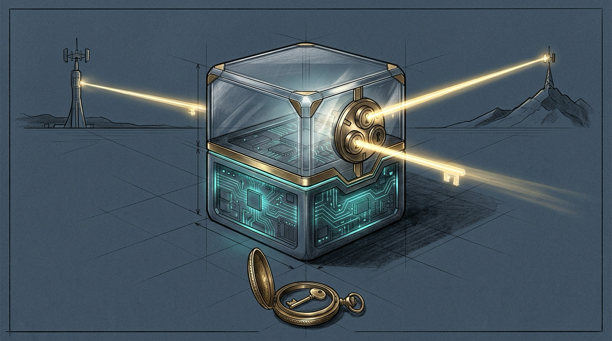
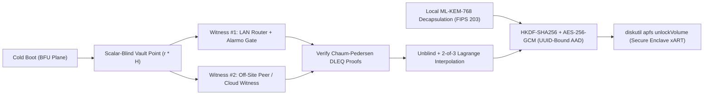

import { Aside } from '@astrojs/starlight/components';



A winter ice storm snaps the hydro line at 2 a.m. Four hours pass. Power flickers back, the Mac mini chimes in a cold basement, and nobody is home to type a password. Turn on stock whole-disk FileVault and the machine stalls forever at a pre-boot login screen — deaf to SSH, blind to Tailscale, unable to warm the cathedral or watch the pipes. Leave FileVault off with an unattended login password on disk and any thief who grabs the aluminum chassis walks out with every secret the Haus owns.

Phones solved this thirteen years ago. Every iPhone splits storage into two cryptographic strata: **Before First Unlock (`BFU`)**, which boots the kernel, radio, and reachability stack immediately after power returns, and **After First Unlock (`AFU`)**, which keeps keys and credentials sealed inside Apple Silicon's `xART` Secure Enclave keystore until authentication succeeds. **Sanctum Vault Armor** (`sanctum-vault-armor`) brings that exact `BFU` / `AFU` split to macOS. Zero USB dongles. Zero custom filesystems. Lockout is mechanically impossible.

## Two strata, zero custom filesystems

Custom encrypted containers fail operators on their worst day. When a bespoke FUSE mount or third-party cipher breaks during an OS upgrade, recovery turns into forensics under stress. Vault Armor refuses that trap. The `AFU` vault is a 100% native Apple Silicon Encrypted APFS volume (`SanctumVault`) inside the existing `disk3` container, backed directly by the Secure Enclave's hardware anti-replay keystore.

| Stratum | Mount | Boot behavior | What lives here | What a stolen chassis yields |
|---|---|---|---|---|
| **BFU** (Rescue & Reachability Plane) | `/` and `/System/Volumes/Data` | Boots immediately on AC restore | `macOS`, `sshd`, `tailscaled`, Screen Sharing, `sanctum-vault-armor`, local `ML-KEM-768` decapsulation key | OS binaries, public configs, and a ciphertext envelope that cannot be unsealed alone |
| **AFU** (Crown-Jewel Vault) | `/Volumes/SanctumVault` | Locked (`FileVault: Yes`, `Locked: Yes`) until `2-of-3` witness quorum | Vault canary (Phase 1); `~/.sanctum/secrets`, mTLS CA keys, OAuth tokens, and SQLite memory stores (Phase 2) | **Zero** — hardware AES-XTS media keys remain sealed inside Secure Enclave `xART` |

The `BFU` plane never touches `sshd`, `~/.ssh/authorized_keys`, `tailscaled`, or Screen Sharing. No bug in Vault Armor can brick remote access. Even if every witness on Earth disappears at once, the operator still lands on the box over SSH and unlocks `/Volumes/SanctumVault` with stock `/usr/sbin/diskutil`.

## The cryptographic spine

Naive network-bound disk encryption leaks identity or trusts a single server blindly. Vault Armor does neither. Four primitives stack together so no witness ever learns the vault key, no single witness can unlock or poison recovery, and no quantum adversary recording traffic today can unwrap a stolen SSD tomorrow.



1. **Blinded `2-of-3` Ed25519 Threshold OPRF.** At initialization, Vault Armor samples a random Ed25519 base point `P` and splits a master scalar `k` via degree-1 Shamir secret sharing over the prime-order subgroup `L` into three shares `(1, k_1)`, `(2, k_2)`, and `(3, k_3)`. On boot, the Mac samples a fresh blinding scalar `r` and sends only `B = r * P` to reachable witnesses. It unblinds their replies `Z_i = k_i * B` by `r^-1` and combines any two shares via Lagrange interpolation to recover `Y = k * P`. Witnesses learn nothing.
2. **Per-share Chaum-Pedersen `DLEQ` verification.** Every witness carries a public verification point `V_i = k_i * G` pinned in `manifest.json` and returns a non-interactive zero-knowledge proof (`RFC 9497` / `SHA-512` Fiat-Shamir) that `log_G(V_i) == log_B(Z_i)`. Garbage replies fail verification immediately. Vault Armor drops the bad share and falls back cleanly to the remaining quorum pair.
3. **Post-quantum hybrid key encapsulation (`ML-KEM-768`).** During `init`, Vault Armor encapsulates a 256-bit post-quantum secret with NIST `FIPS 203` `ML-KEM-768`, storing the decapsulation key (`0600`) on the local `BFU` disk and the ciphertext inside `manifest.json`. Compromising two remote witnesses yields nothing without the physical Mac; stealing the physical Mac yields `0/3` threshold shares.
4. **Hardware UUID-bound `AES-256-GCM`.** The 200-bit Crockford Base32 APFS recovery key (`SVLT-...`) is sealed under `HKDF-SHA256(ikm = Y || ss_pq)` with the APFS hardware `Volume UUID` bound into the `AES-256-GCM` associated data (`AAD`). Volume-swap attacks fail closed.

## Works for any Haus — zero extra hardware

Most households do not own a second cabin. They do not need one. Vault Armor's three share slots map onto gear a normal Haus already runs:

| Share | Default Manoir topology | Single-site Haus topology | What holds it |
|---|---|---|---|
| **Share 1** (Physical / LAN Witness) | `manoir-fw` (Firewalla Gold Pro) gated by HA Green Alarmo state | Router appliance (`sanctum-witness.py`, zero pip deps) or Raspberry Pi / NAS | Stays in the building; refuses evaluation if `alarm_control_panel.alarmo == triggered` or `/revoked` exists |
| **Share 2** (Off-Site Witness) | `chalet` Mac mini over SSH | $0 Oracle/Fly/Cloudflare tunnel witness (`sanctum-vault-armor witness-serve`) or a trusted friend's Haus over Tailscale | Survives physical burglary of the entire home; revocable in one tap from a phone |
| **Share 3** (Owner Break-Glass) | 1Password `Sanctum` vault | 1Password / Bitwarden / paper fire-safe card | Offline emergency quorum share **plus** the raw APFS `diskutil` recovery passphrase |

Grab the Mac mini and bolt out the front door: Share 1 stays on the router, Share 2 sits off-site, and the thief holds `0/3` shares. Rip *both* the Mac mini and the router out of the rack during a break-in and two independent defenses slam shut. Alarmo's `triggered` state blocks Share 1 before the cable comes out, and even a forensic chip-off dump of the router yields `1/3` shares — mathematically indistinguishable from random noise without Share 2.

## Four anti-lockout invariants

Security tools that lock out their own owner are bugs disguised as armor. Four mechanical invariants make lockout impossible:

<Aside type="tip" title="Escrow before seal — verified on disk, proven by rollback">
`sanctum-vault-armor init` pipes the 200-bit APFS passphrase and Share 3 into 1Password via stdin JSON (never `argv`), reads the item back by ID, and compares the round-tripped passphrase byte-for-byte **before** writing `manifest.json`. When 1Password rejects a write, `init` immediately runs `diskutil apfs deleteVolume` so an unescrowed lock can never land on disk.
</Aside>

1. **The `BFU` rescue plane stays untouched.** `sshd`, `tailscaled`, Screen Sharing, and user login remain on standard APFS `Data`.
2. **Read-back escrow precedes sealing.** No `manifest.json` is written unless 1Password already holds and verified both `password` (`SVLT-...`) and `share3_json`.
3. **Apple's stock `diskutil` is the escape hatch.** `diskutil apfs unlockVolume SanctumVault` unlocks the volume directly with the 1Password `password` field — even if `sanctum-vault-armor` is deleted from disk.
4. **Sensors gate witnesses; they never halt the host.** Unlike [power-sense shutdown](/architecture/resilience-doctrine/), a false motion trigger on Alarmo never calls `shutdown -h now`. While the Haus is running, a cat in the hallway does nothing; Alarmo only withholds Share 1 during a cold boot while actively `triggered`.

## Operating the armor

`sanctum vault-armor` wraps the Rust binary for everyday inspection, cryptographic self-tests, and live unlock drills:

```bash
sanctum vault-armor self-test                  # offline TOPRF + DLEQ + ML-KEM-768 suite
sanctum vault-armor status --probe-witnesses   # live APFS xART state + witness DLEQ check
sanctum vault-armor lock                       # unmount and cryptographically lock SanctumVault
sanctum vault-armor unlock --wait 180          # 2-of-3 blinded witness unlock (boot LaunchAgent)
```

Rollout follows a two-phase discipline alongside [Closing the Apocalypse Seams](/operations/2026-10-27-closing-the-apocalypse-seams/), [The Sentinel That Patches the Fleet](/operations/2026-10-22-the-sentinel-that-patches-the-fleet/), and [Sanctum Continuity](/architecture/sanctum-continuity/):

- **Phase 1 — Non-Destructive Shadow Canary (`active`).** `/Volumes/SanctumVault` mounts automatically at boot via `haus.sanctum.vault-armor.plist`, `manoir` stores `0/3` shares locally, and live `2-of-3` unlock across `manoir-fw` and `chalet` completes in `2.00s` while all 41 production services run undisturbed.
- **Phase 2 — Secret Cutover.** Once shadow reboots prove rock-solid across maintenance windows, `~/.sanctum/secrets` symlinks into `/Volumes/SanctumVault/secrets`, `sanctum-boot-ready` gates secret-consuming daemons on the vault canary, and `/etc/sanctum-keychain-pw` retires from the `BFU` disk permanently.

The box still wakes itself in the dark after the ice storm clears. Now, if someone carries it out into the snow instead, the aluminum shell has nothing left to say.
