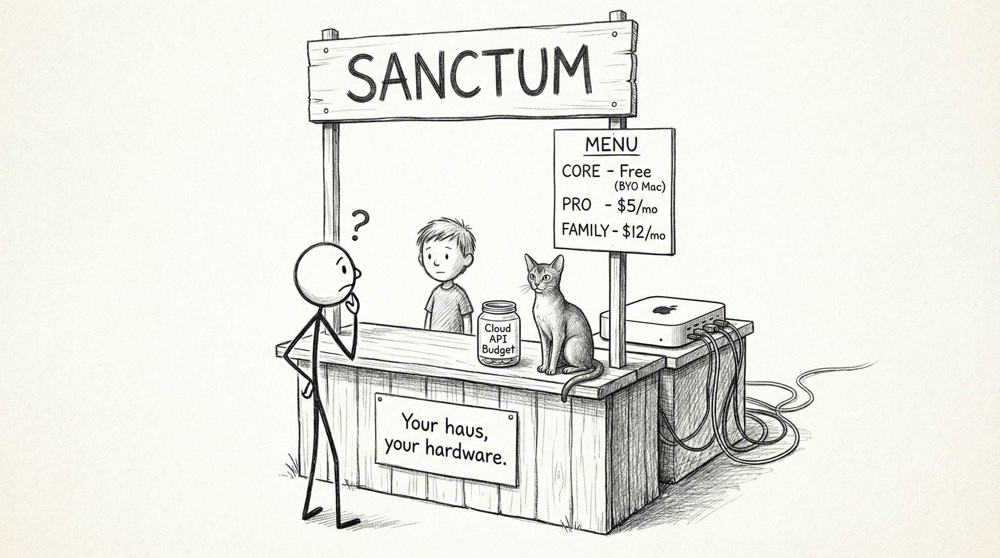

import { Card, CardGrid, Aside } from '@astrojs/starlight/components';

On the third of the month, your phone buzzes. Some app you forgot you even installed just auto-charged $14.99, and a SaaS product you actually liked sent a chipper email announcing that your free tier is now "Starter (Legacy)" — price up 40%, nobody grandfathered, written with the cheerful menace of a guy holding your dog hostage. You stare at the bank alert and watch a tiny piece of your soul eject from the cockpit. Yeah. We hate those clowns too.

Tommy is running the lemonade counter today, and our entire business model fits on a cocktail napkin.

<CardGrid>
  <Card title="Sanctum" icon="heart">
    **Free. All of it.**

    Not a trial. Not a crippled tier. Not free-for-now.

    - Every node, every agent
    - Home Assistant, dashboard, network monitoring
    - Local AI models, voice, wake word
    - Family device policies and curfews
    - Multi-site sync across your own machines
    - Every skill in the marketplace that we wrote
  </Card>
  <Card title="Holocron" icon="star">
    **$9.99 once**

    The native app for the haus — the one you actually keep on your dock.

    - Buy it once, own it
    - No subscription, no seats, no renewal
    - Works against your own hub
    - Sanctum stays fully usable without it
  </Card>
</CardGrid>

<Aside type="note">
  There is no Pro tier. There is no Family tier. There is no Estate tier with a dedicated Slack channel. There was, on this page, until we admitted we did not want to run that business — four tiers is a company with a billing department, a churn dashboard, and a reason to make the free version slightly worse each year. We would rather sell you one good app.
</Aside>

## Why free is not a trick

Sanctum runs on **your** hardware. Every computation happens on your Mac Mini — not our servers. That is not a pricing gimmick; it is [the whole shape of the product](/getting-started/what-is-sanctum/).

Which means our cost to serve you is $0.00. There is no per-user infrastructure bill creeping up behind the scenes, no investor asking why the free users have not converted yet, no quarterly meeting where someone suggests moving multi-site "up into Pro." We physically cannot degrade your experience from here. We would have to break into your haus, and that seems like a lot of effort for a software company.

The usual reason free tiers rot is that they cost the vendor money. This one does not.

## What about cloud AI?

You bring your own key.

Sanctum talks to Anthropic, OpenRouter, Gemini and friends through a [local proxy](/architecture/sanctum-cloud-proxy/) that meters every request at the raw provider price. You pay the provider directly, at their price, with no broker in the middle taking a cut for the privilege of forwarding your tokens. Most haus work never leaves the building anyway — the local models handle it, and the proxy only escalates when a request genuinely needs a bigger brain.

Requests bound for external providers pass through a PII anonymization layer first: names, emails and phone numbers scrubbed on the way out, restored on the way back. To everyone upstream you are a ghost who asks very specific questions about YAML configuration.

<Aside type="tip">
  A metered proxy you own beats an "included budget" you rent. An included budget is someone else deciding what your month is worth, rounding in their favour, and calling the difference a feature.
</Aside>

## FAQ

**So the free thing — what is the catch?**
There isn't one, and yes, we hear ourselves — that sounds *exactly* like what a supervillain says five seconds before unveiling a subscription paywall. The difference is structural, not a pinky promise: read [what runs where](/architecture/overview/). Our servers aren't even in the building. A company cannot hold your haus for ransom when it doesn't own the lock.

**What do I actually get for $9.99?**
A crisp native app instead of a browser tab. If you love browser tabs, keep your ten bucks — we will never slap an annoying "Upgrade to Pro!" banner across your dashboard. Ten dollars, once, is less than what the big guys bill you every single month just to rent back control of your own thermostat.

**Will you add subscriptions later?**
That is the promise this page exists to make: no. The moment there is recurring revenue, there is pressure to justify it, and the honest way to do that is to hold something back. We would rather ship an app good enough that buying it once feels fair.

**What happens to my haus if you disappear?**
It keeps running. That is not a courtesy, it is the architecture — everything already executes on your hardware, and the config is [yours in plain YAML](/reference/sanctum-yaml/). A dead vendor is an inconvenience, not an outage.

**Do you sell my data?**
No. We never have your data. Everything runs on your hardware, kept in [a very short ledger](/operations/privacy/). If we wanted your data we would not have built a platform specifically designed to keep it away from us.

---

Tommy, the haus's late Abyssinian and its most honest auditor, would have approved of a ledger this short. He spent fifteen years confirming that the best things in a haus — the warm flagstone, the south-facing sill, the specific corner of the duvet — cost nothing and belong to whoever shows up. Sanctum is built the same way. Run it on your own hardware, and the only charge that ever lands on the third of the month is the one you already decided to make, once.
