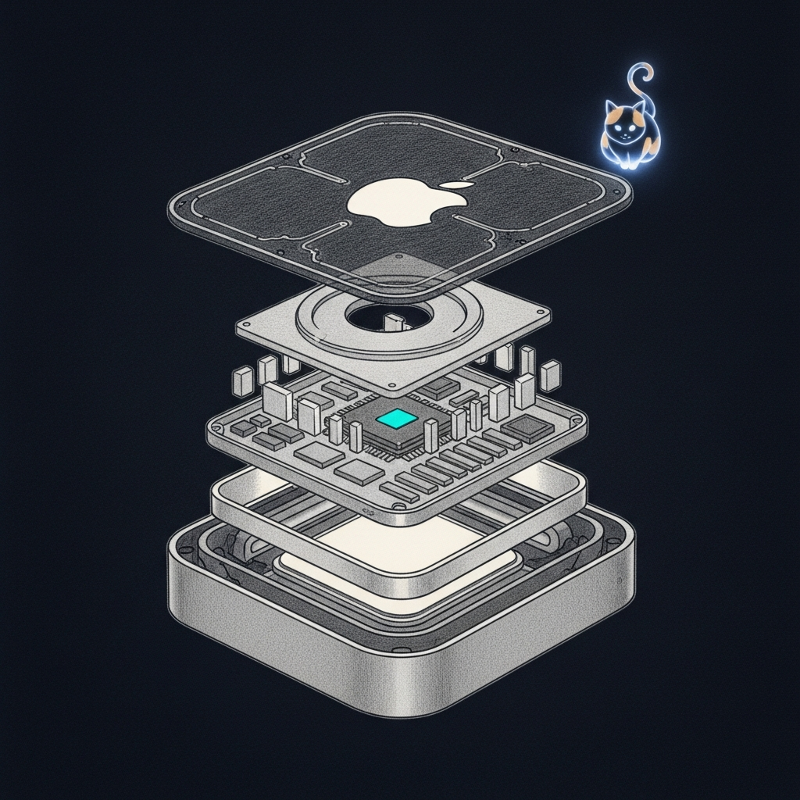

import { Aside, Tabs, TabItem } from '@astrojs/starlight/components';

It's the size of a grilled cheese and weighs about as much as a hardcover. In twenty minutes you are going to shove it into a dark closet and treat it like a Victorian orphan. From there it runs your entire domestic life. Silently, like a tiny aluminum Alfred Pennyworth with root privileges.

Sanctum runs on Apple Silicon Macs, with an isolated Linux VM handling the heavy agent lifting. Yes, you are cramming an enterprise intelligence platform, a firewall brain, and a dead cat's patrol schedule onto a desktop computer the size of a sandwich, and no, we are not taking questions from the sanity police. Still, Alfred needs the right organs before he can run Wayne Manor. Skip a dependency here and you'll be hunting it down at 2 AM in your boxers — and haus automation has never once cared about your REM cycle. Let's get the shopping list right on the first try.



## Hardware

### Apple Silicon Mac (Required)

The first install is an Apple Silicon Mac with 32 GB of memory. A Mac Studio and a Mac Mini take the same path. Leave it on if it is the haus hub. A friend's Studio can sit on a desk and run the same first day.

| Component | Minimum | Recommended |
|-----------|---------|-------------|
| Chip | M2 | M4 Pro |
| RAM | 32 GB | 64 GB+ |
| Storage | 256 GB free | 1 TB+ internal |
| Network | Wi-Fi | Gigabit Ethernet |

<Aside type="tip">
  32 GB holds one local model, the Dragon, a 4-bit 27-billion-parameter Qwen. Quit other large apps before you chat. The studio council is six names on that one Dragon, and Yoda is spoken by the Mac. A second big model still does not fit. Rest the Dragon before opening the Holocron. A 64 GB machine is the one that can keep more than one seat warm.
</Aside>

### External Storage (Optional)

An external drive is useful for offline knowledge bases (Kiwix), media libraries, and backups. Any USB-C or Thunderbolt drive will work. There is no strict performance requirement since these workloads are not latency-sensitive. Even your data gets to relax sometimes.

### Satellite Nodes (Optional)

For multi-site deployments, satellite nodes run on any Apple Silicon Mac. An M1 Mac Mini with 16 GB is plenty for a satellite. If you own more than one haus and want an AI council overseeing all of them, congratulations on both your real estate portfolio and your devotion to over-engineering.

## Software

### Required for the first install

Homebrew is the install the [Quick Start](./quick-start/) starts with. The studio bundle also installs Node, so OpenClaw and the Holocron can run. Docker, Lima, and the Ubuntu VM below stay on the operator haus.

<Tabs>
  <TabItem label="macOS">
    | Software | Version | Install |
    |----------|---------|---------|
    | macOS | macOS 15 Sequoia minimum (26 Tahoe recommended) | System update |
    | Homebrew | Latest | [brew.sh](https://brew.sh) |
    | Python | 3.12+ | `brew install python` |
    | Node.js | 22+ | `brew install node` or via fnm |
    | Docker Desktop | Latest | [docker.com](https://www.docker.com/products/docker-desktop/) |
    | Lima | Latest | `brew install lima` (runs the Ubuntu VM on Apple Virtualization) |
    | socket_vmnet | Latest | `brew install socket_vmnet` (host-only Mac↔VM bridge) |
    | Git | Latest | `brew install git` (or Xcode CLI tools) |
  </TabItem>
  <TabItem label="Ubuntu VM">
    | Software | Version | Notes |
    |----------|---------|-------|
    | Ubuntu | 24.04 LTS | Installed as a Lima `vz` VM |
    | Docker | Latest | `apt install docker.io` |
    | Node.js | 22+ | Via NodeSource or fnm |
    | SOPS | Latest | `apt install sops` or from GitHub releases |
    | age | Latest | `apt install age` (for SOPS encryption) |
    | SSH | OpenSSH 9+ | Included with Ubuntu |
  </TabItem>
</Tabs>

<Aside type="note">
  [Lima](https://lima-vm.io) runs the Ubuntu VM on Apple's Virtualization Framework (`vmType: vz`) — no UTM GUI, no QEMU process. The one thing `vz` does not give you natively is host-only networking, so Sanctum backs the bridge interface with `socket_vmnet` running as root. Two tools, one VM, and the host-only network Apple forgot to ship.
</Aside>

### VM Specifications

When creating the Ubuntu VM with Lima, use these settings:

| Setting | Value |
|---------|-------|
| Backend | Lima (`vmType: vz`, Apple Virtualization) |
| CPU cores | 4 |
| Memory | 8 GB |
| Disk | 100 GB |
| Bridge network | Host Only via `socket_vmnet` (vmnet host mode) |
| Internet | NAT interface, managed by Lima |

The VM carries two interfaces. A host-only bridge (`lima0`) puts the Mac at `10.10.10.1` and the VM at `10.10.10.10` — that private wire is how every agent on the VM reaches services on the hub. A second NAT interface gives the VM its own outbound path to the internet for `apt` and `git`. Not solitary confinement, then; more like a studio apartment with one locked door to the haus and one window to the outside world.

## Optional Components

These are not required for a basic installation but enable additional capabilities. Think of them as side quests.

### Firewalla

A [Firewalla](https://firewalla.com) in Router mode provides network-level security, DNS management, and device monitoring. The hub runs a Gold Pro, but any Router-mode Firewalla works. Sanctum includes a [bridge service](/architecture/sanctum-firewalla/) that talks to it over its P2P API on port 8833.

If you do not have a Firewalla, Sanctum will still function. Network management features will simply be unavailable, and you will have to monitor your network the old-fashioned way: by not monitoring it at all and hoping for the best.

### Tailscale

[Tailscale](https://tailscale.com) provides secure mesh networking between nodes. It is required for multi-node deployments (hub + satellite) and strongly recommended for remote access to your hub.

Install Tailscale on each node:

```bash
brew install --cask tailscale
```

### Cloudflare Domain

A domain managed through [Cloudflare](https://cloudflare.com) enables secure public access to specific services (such as the Home Assistant dashboard or health endpoints) via Cloudflare Tunnel. The free Zero Trust plan is sufficient.

### Local inference (ports 1337 and 3301)

Sanctum serves local models through [`sanctum-mlx`](/architecture/sanctum-mlx/), its own Rust inference server — Qwen3.8-27B-4bit on port 1337 (mTLS-only), and Ornith-1.5-9B-MLX-4bit on port 3301 (mTLS-only) for code work. There is no third-party model app to install; the models themselves are the only heavy download, so budget disk and RAM accordingly.

### iPhone Apps

These iOS apps integrate with Sanctum services on the hub.

| App | Purpose | Required |
|-----|---------|----------|
| [Home Assistant Companion](https://apps.apple.com/app/home-assistant/id1099568401) | HA remote control, presence detection, notifications | Yes |
| [Health Auto Export](https://apps.apple.com/app/health-auto-export-json-csv/id1115567069) | Push Apple Health data to health ingester | If health monitoring enabled |
| [Tailscale](https://apps.apple.com/app/tailscale/id1470499037) | VPN mesh access to hub from anywhere | Recommended |

<Aside type="note">
  The HA Companion app provides presence detection (used by automations to know who is haus), actionable notifications, and location tracking. Health Auto Export sends hourly health data to the [Cilghal health agent](/agents/cilghal/) via a REST API automation. Your phone becomes a sensor that reports on you to your own haus. You volunteered for this.
</Aside>

## Network Architecture

Sanctum expects the following network layout:

```
Internet
  |
Modem / ONT
  |
Firewalla WAN (Router mode)
  |
LAN (10.0.0.0/24, gateway 10.0.0.1)
  |-- Mac Mini (DHCP reservation) -- Host Only bridge (10.10.10.0/24) -- Ubuntu VM (.10)
  |-- Orbi / Wi-Fi AP (AP mode)
  \-- Smart devices, speakers, etc.
```

<Aside type="caution">
  The host-only bridge (`10.10.10.0/24`) is the only path between the VM and hub services — agent workloads on the VM talk to the Mac over that private wire and nowhere else. The VM does keep a separate NAT interface for outbound `apt` and `git`, so it is not air-gapped: it is firewalled by topology, not by amputation. If you want a true air-gap, drop the NAT NIC and proxy package installs through the Mac — but then you own the proxy, forever.
</Aside>

## Verification

Before moving on, confirm you have the required tools installed:

```bash
# Check macOS version
sw_vers

# Check Homebrew
brew --version

# Check Python
python3 --version

# Check Node.js
node --version

# Check Docker
docker --version

# Check Lima (runs the VM) and socket_vmnet (the host-only bridge)
limactl --version
which socket_vmnet
```

If all of those commands printed real version numbers instead of screaming at you, you're cleared for takeoff. If any failed, fix it now — the installation guide is patient, sure, right up until it leaves you alone with a missing binary at 2 AM.

That's the whole shopping list. Feed the closet the right silicon and packages, and it pays you back in years of quiet competence. Time to wake the butler over in [Installation](/getting-started/installation/).
