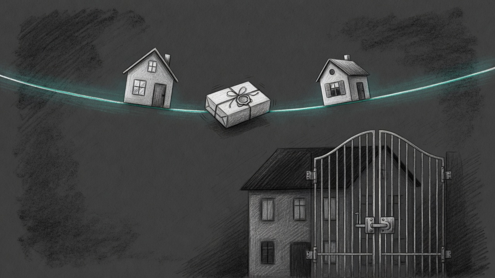

import { Steps, Aside } from '@astrojs/starlight/components';

A friend joins your tailnet, and suddenly you can slide a signed parcel across the wire without unlocking your front door.



The [Quick Start](./quick-start/) builds the fortress. The tribe is the speakeasy slot in the steel door — for handing a friend a package that has zero business sitting on a public download link. The mesh still flat-out refuses any model that hasn't survived the [champion gauntlet](/operations/2026-07-05-no-haus-is-an-island/). A parcel is simpler: signed, hashed, dropped onto disk, and never auto-executed. Trust, verified in cryptographic receipts instead of awkward hugs.

## What the friend can reach

Your friend gets exactly one badge: `tag:sanctum-tribe`. That badge lets them knock on port 8788 on your admin machines and other tribe nodes — and absolutely nowhere else. No SSH. No haus services. No poking around your basement server rack at midnight to see what's blinking. Any machine already wearing an admin, host, or mobile tag rejects the tribe badge on sight, so the operator's own Mac never accidentally demotes itself.

<Steps>

1. **Install or upgrade the CLI.**

   ```bash
   brew install ogilthorp3/sanctum/sanctum-cli
   ```

   If Sanctum is already installed, `brew update` and then `brew upgrade sanctum-cli`. The first build takes a while.

2. **Join the tribe with the one-time key the operator sent.**

   ```bash
   sanctum mesh join --tribe 'tskey-auth-…'
   ```

   Tailscale comes up on the shared tailnet and advertises only the tribe tag. When the command prints that the tailnet is up, reply to the operator.

3. **Receive the file.**

   ```bash
   sanctum mesh receive 'the-ticket-the-operator-sends'
   ```

   The file is saved at `~/.sanctum/mesh/inbox/`. The command checks the signature and the sha256 before it keeps the bytes.

</Steps>

<Aside type="note">
The tribe key is a single-use Tailscale device key. It opens the parcel slot once — it is not a spare key to the haus.
</Aside>

Start the transfer on your own Mac with `sanctum mesh send` and the file path, then leave it running while your friend pulls the bytes. Paste them the ticket line from the output, hit Ctrl-C once the transfer lands, and pour the tea. The parcel is on your friend's disk, verified to the bit, and the haus door never even creaked open.
