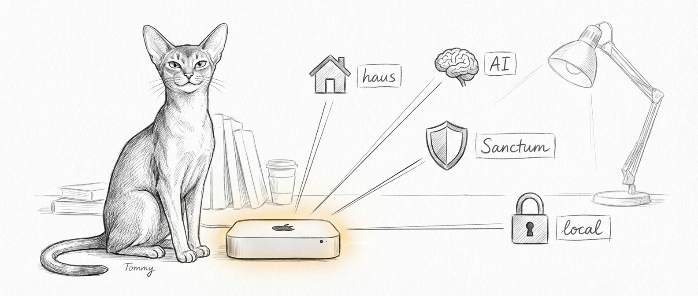
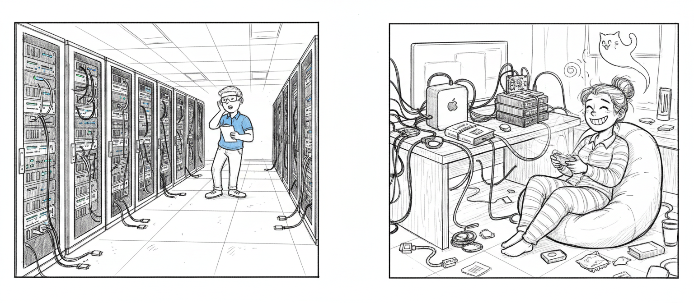

import { Card, CardGrid, Aside, Tabs, TabItem } from '@astrojs/starlight/components';

The hallway lights just turned themselves on. The thermostat thinks it is July in Miami. The only thing standing between you and sleep is a NAS that has decided — as a personal philosophical stance — that it no longer believes in DNS. Congratulations: you did not build a smart haus. You accidentally hired yourself for an unpaid night shift that schedules its own emergencies and pays exclusively in cortisol.

Sanctum is the platform that fires you from that shift. One Mac Mini shoved in your closet, one YAML file, one dashboard — haus automation, a mildly unhinged council of AI agents, network defense, and local voice control, all answering to hardware you physically own and zero tech billionaires. Built for the kind of haushold where "reboot the router" isn't a punchline, it's foreplay on a Tuesday.

## The Problem

You already know the problem. You are living it.

Your smart haus is a Frankenstein's monster stitched together from a dozen services that have never met. Home Assistant handles the lights. A separate NAS manages your photos. Network monitoring lives in an app you forgot the password to. Your AI assistant is a cloud-dependent black box that cheerfully sends your conversations to a data center in Virginia. Four systems, four dashboards, four ways to be woken at 2 AM.

## The Platform

Sanctum brings these layers together into a single managed platform running on hardware you own. One config file. One dashboard. One thing to blame when it breaks.

<CardGrid>
  <Card title="Haus Automation" icon="laptop">
    Home Assistant runs on a dedicated Green appliance on your haus network, with full LAN access to Sonos, HomeKit, and smart devices.
  </Card>
  <Card title="AI Agents" icon="star">
    Specialized agents handle security monitoring, energy efficiency, family health tracking, and financial oversight, each with dedicated models and skills.
  </Card>
  <Card title="Network Management" icon="setting">
    Firewalla integration provides firewall rules, DNS policy, and network topology from within the platform.
  </Card>
  <Card title="Voice Control" icon="signal">
    Yoda, the voice agent, speaks in a Chatterbox-MLX cloned voice for local text-to-speech on Apple Silicon GPU. No cloud dependency for voice. Your haus talks to you and only you.
  </Card>
</CardGrid>

## How It Works

At the core of Sanctum is a single YAML configuration file (`instance.yaml`) that describes your entire deployment: which services are enabled, what ports they bind to, which nodes exist, and how secrets are managed. Every script, LaunchAgent, and dashboard panel reads from this one source of truth — the [config system](/architecture/config-system/) is the spine the rest of the platform hangs on.

One file to rule them all — and exactly one file to blame when it's wrong.

<Tabs>
  <TabItem label="Hub Node (Mac Mini)">
    The hub is the primary node. It runs on an Apple Silicon Mac Mini — a $600 aluminum rectangle shouldering the responsibilities of a small government — and hosts:
    - The Sanctum gateway and dashboard
    - The Home Assistant Green link (the control plane runs on its own appliance)
    - AI agent gateway and specialized agents
    - Local LLMs via MLX (a council seat and a coder seat, both on Apple Silicon GPU)
    - Sanctum TTS — a Chatterbox-MLX voice synthesis server
    - Cloudflare tunnel for secure remote access
  </TabItem>
  <TabItem label="VM Workloads (Ubuntu)">
    A Lima-managed Ubuntu VM, running on Apple's Virtualization.framework (the `vz` backend, not QEMU), handles workloads that benefit from a Linux environment:
    - Agent orchestration (multi-agent routing, skill execution)
    - Knowledge graph (Neo4j + Graphiti)
    - SOPS-encrypted secrets for service credentials
    - Network-isolated processing (host-only networking, no direct internet)

    The VM cannot reach the internet. This is not a bug. This is the VM living in a sensory deprivation tank for security reasons.
  </TabItem>
  <TabItem label="Satellite Nodes">
    Additional locations (vacation haus, office) run lightweight satellite nodes. The hub reaches them over Tailscale; a satellite never opens a connection to the hub. Satellites get their own `node_id` and run a subset of services defined in `instance.yaml`.
  </TabItem>
</Tabs>

## Why "Sanctum"

The name means *sacred inner chamber* — and the mark literalizes it. A dark square holds an amber diamond at its center: the thing you care about most, inside the thing strong enough to protect it.

In a year when every major platform is racing to ingest personal data for model training, the idea of a private inner chamber has moved from metaphor to survival strategy. Sanctum runs on your hardware, in your haus, answering to no one's servers. The amber is deliberate — firelight, candlelight, the oldest color of *someone is haus*. Set against dark slate, it becomes a hearth inside architecture. Domesticity, not disruption.

Two shapes. Two colors. No gradients, no glowing orbs, no neural-network illustrations. In an era of AI-generated visual noise, restraint is the position statement.

## Key Differentiators

### Single Configuration File

Every service, port, path, and integration is declared in `~/.sanctum/instance.yaml`. There are no scattered `.env` files, no hardcoded usernames in scripts, no magic constants buried in a file you last edited in a fugue state at 3 AM. When you change a port number, you change it in one place.

### Multi-Node Architecture

Sanctum supports hub, satellite, mobile, and sensor node types. Your primary haus is the hub. A vacation haus runs a satellite. Your laptop is a mobile node. Each node knows its role and adjusts its services accordingly — which is more than can be said for most family members. The [node topology](/architecture/node-topology/) spells out who does what.

### Self-Healing Watchdog

A [watchdog process](/guides/watchdog/) checks every service in the [catalog](/architecture/services/) every 10 minutes. When it detects a failure, it attempts automatic remediation using the service-doctor skill before alerting you. Most issues resolve without human intervention. The rest resolve after human intervention and a glass of something strong.

### Encrypted Secret Rotation

API tokens and credentials are stored in macOS Keychain (on the Mac) and SOPS-encrypted files (on the VM). A monthly rotation job generates new tokens, updates Keychain entries, re-encrypts SOPS files, and restarts affected services.

### Local-First AI

Large language models run locally [via MLX](/architecture/sanctum-mlx/) (Apple Silicon optimized) — a Qwen3.8-27B council seat and an Ornith-1.5-9B coder seat, each its own server on the GPU. Cloud APIs are available as fallbacks with automatic failover, but the system is designed to operate entirely on-premises when needed. Your conversations with your haus stay in your haus.

<Aside type="note">
  Sanctum is the shiny name we put on the door. Underneath, it runs on the OpenClaw agent framework and stacks battle-tested open-source bricks (Home Assistant, Docker, Tailscale, Firewalla). Zero vendor lock-in. We are not building a polite walled garden — we are building a heavily armed *fortress* out of everyone else's open-source concrete, and yes, we brought katanas to the HOA meeting.
</Aside>

## Who Is Sanctum For?

Sanctum is designed for technically inclined hausholds that want:

- **Full ownership** of their haus intelligence stack, running on silicon you can unplug with your bare hands when Skynet gets mouthy.
- **Deep customization** through YAML, shell scripts, and agent skills instead of fisher-price drag-and-drop wizards that hide the wiring.
- **Privacy by default**, with local LLMs, on-device voice, and zero cloud tether.
- **Multi-site support** for families running more than one haus.

If you are comfortable inside a terminal, fluent in YAML, and don't flinch at a `launchctl` command, welcome to the haus — pull up a chair. If the phrase "Host Only networking" makes your left eye twitch, this is probably not your rodeo, and zero judgment: there are plenty of glossy consumer hubs that will happily auction your thermostat schedule to an ad broker in Virginia.

## Next Steps

Ready to get started? Check the [Requirements](/getting-started/requirements/) to make sure your hardware and software are in order, then move on to [Installation](/getting-started/installation/).
