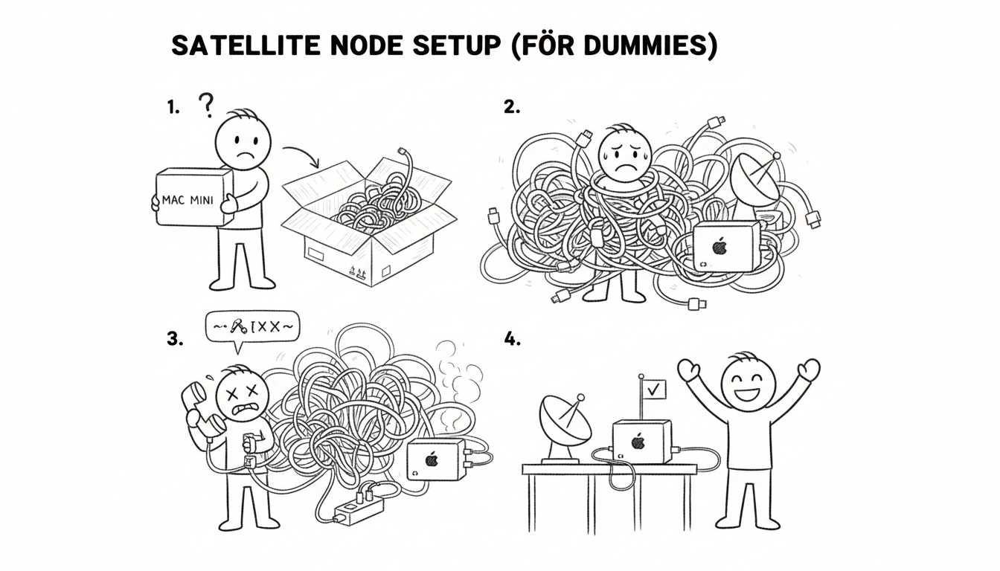

import { Steps, Aside } from '@astrojs/starlight/components';

A Mac mini sits in a closet at the chalet, three hours north, and has never heard of Sanctum. You will stand next to it once. Everything after that visit happens over the tailnet.

That closet Mac is about to become a **satellite node**: a second Sanctum machine at another location, the cottage or the chalet or a parent's place, with its own small brain and its own Home Assistant, answering to your hub. Congratulations on deciding that one location running a haus intelligence platform wasn't enough. You are now operating a distributed system. Every distributed-systems paper ever written is trying to warn you about something, and you're doing it anyway.



## The shape of it

Two machines take part. The **hub**, `manoir` in this guide, builds the installer, adopts the new Mac and keeps the roster; the **new Mac** gets visited once. Run the hub's commands at its keyboard or over SSH from your laptop, whichever is closer. Our new Mac becomes `chalet`, and `chalet` is also its tailnet name, its `.node_id` and its roster key. One name everywhere is the rule, not a coincidence.

<Aside type="note" title="Why one visit is unavoidable">
A brand-new Mac has **no remote way in**. SSH, Screen Sharing and remote management are all off out of the box, and it is not on your tailnet yet. Someone at its keyboard has to open the first door. After that, the machine is yours to drive remotely.
</Aside>

## Before you start

- An Apple Silicon Mac at the satellite location with 16 GB or more, through macOS setup, with an admin account. chalet is an M1 with 16 GB.
- The same short username as on the hub saves a flag later; `sanctum node adopt --user` covers a different one.
- `sanctum-cli` on the hub, and a Tailscale tailnet the hub already belongs to.

## Step 1 — Make the installer on the hub

```bash
sanctum node bootstrap-script
# driving the hub from a laptop? copy the installer off it:
scp manoir:Desktop/Sanctum-Node-Setup.pkg ~/Desktop/
```

It writes `~/Desktop/Sanctum-Node-Setup.pkg` on the hub (`--out` puts it elsewhere) and, on first run, mints the hub's automation key. The installer does exactly four things and nothing else: turns on Remote Login, authorizes *that key* so the hub logs in without a password, applies the headless-reliability settings (never sleep, wake-on-LAN, restart after power loss, so a closet Mac comes back on its own after an outage), and, only if you passed `--sudo-nopasswd`, allows passwordless sudo for a short list of those settings commands, so the hub can re-assert them unattended. The six-digit pairing code it prints is derived from that key. Nothing on the new Mac asks for it yet.

The `.pkg` is signed only when the hub's keychain holds a Developer ID Installer identity, and it is never notarized. macOS blocks its first open either way; step 2 has the way past.

<Aside type="tip" title="Getting it there">
AirDrop the `.pkg` from any Mac within reach of the new one, or carry it on a USB stick. Prefer Terminal? `--format script` emits the same steps as a shell script you run on the new Mac instead.
</Aside>

## Step 2 — The one visit

At the new Mac's keyboard, in Terminal:

<Steps>

1. **Install Homebrew** from [brew.sh](https://brew.sh), then run the commands its installer prints under "Next steps" so `brew` is on your `PATH`.

   ```bash
   /bin/bash -c "$(curl -fsSL https://raw.githubusercontent.com/Homebrew/install/HEAD/install.sh)"
   ```

2. **Join the tailnet with a system daemon.** A headless satellite needs the open-source `tailscaled` running as a LaunchDaemon, not the App Store app, which runs inside a logged-in session. The daemon has the Mac back on the tailnet after a power cut before anyone logs in, and nobody will.

   ```bash
   brew install tailscale
   sudo brew services start tailscale     # tailscaled as root, now and at every boot
   sudo tailscale up --hostname=chalet    # prints a login link; open it on any device
   ```

   Then disable key expiry for `chalet` in the Tailscale admin console, or the satellite falls off the tailnet the day its key expires.

3. **Open the installer.** Double-click the `.pkg`, and macOS blocks it. Open **System Settings > Privacy & Security**, scroll to **Security**, click **Open Anyway** beside the installer's name and authenticate. Then click through the installer, which asks for the Mac's password.

</Steps>

That is all the keyboard work the new Mac needs. The rest happens from the hub.

## Step 3 — Adopt it from the hub

```bash
sanctum node scan                          # chalet shows up as a tailnet peer, "adoptable now"
sanctum node adopt chalet --name chalet
```

The first `chalet` says where to reach the Mac. Give it the MagicDNS name: adopt records a bare name as both `host` and `tailscale_name`, while a Tailscale IP lands in `host` alone. `--name` says what to register it as, and it must equal the `.node_id` the satellite gets in step 4. Leave it off and adopt files the Mac under its own hostname, a key nothing else uses. Adopt waits up to 90 seconds for SSH (`--wait` takes another number of seconds, `0` for a single probe), then runs an **honest-verify scorecard**: reach, key authentication, identity, key hygiene, headless posture, registration. Each line comes from a real check on the machine, and headless posture can only warn. **Only** if the first four layers pass does the roster row land in the hub's `instance.yaml`, and adopt reads it back before it claims success:

```yaml
nodes:
  chalet:
    type: satellite
    tier: edge
    ssh_user: neo
    host: chalet
    adopted: '2026-07-18'
    tailscale_name: chalet
```

Adopt rewrites the hub's whole `instance.yaml` to add that row, and the rewrite drops the file's comments. The previous version, comments included, stays as `instance.yaml.bak`.

## Step 4 — Give it the satellite profile

From here on, work on the satellite: at its keyboard, or over SSH from the hub. Plain `ssh chalet` asks for the satellite account's password, because the automation key the installer authorized is for sanctum's own commands, not for your shell.

```bash
brew install ogilthorp3/sanctum/sanctum-cli
sanctum --version                              # must be 1.0 or later
sanctum init --name chalet --role satellite
echo chalet > ~/.sanctum/.node_id
```

The satellite profile needs **sanctum-cli 1.0** or later. Earlier releases have no `--role` and reject `instance.role` outright, so `brew upgrade ogilthorp3/sanctum/sanctum-cli` any older install first. `init` writes a minimal `~/.sanctum/instance.yaml`, just the instance name, slug and role. A satellite keeps its own small file; its roster row lives on the hub. Re-run `init` with `--name` or `--role` and it updates only `instance.name` and `instance.role`, never the slug, keeps every other block and comment, and saves the old file as `instance.yaml.bak`. `--force` replaces the whole file and drops every other block, the router block too; the old file is kept as `instance.yaml.bak`.

The role is what makes `sanctum self-test` grade this Mac as a satellite, not as a hub missing half its services.

## Step 5 — Local brain and Home Assistant

A satellite thinks with its own model, so it keeps thinking when the link to the hub does not. Serve a model the hardware can hold behind any OpenAI-compatible server. chalet's is `Ornith-1.5-9B-MLX-4bit` with the `ahsoka-ornith-9b-v7-balanced-16` adapter, served by [sanctum-mlx](/architecture/sanctum-mlx/) mTLS-only on `:6502` as the LaunchDaemon `com.sanctum.ahsoka-brain`, running as the `sanctum` service user. Point the router at it in `~/.sanctum/instance.yaml`:

```yaml
router:
  default: local
  backends:
    local:
      url: https://127.0.0.1:6502/v1
      ca_cert_path: ~/.sanctum/certs/ca.crt
      client_cert_path: ~/.sanctum/certs/clients/canary.crt   # any client cert the brain's CA signed
      client_key_path: ~/.sanctum/certs/clients/canary.key
```

`router.default` names a key under `router.backends`, and `url` is the server's OpenAI base URL, ending in `/v1`. The three `*_path` keys are for an `https` server that demands a client certificate, as chalet's does. For a plain HTTP server on the same Mac, set only `url`, for example `http://127.0.0.1:8080/v1`, the default of `mlx_lm.server`, and leave the three paths out. Minting a CA and client certificate like chalet's is operator-only for now.

Home Assistant runs on-site, next to the devices it drives. On chalet it is a container on the Mini at `:8123`; a Home Assistant Green on the site's LAN works just as well.

## Step 6 — Self-test

```bash
sanctum self-test
```

On a satellite it reports the `satellite` tier. The hub probes (the cathedrals, proxyd and its key, Force Flow, chitti, R2D2, TCC grants, the service user, the audit log) print `n/a`, because those run on the hub. `satellite local brain` must get HTTP 200 from `{url}/models` on the `router.default` backend, or a 401 or 403 from a server that wants a key, and `vault armor unlocked` reads `n/a` until Vault Armor exists. Every applicable probe green and exit `0` means the satellite is done. The full probe list is in the [CLI reference](/reference/sanctum-cli/#sanctum-self-test).

<Aside type="caution" title="Vault Armor is operator-only for now">
[Vault Armor](/architecture/vault-armor/) can seal a satellite's secrets in an encrypted volume, but no first-user installer ships yet; chalet's boot daemon, witness and tunnel are hand-built. Know the trade before you ask for it. A Vault-Armored satellite holds only its LAN share locally, and share 3 is offline break-glass, so a cold boot waits for the hub's witness, and the vault stays locked until the hub's tunnel reaches it.
</Aside>

## What a satellite runs

Not the hub's stack. A 16 GB Mac can't and shouldn't run the cathedrals or the council. After this page it runs the tailnet daemon, the SSH door and headless settings from the installer, `sanctum-cli` with its own small `instance.yaml`, a local brain behind `router.default`, and Home Assistant. Its roster row and the heavy inference stay on the hub. Where it sits in the larger picture is the [node topology](/architecture/node-topology/).

## On-site devices

Some things still require you to be in the building, pressing buttons on physical objects like a cave person: pairing cameras, alarms and smart switches with Home Assistant, and noting the local router. Stay for them after step 5, or leave them to whoever lives there. Every other step is remote. That is the point.
