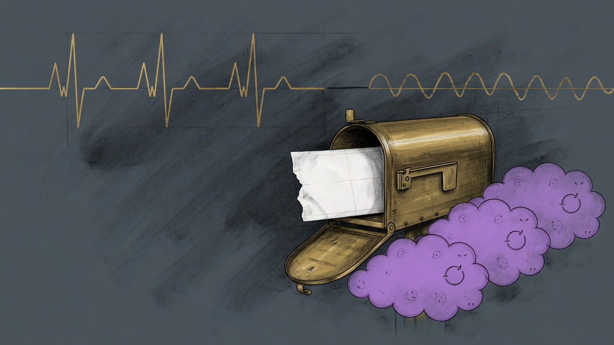

A blank reminder stopped Ki-Adi-Mundi for seven hours.

Affinity returned `"content": null` on a due reminder for Pong (Vira Labs). `dict.get("content", "")` keeps a present null, and `mundi-watch` then sliced it. The run died before it saved state, so the same batch came back every half hour from 08:14. The failure clock paged once it passed an hour. `sanctum-crm` `7568f35` stores a blank body as an empty string. The 15:46 run exited clean, cleared the clock, and sent the one Signal page that reminder was owed. The other fresh mail was held.

## The beat that went quiet on purpose

`mbp:qwen-haus-dragon` is the haus-dragon supervisor's hourly proof that a cycle finished. Its limit is three hours. On 20 October at 17:32 EDT the vault SSH lane to manoir had been down for half an hour, so the supervisor withheld the beat. That was amendment A4: if a page cannot reach Bert, stop the heartbeat and let the Cloudflare eye email. The laptop then slept. At 12:07 UTC on 22 October the eye reported the beat 39 hours old.

The lane came back at 11:37 EDT and the beats resumed. The withhold was the wrong signal. A down lane means the pager is stuck, not that the supervisor has stopped. `a4d3c16` on `feat/haus-dragon` keeps beating through a lane outage and withholds only when a dropped page has stayed undeliverable for 30 minutes. While the chain is alive, `caffeinate -is -w` runs in its own session so a dark display does not idle-sleep the Mac. Closing the lid on battery still sleeps it.

## One slow call failed a whole job

The dataroom Function App paged four times in five days. Each page was one transient, and each one failed the entire run.

| When (UTC) | What failed | What the next run did |
|---|---|---|
| 18 Oct 04:18 | Graph search for Anomaly Games in Guillaume's mailbox | Later runs succeeded |
| 19 Oct 04:55 | No Friday-brief heartbeat for 26 hours | A run landed by 06:57 |
| 19 Oct 05:02 | Credential watch, Graph 403 on app registrations | `Application.Read.All` is on the job identity |
| 21 Oct 14:18 | Drive listing returned HTTP 500 | The next listing succeeded |
| 22 Oct 04:17 | Graph timed out searching joe@ for Tokidos, at the 300 second mark | Every later filing that day was `ok` |

The credential-watch grant was already in place by the time of the later runs. The other three were retries the code did not take. Graph GETs now try a timeout, a dropped connection, and HTTP 429/500/502/503/504 three times. Drive GETs retry HTTP 500/502/503/504 the same way they already retried quota. The Friday-brief timer also fires at 08:07 UTC, an idle heartbeat, so a missed 20:07–22:07 cluster cannot empty the 26-hour dead-man.

That package is `8afe56a` on the dataroom Function App, merged to main as `ef8ae0a`. The 19:45 UTC dataroom tick after the deploy was `ok`.

A one-line Prettier miss on the tearsheet repo's `CLAUDE.md` was the other red check that afternoon. `1fffeec` is on main, and the format check is green. It deploys nothing. The fleet work from the same day is [The Sentinel That Patches the Fleet](/operations/2026-10-22-the-sentinel-that-patches-the-fleet/).

The eye, the filing job, and the watch now fail when the work has stopped, not when a field is empty or a single call is slow.
