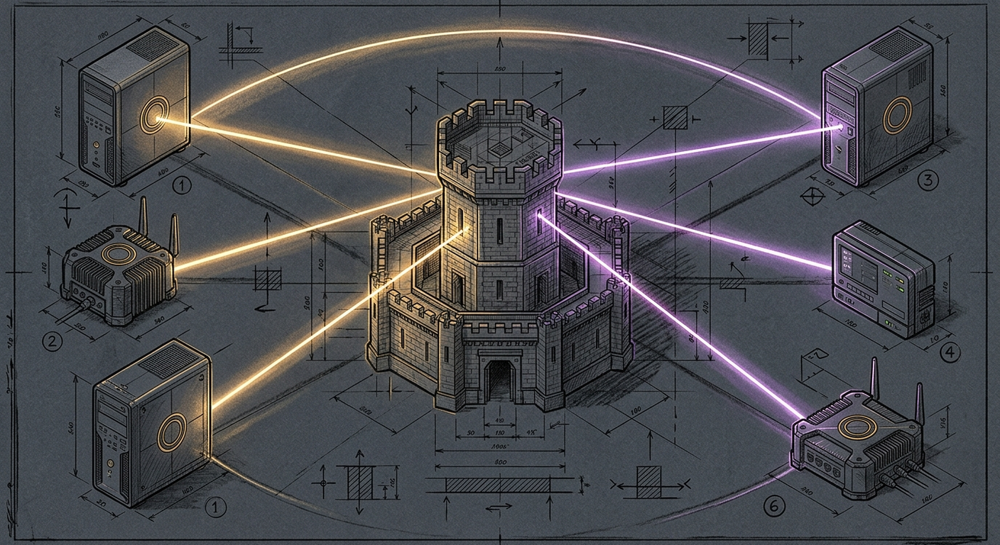

import { Aside } from '@astrojs/starlight/components';



Six nodes sat on the tailnet, and four of them disagreed on what version of Tailscale they were running.

On the Mini, `brew upgrade` had bumped the `/opt/homebrew/bin/tailscale` CLI to `1.104.2` while the running `com.tailscale.tailscaled` LaunchDaemon stayed on `1.102.5`. On the MBP, the CLI was `1.104.1` and the daemon was `1.102.5`. On the two Firewalla routers, the Docker containers were frozen at `1.98.4` and `1.98.9`—whatever `tailscale/tailscale:latest` had resolved to the day each container was first created. On Home Assistant Green, the Tailscale add-on sat at `0.28.1` with `0.30.3` waiting. And the chalet Mac mini had not answered a ping in seven days.

## Three substrates, three ways to drift

A multi-substrate mesh does not stay current from a single `brew upgrade`. Every substrate fails differently. Each one stalls in its own idiom when an upgrade is half-applied.

| Substrate | What drifted | Why it stayed drifted |
|---|---|---|
| macOS (`manoir`, `mbp`, `chalet`) | CLI `1.104.2` vs running daemon `1.102.5` | `brew upgrade` replaces `/opt/homebrew/bin/tailscaled` on disk, but `launchctl kickstart -k` fails with `OS_REASON_CODESIGNING` |
| Firewalla Linux (`manoir-fw`, `chalet-fw`) | Containers stuck on `1.98.4` and `1.98.9` | `docker-compose.yml` references `tailscale/tailscale:latest`, which Docker never re-pulls unless told |
| Home Assistant OS (`green`) | Add-on stuck on `0.28.1` (`0.30.3` available) | Supervisor records `update_available: true` and waits for `ha apps update` |
| Remote headless Mac mini (`chalet`) | Offline on the tailnet for seven days | A power blink rebooted the machine into the macOS FileVault pre-boot unlock prompt before the OS or Tailscale could load |

## The Launch Constraint trap on macOS

When Homebrew replaces `/opt/homebrew/bin/tailscaled` in place, the natural reflex is `sudo launchctl kickstart -k system/com.tailscale.tailscaled`. On macOS Sequoia and Tahoe, that command kills the daemon and refuses to start the new one (`EX_OSERR (71)` / `OS_REASON_CODESIGNING`).

`launchd` caches the code-signing CDHash of a LaunchDaemon's binary inside its in-memory Launch Constraint (`LWCR`) table when the plist is bootstrapped. When Homebrew writes a new binary with a new CDHash at the same path, `kickstart -k` checks the new Mach-O binary against the cached CDHash from the old bottle and aborts execution.

<Aside type="caution" title="Bootout and bootstrap after a binary swap">
Never use `launchctl kickstart -k` after upgrading a system LaunchDaemon binary in place. Evict the cached Launch Constraint with `bootout` and re-register the plist with `bootstrap`:

```bash
sudo launchctl bootout system/com.tailscale.tailscaled
sudo launchctl bootstrap system /Library/LaunchDaemons/com.tailscale.tailscaled.plist
```
</Aside>

## The seven-day pre-boot silence at the chalet

At the chalet, `chalet-fw` (`100.0.0.2`) was answering pings while the chalet Mac mini (`100.0.0.3`) was dark. Usually that pattern means the Mini is powered off. This time it was powered on and listening—just not on the tailnet.

Jumping through `chalet-fw` onto the chalet LAN (`10.0.0.10:22`) revealed Apple's FileVault pre-boot SSH unlock ramdisk (`Password for disk:`). A power blink seven days earlier had rebooted the M1 Mini. Because FileVault was enabled, the encrypted Data volume (`/Volumes/Macintosh HD - Data`, where `/opt/homebrew/bin/tailscaled` lives) was never mounted.

Unlocking the pre-boot prompt brought the chalet Mini back onto the tailnet within fifteen seconds. Because a headless server in a locked physical sanctum must survive unattended power restoration, we disabled the pre-boot FileVault gate (`sudo fdesetup disable`) so the chalet Mini matches the hub Mini: Apple Silicon's Secure Enclave keeps the APFS volume hardware-encrypted at rest (`FileVault: No (Encrypted at rest)`), while reboots go straight to the OS and join the tailnet without human intervention.

## Teaching Windu to patch the fleet

Windu (`~/.sanctum/windu/windu-threat-watch.py`) already ingested CISA advisories, security feeds, and X threat intelligence, cross-referencing them against the haus inventory. Reporting a vulnerability or version drift when the remedy is deterministic still made the operator the bottleneck.

Windu now runs a canary-gated autonomous remediation pass (`auto_patch_runtimes`) across every reachable substrate before evaluating residual risk:

```python
# 1. macOS nodes (manoir, mbp, chalet): upgrade security formulae & realign tailscaled
if ts_cli and ts_daemon and ts_cli != ts_daemon:
    _cmd_out(["/usr/bin/sudo", "-n", "/bin/launchctl", "bootout", "system/com.tailscale.tailscaled"], 15)
    _cmd_out([
        "/usr/bin/sudo", "-n", "/bin/launchctl", "bootstrap", "system",
        "/Library/LaunchDaemons/com.tailscale.tailscaled.plist",
    ], 15)

# 2. Firewalla routers (manoir-fw, chalet-fw): pull first, then detach container recreate
fw_cmd = (
    "COMPOSE=/home/pi/.firewalla/run/docker/tailscale/docker-compose.yml; "
    "sudo docker compose -f \"$COMPOSE\" pull && "
    "nohup sudo docker compose -f \"$COMPOSE\" up -d >/tmp/ts-upgrade.log 2>&1 </dev/null & "
    "sleep 1"
)

# 3. Home Assistant Green: apply supervisor add-on update when available
if green_rt.get("reachable") and green_rt.get("update_available"):
    _cmd_out(["/usr/bin/ssh", "-o", "BatchMode=yes", "green", "ha apps update a0d7b954_tailscale"], 180)
```

Notice the Firewalla upgrade pattern: because Windu reaches `chalet-fw` over Tailscale itself, running `docker compose up -d` synchronously in the foreground would tear down the `tailscale` container mid-command and sever the SSH session before the new container starts. Pulling the image synchronously and detaching `nohup docker compose up -d` in the background swaps the container cleanly in ~2 seconds.

## Military-grade CI across all sixteen workflows

In the same sweep, we hardened all sixteen GitHub Actions workflows across the ten haus and work repositories (`sanctum-rs`, `sanctum-cli`, `sanctum-runtime`, `sanctum-docs`, `the-holocron`, `yoda-voice-agent`, `homebrew-sanctum`, `sanctum-backup-deadman`, `work-cli`, and `work-skills`) against supply-chain and runner-persistence attacks:

- **100% 40-character commit SHA pinning**: Every third-party action (`actions/checkout`, `actions/setup-node`, `actions/setup-python`, `dtolnay/rust-toolchain`, `taiki-e/install-action`, `cloudflare/wrangler-action`) is pinned to an immutable 40-char commit SHA rather than a mutable `@v4` or `@master` tag.
- **Zero persisted credentials on self-hosted runners**: Every `actions/checkout` step sets `persist-credentials: false` so ephemeral `GITHUB_TOKEN` credentials are never left behind in `.git/config` on `manoir`'s self-hosted runner worktrees.
- **Least-privilege token permissions & bounded execution**: Every workflow declares top-level `permissions: contents: read`, explicit `concurrency` groups, and bounded `timeout-minutes` on every job.
- **Zero script injection**: Every `${{ github.event... }}` expression was removed from `run:` shell blocks and passed strictly via environment variables (`env:`).
- **Automated vulnerability hard gates**: `cargo deny check advisories bans sources` in `sanctum-rs` caught and forced the upgrade of seven `RUSTSEC-2026-*` advisories (`rustls 0.23.46`, `rustls-webpki 0.103.16`, `webpki-roots 1.0.10`), and `pnpm audit --audit-level=high` in `the-holocron` cleared sixty-two advisories (`electron 43.8.3`, `vite 6.4.5`).

## Lineage

- [The Check That Rode Along](/operations/2026-10-17-the-check-that-rode-along/) — where a second Tailscale client on the MBP hid behind an SSH `ControlMaster` socket
- [Kickstart Is Not a Heal](/architecture/kickstart-is-not-a-heal/) — why `launchctl kickstart` is the wrong primitive when launchd state or code-signing constraints change
- [Upgrade Path](/operations/upgrade-path/) — the Sunday upgrade harness and pinned-formula dylib linkage checks
- [Hive Topology](/architecture/hive-topology/) — the tailnet substrate across `manoir`, `mbp`, `chalet`, the Firewalla routers, and Home Assistant Green

Six nodes sit on the tailnet, and all six now report `1.104.2`. When `1.104.3` ships, Windu will not wait to be asked.
