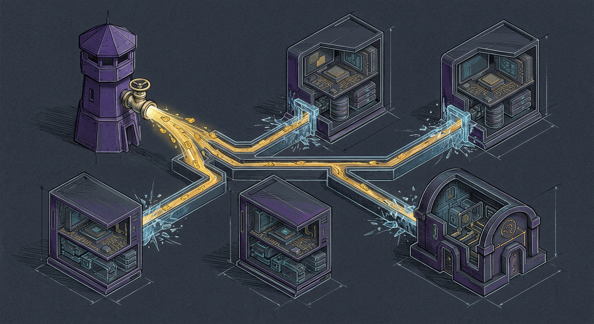

A sentinel that reads yesterday's catalog reports yesterday's peace.

At 07:41 this morning, [Windu](/agents/windu/) upgraded the Tailscale add-on on Home Assistant Green (`0.30.3 -> 0.30.4`) and declared every runtime across `manoir`, `mbp`, `chalet`, and `yoda` current (`outdated_security_brew: []`). Every check was green. Six blind spots hid underneath that green.

## Six ways the watch went blind

| Blind spot | What was on disk | What Windu missed |
|---|---|---|
| **Frozen Homebrew index** | `HOMEBREW_NO_AUTO_UPDATE=1` ran without `brew update --quiet`, and `mbp`'s Sunday job ran `brew upgrade` without refreshing taps | 9 outdated security formulae on `manoir`, 10 on `mbp`, and 5 on `chalet` (`openssl@3`, `libnghttp3`, `libngtcp2`, `rust`) |
| **Pinned security point-drift** | `python@3.11..3.14`, `restic`, and `uv` were pinned to block major jumps, freezing point releases too | `manoir` lagged on `python@3.11` (`3.11.15_1 -> 3.11.17_1`), `python@3.12` (`3.12.13_2 -> 3.12.15_1`), `python@3.14` (`3.14.7 -> 3.14.9`), `restic` (`0.18.1 -> 0.19.1`), and `uv` (`0.11.14 -> 0.13.5`); `chalet` lagged on `python@3.14` (`3.14.8_2 -> 3.14.9`) |
| **Home Assistant Green tunnel vision** | `_ha_tailscale()` inspected only `a0d7b954_tailscale` | Home Assistant Core (`2026.8.1 -> 2026.10.3`), HA OS (`18.2 -> 18.3`), `a0d7b954_ssh` (`24.0.1 -> 24.2.0`), `core_ssh` (`10.3.0 -> 10.5.0`), and `core_mosquitto` (`7.1.1 -> 7.1.2`) sat unapplied |
| **Airgapped VM `apt` freeze** | `yoda` (`Ubuntu 24.04`) has no outbound route by design, so both daily checks and Sunday upgrades skipped `apt` | `openssl` (`3.0.13-0ubuntu3.11 -> 3.0.13-0ubuntu3.16`) and `curl` (`8.5.0-2ubuntu10.11 -> 8.5.0-2ubuntu10.16`) sat five Ubuntu security updates behind alongside `libssh-4`, `apparmor`, and the `6.8.0-147` kernel |
| **macOS 27 `SoftwareUpdate` check** | `sanctum-mbp-harden.sh` read an omitted `AutomaticCheckEnabled` plist key instead of `softwareupdate --schedule` | Reported a false `FAIL` on `mbp` while sending alerts to a dead `127.0.0.1:4077` endpoint instead of `manoir` |
| **Static `BELL049` assumption** | `hub()` hardcoded `"radios": "beaconing"` as a string literal | Kept reporting `BELL049` as unknown (`affected: null`) after the Bell Giga Hub radio was already turned off over the air |

## Thawing the tap and rolling same-major pins safely

Passing an uninstalled formula name to `brew outdated --quiet` exits `1`, which previously caused Windu to discard the entire outdated list. Both `windu-threat-watch.py` and `windu-doctor.py` now refresh Homebrew's signed JWS index on a bounded TTL (`brew update --quiet`), read `brew outdated --json=v2`, and cover a 39-formula security perimeter across `manoir`, `mbp`, and `chalet`.

Unpinned security formulae upgrade immediately with `HOMEBREW_NO_INSTALL_CLEANUP=1` so running daemons never lose open `Cellar` files mid-flight. Pinned runtimes (`node`, `python@3.11..3.15`, `restic`, `uv`) now roll automatically **only within the same major track** (`3.14.x` for Python kegs, `26.x` for Node): Windu unpins the formula, upgrades with `HOMEBREW_NO_INSTALL_CLEANUP=1`, verifies `brew linkage --test`, re-pins in a `finally` block, and runs `sanctum-sunday-upgrade.sh --check-pins` under [Upgrade Path](/operations/upgrade-path/). Hypervisor pins (`lima`, `qemu`) remain strictly excluded while `sanctum-vm` runs, and `1password-cli` stays excluded so desktop biometric authorization is never silently voided.

## Closing Home Assistant Green, `SoftwareUpdate`, and over-the-air telemetry

On `green` (`manoir-ha`), Windu now queries `ha core info`, `ha os info`, and `ha apps` on every cycle and patches the full appliance in dependency order:

1. Non-SSH add-ons (`a0d7b954_tailscale`, `a0d7b954_ssh`, `core_mosquitto`) upgrade with `--backup --no-progress`.
2. `core_ssh` upgrades over `green-adv` (port 2222) so restarting port-22 `sshd` never aborts its own transaction.
3. Home Assistant Core upgrades via `ha core update --backup --no-progress`.
4. Home Assistant OS writes the inactive RAUC A/B boot slot (`ha os update --no-progress`), detects `version_pending`, triggers `ha host reboot --no-progress`, and polls until `green` returns online on the new OS build with Supervisor idle.

Across `manoir`, `mbp`, and `chalet`, Windu and `sanctum-mbp-harden.sh` now validate `softwareupdate --schedule` alongside `AutomaticDownload`, `CriticalUpdateInstall`, `ConfigDataInstall`, and `SplatEnabled` (Rapid Security Responses). On `manoir-fw`, `hub()` now runs a live dual-band `iw dev wlan0 scan ap-force` across 2.4 and 5 GHz: `BELL049` is verified `off` (`affected: false`), and if an ISP firmware push ever re-enables the bridge modem's radio, Windu flips to `affected: true` and pages immediately.

## Patching an airgapped VM without breaking the airgap

`yoda` runs host-only on `bridge100` with zero internet access. Giving it a standing proxy or NAT route would violate [The Airgap That Forgot Itself](/operations/2026-07-26-the-airgap-that-forgot-itself/). Leaving its `apt` cache frozen left `openssl` and `curl` five Ubuntu security releases behind.

Windu (daily at 07:40 and via `sanctum-sunday-upgrade.sh`) now opens a temporary, strictly allowlisted bridge that exists only for the seconds `apt-get` runs:

1. `manoir` binds an in-process `ThreadingHTTPServer` on `127.0.0.1:0` that permits **only** `GET` and `HEAD` requests matching `http://ports.ubuntu.com/ubuntu-ports/*` (`HTTP 403` on any other host, scheme, method, or path).
2. `ssh -R` forwards a loopback port into `yoda` (`ControlMaster=no`) while `apt-get` verifies Canonical's `ubuntu-archive-keyring.gpg` signatures and installs updates with `NEEDRESTART_SUSPEND=1`.
3. `nodejs` is held via `apt-mark hold` (and when `manoir`'s `node` `26.x` advances, Windu verifies `SHASUMS256.txt` from `nodejs.org` on `manoir` and streams the verified Linux `arm64` tarball into `/opt/node26`).
4. `openclaw-vmnet-ip.service` carries `PartOf=systemd-networkd.service` so `10.10.10.10/24` on `lima0` survives `systemd-networkd` restarts during `dbus` and `systemd` upgrades.

As soon as `ssh` exits, the reverse tunnel and local listener close. Nothing lingers. Every node refreshes its catalog before it speaks, and the airgap opens one verified keyhole before locking shut again.
