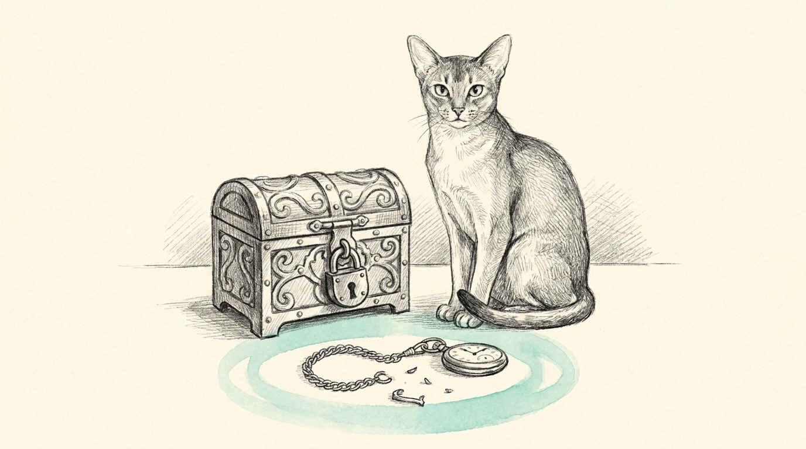

The haus was still online.

The gateway answered. Egress was fine. One SSH read of the route table did not return for about ten minutes, and the empty result paged. The watchdog held. The WAN stayed put. Two minutes later the same read was healthy.

## The keepalive was talking to a live peer

ServerAlive drops a peer that has gone quiet. A live sshd whose remote command is stuck in the kernel keeps answering those probes, so the client waits. On 27 October the verify that finished at 18:30 was healthy, the next one did not return until 18:42, and the dump it finally produced was empty while egress was still ok. The action was hold_online. The following tick, at 18:44, was single-NAT on a public address again, and the recovery was logged at info. A normal dump here is about fifty lines and comes back in a second. Those long reads were wedges.

## A wall, then a second look

`read_fw_dump` starts the SSH client in its own process group and kills that group at twenty seconds. An empty first read is tried once more under the same wall, so both attempts fit inside the ninety second launchd slot. The watchdog still refuses to heal on an unreadable box. It pages `FW_UNREACHABLE` only on the second consecutive reading. One wedge keeps the last published state. A dark haus, the one with no egress, still pages on the tick that sees it.

## What EETISMAD looks like here

| Gate | Evidence |
|---|---|
| Everything E2E Tested | `bash ~/.sanctum/tests/test-singlenat-fw-wall.sh` — 16 passed. A stuck child dies inside the wall, and its grandchild dies with it. One empty read is retried. The first `FW_UNREACHABLE` stays on the previous state. The second publishes. `DARK` still publishes immediately. A live `singlenat-verify.sh` after the change returned `HEALTHY` |
| in Sanctum-docs | This field note, its sidebar entry, and the SSH-wall row on [engineering discipline](/architecture/engineering-discipline/) |
| Merged | `sanctum-config` `9a9e464` on `origin/main` |
| And Deployed | `haus.sanctum.singlenat-watchdog` runs `~/.sanctum/bin/singlenat-watchdog.sh`, and that file is the one on `origin/main`. The verify beside it is too. No heal ran |

The bar for the claim is [engineering discipline](/architecture/engineering-discipline/). The same day, a killed gland beat learned a cousin of this rule in [The Stamp That Outlived the Beat](/operations/2026-10-27-the-stamp-that-outlived-the-beat/).

One stall stays quiet. A second miss still pages.
