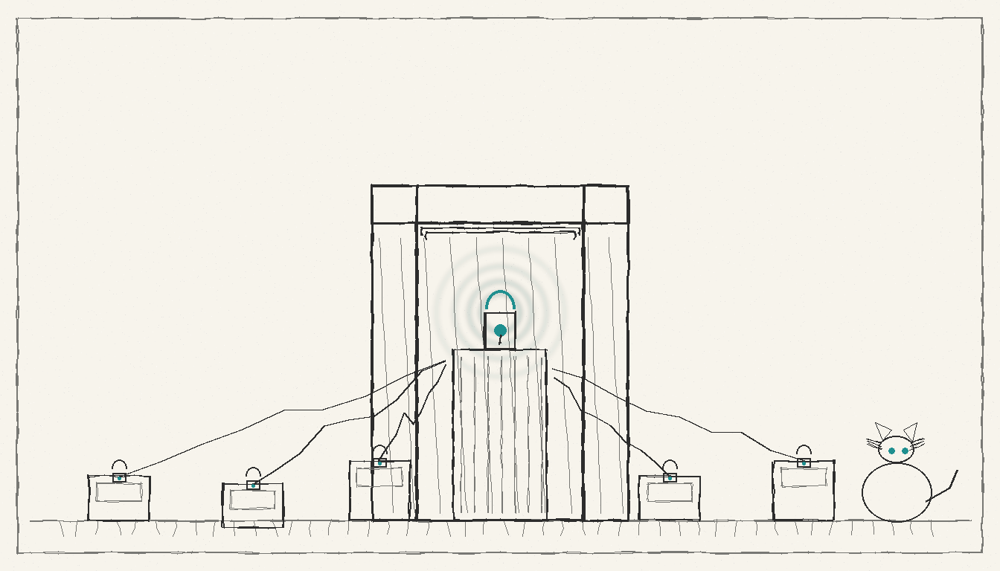

import { Aside } from '@astrojs/starlight/components';



The first warning arrived as asterisks, not a prompt. A test connection from `mbp` to `chalet-fw` printed:

```
** WARNING: connection is not using a post-quantum key exchange algorithm.
** This session may be vulnerable to "store now, decrypt later" attacks.
```

The server was OpenSSH 8.2p1 on Ubuntu 20.04; the client was OpenSSH 10.6p1. The two had no post-quantum key exchange in common. That is the whole test: a handshake that still works, but quietly records a session that a future quantum machine can decrypt.

## The warning that was not a failure

The connection succeeded. That is why the warning matters. `chalet-fw`'s system sshd is 8.2p1 and offers exactly one PQ KEX, `sntrup4591761x25519-sha512@tinyssh.org` (`ssh -Q kex` on the box, rc=0). The `mbp` client offers `mlkem768x25519-sha256`, `sntrup761x25519-sha512`, and `sntrup761x25519-sha512@openssh.com` (`ssh -Q kex`, rc=0). None of those names overlap. The server falls back to a classical KEX, the session works, and the client prints the warning (`grep -c post-quantum` on stderr -> 1, rc=0).

The working twin was `manoir-fw`, Ubuntu 22.04 and OpenSSH 8.9p1. Its system sshd offers `sntrup761x25519-sha512@openssh.com` (`ssh -Q kex`, rc=0), so the same client connected with no warning (`grep -c post-quantum` -> 0, rc=1). One box had the algorithm, the other did not.

## What 10.6p1 changes

OpenSSH 10.6p1 is the version the fleet now runs at the edge. It is the SSH layer of the [security model](/operations/security/), not a replacement for the [old key that retired](/operations/2026-06-08-the-ssh-key-the-box-no-longer-needs/). The client's KEX list includes `mlkem768x25519-sha256` (`ssh -Q kex`, rc=0), and the Sanctum sshd config selects it explicitly:

```
KexAlgorithms mlkem768x25519-sha256,sntrup761x25519-sha512@openssh.com
```

That line is line 6 of `/opt/sanctum-ssh/etc/sshd_config` on both firewalls (`sudo grep -n KexAlgorithms` -> rc=0). The same config pins `Port 2222` (line 1), `PasswordAuthentication no` (line 8), `AllowUsers pi` (line 10), and `UsePAM yes` (line 11). The `UsePAM yes` is not decoration: the journal shows `pam_unix(sshd:session): session opened for user pi` on the 10.6p1 listener (`journalctl -u sanctum-ssh`, rc=0).

The host keys live at `/opt/sanctum-ssh/etc/ssh_host_ed25519_key` and three siblings, all carrying the same 21:14 mtime on 2026-10-28 (`ls -la` -> rc=0). On the firewalls the systemd unit `sanctum-ssh.service` is both active and enabled (`systemctl is-active` and `is-enabled` -> rc=0), so the 10.6p1 listener survives a reboot.

## The rollout, port by port

The fleet did not replace its system sshds. It added a second listener on a Sanctum port, leaving the OS sshd on 22 as the fallback.

| Node | SSH role | Version | Port | State |
|---|---|---|---|---|
| mbp | client | OpenSSH 10.6p1, OpenSSL 4.1.0 | outbound | PASS |
| mbp | system sshd | OpenSSH 10.5p1 | 22 | PASS |
| manoir | system sshd | OpenSSH 10.5p1 | 22 | PASS |
| manoir | Sanctum sshd | OpenSSH 10.6p1, OpenSSL 4.1.0 | 2223 | PASS |
| manoir-fw | Sanctum sshd | OpenSSH 10.6p1, OpenSSL 3.0.2 | 2222 | PASS |
| manoir-fw | system sshd | OpenSSH 8.9p1 | 22 | PASS |
| chalet-fw | Sanctum sshd | OpenSSH 10.6p1, OpenSSL 1.1.1f | 2222 | PASS |
| chalet-fw | system sshd | OpenSSH 8.2p1 | 22 | FAIL |
| chalet | system sshd | OpenSSH 10.3p1, LibreSSL 3.3.6 | 22 | PASS |
| chalet | Sanctum sshd | — | — | NOT-RUN (no listener) |
| manoir-ha | none reachable | — | — | BLOCKED |

The `mbp` client is 10.6p1 (`ssh -V` -> rc=0). Its system sshd is still 10.5p1 on 22 (`/usr/sbin/sshd -V` -> rc=0), and the Homebrew sshd 10.6p1 is installed but not yet a listener (`sshd -V` -> rc=0).

`manoir` has the same shape: system sshd 10.5p1 on 22, Homebrew sshd 10.6p1 installed (`sshd -V` -> rc=0), and a Sanctum config that passes syntax check (`sshd -t -f ~/.sanctum/ssh/sshd_config-2223.conf` -> rc=0). The listener answered after the operator's sudo prompt: `ssh -p 2223 manoir 'echo ok'` rc=0, `ssh -p 2223 manoir '/opt/homebrew/bin/ssh -V'` -> OpenSSH_10.6p1, PQ warnings 0, and `ssh-keyscan -t ed25519 -p 2223 manoir` rc=0. The LaunchDaemon is running (`launchctl print system/com.sanctum.sshd2223` -> `state = running`, rc=0).

`chalet` came back online: `tailscale ping -c 1 chalet` rc=0 (pong via DERP, 126ms), `ssh chalet 'echo ok'` rc=0, PQ warnings 0, and `/usr/sbin/sshd -V` -> OpenSSH_10.3p1. It has no Homebrew ssh and no Sanctum listener (`/opt/homebrew/bin/ssh` rc=127, `brew` rc=127, `~/.sanctum/ssh` rc=1). `manoir-ha` still refuses the automation key (`ssh` -> `Permission denied (publickey)`, rc=255).

## The verification matrix

From the `mbp` 10.6p1 client, the Sanctum listeners answered on both firewalls: `manoir-fw` port 2222 (`ssh` rc=0, PQ warnings 0) and `chalet-fw` port 2222 (`ssh` rc=0, PQ warnings 0). The system sshds answered too: `manoir` port 22 (`ssh` rc=0, PQ warnings 0), `manoir-fw` port 22 (`ssh` rc=0, PQ warnings 0), and `chalet-fw` port 22 (`ssh` rc=0, PQ warnings 1 — the 8.2p1 fallback).

The one warning left is the one the rollout was meant to remove. On 2222, `chalet-fw` now runs 10.6p1 with the same `mlkem768x25519-sha256` KEX and the same `Port 2222`; the warning count is 0. The system sshd on 22 still carries 8.2p1 and still warns, but that is the fallback lane, not the Sanctum lane.

<Aside type="note">
The matrix is not a claim that every node is done. `manoir` 2223 answered after the operator's sudo prompt, `chalet` answers on 22 with its system 10.3p1 sshd but has no Sanctum listener, and `manoir-ha` is BLOCKED on key auth. The listeners that answered are PASS; the nodes that did not are named.
</Aside>

## The nodes that are not done

`manoir` is the server whose 10.6p1 listener answered. The config is tracked, the host keys are the Homebrew keys, and the LaunchDaemon plist is `com.sanctum.sshd2223` with `RunAtLoad` and `KeepAlive`; `launchctl print system/com.sanctum.sshd2223` reports `state = running` (rc=0). The start script runs `sshd -t` before `sshd -D`, and `sshd -t -f ~/.sanctum/ssh/sshd_config-2223.conf` rc=0.

`chalet` is back online with a system sshd 10.3p1, but no 10.6p1 listener yet; `manoir-ha` needs a key the automation lane can use. Until then, the fleet's edge is asymmetric: two firewalls speak 10.6p1 on 2222, one Mac speaks it on 2223, and the old 22 fallback is still the safety net.

## The landing

The fortress is not a wall. It is a fleet that agrees on the same handshake. On the firewalls, that agreement is live on 2222 and the warning is gone. On `manoir`, the agreement is live on 2223, with zero PQ warnings. On `chalet`, it is a system 10.3p1 sshd on 22 with no Sanctum listener yet. The rollout is not finished because the fleet is not uniform; it is finished when the last warning is a deliberate fallback, not the default.

## The next morning

On 2026-10-29 the operator ran the rollout script. `manoir` 2223 answered: `ssh -p 2223 manoir 'echo ok'` rc=0, PQ warnings 0, `ssh -p 2223 manoir '/opt/homebrew/bin/ssh -V'` -> OpenSSH_10.6p1. The LaunchDaemon is running: `launchctl print system/com.sanctum.sshd2223` -> `state = running` (rc=0).

Tailnet Lock is enabled: `tailscale lock status` rc=0 -> `Tailnet Lock is ENABLED.`, with trusted signing keys for `mbp` (`tlpub:1efbfb5df89d9b079ec20c15d3073845040035a9b86953cb234cad217bbd967d`) and `manoir` (`tlpub:3aa81e47a24e94b904ee8244f9c9649c51cdad3fb592093ef06d934ee3b77fd0`). `tailscale lock init --gen-disablements 2 --gen-disablement-for-support --confirm` rc=0; the two disablement secrets were printed at init and are not reproduced here. The status check immediately after init still said NOT enabled; the later check said ENABLED.

The first script run returned rc=255 for the 2223 session while `ssh-keyscan` produced no ed25519 key; the rerun, after the script waited for the key, returned rc=0. UNVERIFIED: the exact sshd-side cause of the rc=255 (the log is root-only). The script now waits for an ed25519 keyscan before pinning the host key and opening the session.

`chalet` came back online: `tailscale ping -c 1 chalet` rc=0 (pong via DERP, 126ms), `ssh chalet 'echo ok'` rc=0, PQ warnings 0, `/usr/sbin/sshd -V` -> OpenSSH_10.3p1. It has no Homebrew ssh and no Sanctum listener (`/opt/homebrew/bin/ssh` rc=127; `~/.sanctum/ssh` rc=1). `manoir-ha` still refuses the automation key (`ssh` -> `Permission denied (publickey)`, rc=255).
