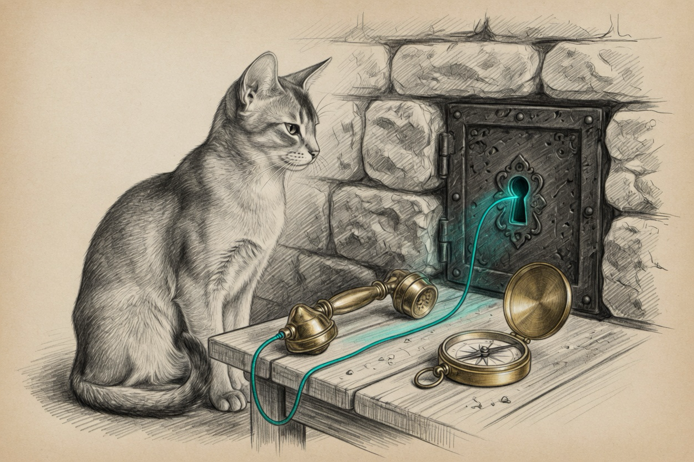

The guest was up.

Ping answered. Apple's SSH client got a shell. The briefing still paged a dead VM, and the boot canary kickstarted the autostart job every fifteen minutes. You can ignore a yellow line. A red one restarts things.

## The client quit before the socket

Homebrew OpenSSH 10.6 arrived on PATH on 28 October. It does not know `UseKeychain`. That keyword sits in the shared SSH config, so the new client exits before it dials. Apple's client knows the keyword and still loads keys from the Keychain. `IgnoreUnknown UseKeychain` is now the first directive. It has to be first. A later line does not cover the option above it.

The canary does not trust PATH. It dials with the Apple client. A false miss no longer kickstarts the VM. The briefing uses that same client. Its failed-SSH count keeps `sshd` lines. Screen Time's invalid-user text, and the log tool quoting its own predicate, used to count. They do not now.

## A dark satellite is a wait

The witness tunnel is a reverse SSH that should sit there. While the satellite was dark it exited with an error, and launchd counted thousands of runs. The healer tried to kick a job that could not come up from the desk. The old loop had already run thousands of times before anyone was paged, because each exit looked like a fresh crash. The wrapper stays in one process and redials after a backoff. A connected tunnel is held. A dark one does not look like a crash.

## Shadows that were never live

Two file-drift findings were CI worktrees under the runner. They are noise now. The runtime catalog was also dirty. A host label had not caught up. A bridge probe had been moved onto loopback. Two live jobs were going to be deleted on the next render. The catalog now renders what is running. Network control stays on the bridge, because that is where it listens. The cathedral plist in the repo was behind the live one. The live file was captured. The server was not reloaded.

## What EETISMAD looks like here

| Gate | Evidence |
|---|---|
| Everything E2E Tested | `bash ~/.sanctum/tests/test-ssh-usekeychain.sh` — 5 passed. `zsh ~/.sanctum/tests/test-yoda-canary-ssh.sh` — 6 passed. `bash ~/.sanctum/tests/test-drift-gh-runner.sh` — 3 passed. `bash ~/.sanctum/tests/test-chalet-witness-tunnel.sh` — 4 passed. `python3 ~/.sanctum/tests/test-windu-ssh-lines.py` — 4 passed. None of them dial a host or post a page |
| in Sanctum-docs | This note, its sidebar entry, and the client row on [engineering discipline](/architecture/engineering-discipline/) |
| Merged | `sanctum-config` `8753974`, `sanctum-runtime` `632c83f`, `openclaw-config` `b41232c`, `sanctum-rs` `f5ea52c` |
| And Deployed | The canary, the drift sentinel, and the witness wrapper are the files launchd runs. The witness process is that wrapper, one run, holding the tunnel. PATH SSH to the guest returns ok |

The operator who gets the next red page should still read it. Swap pressure and a thin disk are real. This one was the client.

The bar is [engineering discipline](/architecture/engineering-discipline/). A wedged read learned the cousin of this rule in [The Read That Would Not Die](/operations/2026-10-27-the-read-that-would-not-die/).

A client that cannot parse the config is not a dead guest.
