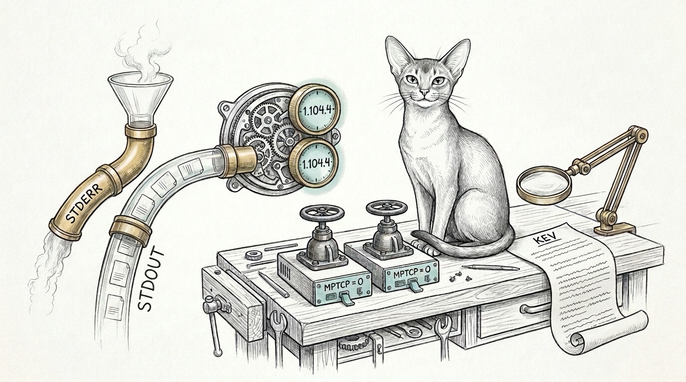

import { Aside } from '@astrojs/starlight/components';

The warning meant to report a stale daemon was the exact string that kept the daemon stale.

When Homebrew upgraded Tailscale from `1.104.2` to `1.104.4`, `tailscale status --json` began printing `Warning: client version "1.104.4" != tailscaled server version "1.104.2"` on `stderr` ahead of its JSON payload on `stdout`. [Windu](/agents/windu/)'s helper concatenated `stdout` and `stderr` before calling `json.loads()`. Parsing threw `JSONDecodeError`. The helper returned an empty daemon string. Its realignment guard (`if ts_cli and ts_daemon and ts_cli != ts_daemon`) quietly stepped aside. Every remote node moved to `1.104.4`; `manoir` itself stayed behind on `1.104.2`.

Asking whether Windu had caught the late-October Linux kernel (`CVE-2026-46300` "Fragnesia", `CVE-2026-98432` MPTCP use-after-free) and Home Assistant advisories turned that single parser bug into a six-seam audit across the fleet.

## What was already patched — and what was hiding underneath

Home Assistant Green (`green`) and the airgapped Ubuntu 24.04 VM (`yoda`) had already received their upstream patches: `green` was booted on HA OS `18.4` (`Linux 6.18.58-haos`), HA Core `2026.10.4`, and current add-ons, while `yoda` was booted on `6.8.0-147-generic` with `CVE-2026-46300`, `CVE-2026-53266`, and `CVE-2026-53362` recorded in its installed Debian kernel changelog. Six operational gaps still sat beneath that green surface:

| Seam | What looked fine | What disk inspection proved |
|---|---|---|
| `tailscaled` skew & `launchd` teardown race | Remote nodes reported `1.104.4` | Merging `stderr` into `tailscale status --json` hid `manoir`'s `1.104.2` daemon, and firing `launchctl bootstrap` zero milliseconds after `bootout` raced `launchd` teardown and left the tunnel unloaded. |
| Linux MPTCP attack surface (`CVE-2026-98432`) | `yoda` and `manoir-fw` kernels answered healthy | Both Linux 6.x hosts (`yoda` `6.8.0-147-generic` and `manoir-fw` `6.5.0-25-generic`) still exposed `net.mptcp.enabled = 1` despite zero multipath TCP traffic in the haus. |
| VM kernel reboot automation | `apt-get dist-upgrade` upgraded `linux-image-*` inside `yoda` | Nothing compared `uname -r` against the newest installed `linux-image-*-generic` or checked `/var/run/reboot-required` to reboot the Lima guest into a newly unpacked kernel. |
| CISA feed truncation & Linux/HA keywords | Four security RSS feeds polled daily | CISA's `all.xml` embedded a multi-hundred-kilobyte CSAF `<description>` that truncated before the first `</item>`, logging `feed www.cisa.gov unparsed`, while Grok's X prompt omitted `Linux kernel`, `Ubuntu`, `Home Assistant`, and `HAOS`. |
| `/usr/local/bin/node` CVE floor vs point bumps | Homebrew `node` rolled to `v26.13.0` | `v26.13.0` (`security: false` in `nodejs.org/dist/index.json`) made `windu-doctor` page `WARN` every four hours against `/usr/local/bin/node` `v26.12.1` (`security: true`), which holds Apple Developer ID TCC grants and cannot be overwritten with an ad-hoc binary. |
| Firewalla sentinel & HA Green full backup | `manoir-fw` upgraded to `goldpro-prod-v1.984.016` | `firewalla-kernel-age-sentinel.py` invoked bare `ssh` off `launchd`'s minimal `PATH` and failed to parse `goldpro-prod-v1.984.016`; `green` carried partial backups without a fresh full Supervisor archive (`no_current_backup`). |

## Separating the pipes and pacing `launchd`

Fixing `_local_tailscale_versions()` in `~/.sanctum/windu/windu-threat-watch.py` and `~/.sanctum/windu/windu-doctor.py` meant reading `stdout` alone via `parse_tailscale_status_stdout()` and treating an unreadable daemon alongside a present `/Library/LaunchDaemons/com.tailscale.tailscaled.plist` as drift rather than silence.

Live testing immediately caught the second half of the trap. On macOS, `launchctl bootout system/com.tailscale.tailscaled` returns while `tailscaled` is still closing its `utun` socket; calling `launchctl bootstrap` immediately fails while teardown is in flight. `auto_patch_runtimes()` now retries `bootstrap` across a six-second window and waits until `BackendState == "Running"` before dialing any Tailscale peer, while remote Mac realignment detaches cleanly under `nohup` so a momentary tunnel reset never severs the recovery loop.

## Closing kernel, feed, and TCC seams without weakening boundaries

- **Persistent MPTCP disablement and VM kernel reboots.** Windu now audits `net.mptcp.enabled` on both `yoda` and `manoir-fw`, persists `/etc/sysctl.d/90-sanctum-mptcp-hardening.conf` (`net.mptcp.enabled = 0`) on `yoda` plus `~/.sanctum/firewalla/post_main.d/10-sanctum-resilience.sh` on `manoir-fw` across tmpfs reboots, and automatically reboots `lima-sanctum-vm` via `limactl stop`/`start` whenever `/var/run/reboot-required` or `kernel_installed > kernel_running` appears.
- **Resilient CISA KEV + CSAF ingestion.** Raising the feed cap to `1.2 MB`, salvaging `<item>` headers when giant CSAF descriptions truncate, ingesting CISA's JSON Known Exploited Vulnerabilities catalog (`known_exploited_vulnerabilities.json`) directly, and adding `Linux kernel`, `Ubuntu`, `Home Assistant`, `HAOS`, `MPTCP`, and `XFRM` to Windu's X and gear matchers eliminated the advisory blind spot.
- **Upstream `security: true` floor + notarized `.pkg` helper.** Both Windu scripts now resolve the highest `security: true` Node 26 release from `nodejs.org/dist/index.json` (cached 12h, floored at `v26.12.1`) so feature-only point releases stop crying wolf, paired with `~/.sanctum/scripts/sanctum-sync-node-pkg.sh` to verify `SHASUMS256.txt` and `Developer ID Installer: Node.js Foundation (HX7739G8FX)` whenever `/usr/local/bin/node` needs a notarized `.pkg` sync.

<Aside type="note" title="Fleet verification after live healing">
`windu-threat-watch.py --patch-only` enforced `net.mptcp.enabled = 0` live on `yoda` and `manoir-fw` and verified `10/10` local checks at `affected: false` with all six Tailscale nodes aligned on `1.104.4`. `windu-doctor.py --armed` moved `runtime_patch_level` back to `OK`, `firewalla-kernel-age-sentinel.py` parsed `goldpro-prod-v1.984.016` with `0 finding(s)`, and full backup `e0c5c538` cleared `no_current_backup` on Home Assistant Green (`issues: []`).
</Aside>

In [The Sentinel That Patches the Fleet](/operations/2026-10-22-the-sentinel-that-patches-the-fleet/) and [Closing the Seams Beneath the Shield](/operations/2026-10-27-closing-the-apocalypse-seams/), we gave the sentinel reach across every box; in [The Client That Cried Down](/operations/2026-10-29-the-client-that-cried-down/), we learned what happens when a probe misreads its own transport. Keep diagnostics off the data pipe, and the healer can read the warning it was built to fix.
