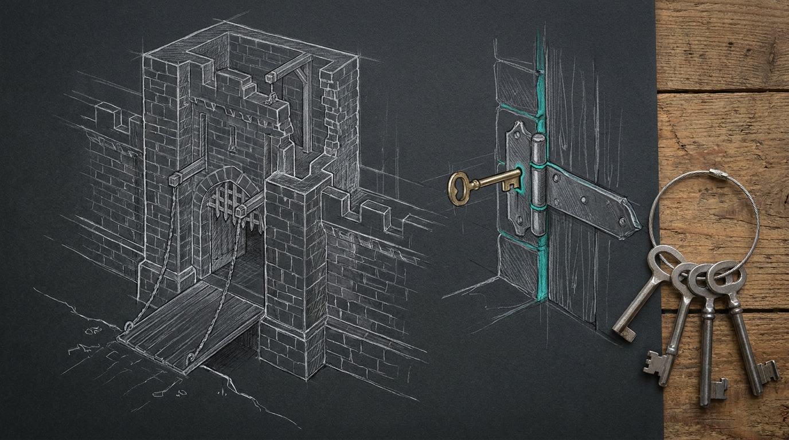

The operator's terminal still had the script open.

The run had stopped at a password prompt that no one could see, then a second time at a chalet-fw sshd switch that had already happened. The fixes were real; the product was not. The file lived in `~/Projects/Claude_Code/scratchpad/fortress-finish.sh`, which is a place a script goes to be run once and forgotten. Sanctum needs commands that survive a disk, a user, and a reinstall.

So the fortress finish moved into `~/.sanctum-mbp` and became `fortress-finish`.

## The scratchpad had a fortress, not a product

The original script was a good runbook with a bad home. It wrote its own pf anchor and applier if they were missing, hardcoded `/Users/bert`, and assumed the only user was Bert. That is fine for one terminal on one afternoon. It is not fine for every user who needs to run the same gate.

The productized form has four tracked pieces:

- `redteam-inbound.pf.conf` — the pf anchor, tracked in `sanctum-mbp`
- `scripts/apply-redteam-pf.sh` — the idempotent applier; it resolves the repo root from its own `BASH_SOURCE`
- `scripts/install-fortress-finish.sh` — installs and checks the live symlinks
- `scripts/fortress-finish.sh` — the command itself

The command resolves `REPO_ROOT` from the symlink it was invoked through, uses `$HOME` instead of `/Users/bert`, and writes `AllowUsers` from the current user unless `FORTRESS_ALLOW_USERS` overrides it. The pf anchor and applier are no longer generated at runtime; they are tracked files. A missing anchor is a `FAIL`, not a quiet rewrite.

## The product is a command

The live install is a symlink, not a copy:

```bash
~/.local/bin/fortress-finish -> ~/.sanctum-mbp/scripts/fortress-finish.sh
~/.sanctum/scripts/fortress-finish.sh -> ~/.sanctum-mbp/scripts/fortress-finish.sh
~/.sanctum/scripts/apply-redteam-pf.sh -> ~/.sanctum-mbp/scripts/apply-redteam-pf.sh
~/.sanctum/redteam-inbound.pf.conf -> ~/.sanctum-mbp/redteam-inbound.pf.conf
```

`install-fortress-finish.sh --check` reports drift without changing anything. The installer is per-home: run it in each user's home to productize the command for that user. On the MBP, the live paths are symlinks into `~/.sanctum-mbp`; the repo file is the live file.

The command still prompts once locally and once on `manoir` for sudo. The prompt fix from the first run is in the product: `ssh_sudo_m` forces a fresh tty, and the pf and sshd phases pipe through `tee` so the password prompt stays on the terminal while the output is saved.

## The gate that failed first

The first negative control was deliberate: point `FORTRESS_REPO_ROOT` at a directory with no anchor and run the dry gate. It failed with `rc=1` and `FAIL: tracked pf anchor/applier missing`. That is the point. A gate that cannot fail is not a gate; it is a green light with no wire behind it.

The dry run is the other side of the same wire: `DRY_RUN=1 SKIP_REMOTE=1 SKIP_HMAC=1 SKIP_CHALET=1` gives `PASS=11 FAIL=0 SKIP=4`, rc=0. The installed command gives the same result when invoked through `~/.local/bin/fortress-finish`. The product test gives `PASS=14 FAIL=0 NOT-RUN=0`, rc=0, and checks syntax, the dry run, the negative control, the tracked pf artifacts, and the live install drift.

## What EETISMAD looks like here

EETISMAD is four gates: Everything E2E Tested, in Sanctum-docs, Merged, And Deployed. The table is the claim, not the slogan.

| Gate | Evidence |
|---|---|
| Everything E2E Tested | `bash ~/.sanctum-mbp/tests/test_fortress_finish.sh` -> `PASS=14 FAIL=0 NOT-RUN=0`, rc=0. Dry run -> `PASS=11 FAIL=0 SKIP=4`, rc=0. Negative control `FORTRESS_REPO_ROOT=/tmp/missing` -> rc=1. Live checks: `chalet-fw` and `manoir-fw` ports 22 and 2222 -> rc=0, zero post-quantum warnings; bridge replay -> 3 PASSED; SOPS decrypt -> `sops_rc=0`, one `hmac:` section; MBP and manoir token mint -> HTTP 200; chalet token mint -> HTTP 000; chalet denied all manoir ports, MBP reached all of them. The pf and sshd phases in `/tmp/fortress-finish-20261031-141941.log` show `pf-apply rc=0`, `PASS: mbp pf anchor loaded`, `PASS: mbp sshd config parses`, and `manoir-pf-rc=0` |
| in Sanctum-docs | This field note, its sidebar entry, and the fortress row on [Engineering Discipline](/architecture/engineering-discipline/) |
| Merged | `sanctum-mbp` `1f656d7` on `origin/main`; `sanctum-docs` `main` after this page lands |
| And Deployed | `~/.local/bin/fortress-finish` and `~/.sanctum/scripts/{fortress-finish,apply-redteam-pf}.sh` symlink into `~/.sanctum-mbp`; `install-fortress-finish.sh --check` rc=0 |

The full-sudo re-run from the productized command is the one gate that still needs Bert's password in this session. The pf and sshd evidence above comes from the 14:19:41 run, not from a fresh run after the productization. The command is ready to prompt; the password is the part no test can supply.

## The bar

The bar for this claim is [Engineering Discipline](/architecture/engineering-discipline/): if it is not tested, it does not exist. The fortress finish now has a tracked anchor, a tracked applier, a per-home installer, a hermetic suite, and a live command that any user can invoke without remembering the scratchpad path.

The run that started this page stopped at a prompt. The product starts at the same prompt and knows what to do next. That is the difference between a fortress and a product.

One script, one gate, and one command that survives the disk.
