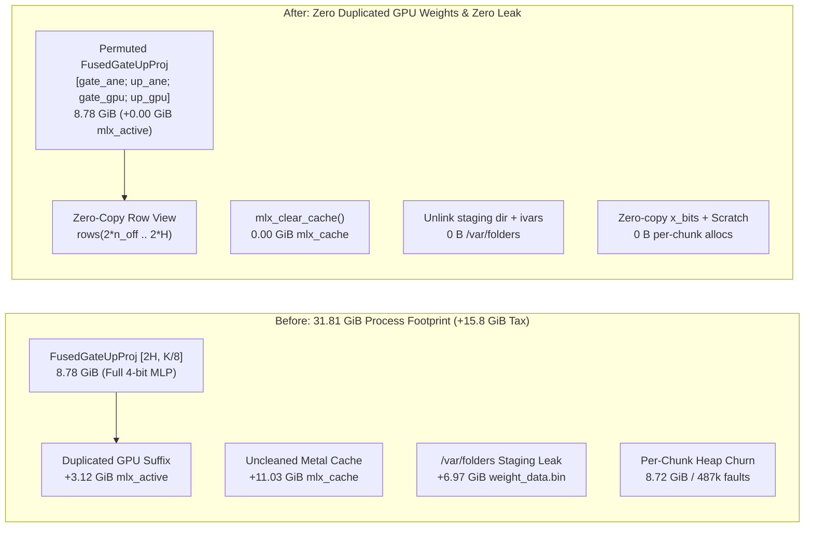

import { Aside } from '@astrojs/starlight/components';


Hybrid GPU and Apple Neural Engine (ANE) prefill on `Qwen3.8-27B-4bit` cut a `2048`-token prompt from `11.09 s` to `8.59 s` (`238.5 tok/s`). The speed was real. The memory bill was not. Arming `--ane-prefill 0.48` added **`+3.12 GiB`** to `mlx_active`, trapped **`11.85 GiB`** in `mlx_cache`, leaked **`6.97 GiB`** into `/var/folders`, churned **`8.72 GiB`** of heap per chunk, and pushed `phys_footprint` to **`31.81 GiB`**.

On `manoir`'s `64 GiB` M4 Pro Mac Mini, a `31.8 GiB` primary brain left no room for [Qui-Gon](/agents/quigon/)'s `:3301` seat and the Linux VM. Before giving up on ANE prefill on M4, we asked two questions. Why couldn't the M4 ANE read 4-bit weights directly, and how much of that `15.8 GiB` surge came from software copies?

## 1. Probing the M4 ANE (`H16G`) compiler for 4-bit weights

In `ane_shim.mm`, our MIL graphs use `constexpr_affine_dequantize` with `int8` weight blobs (`1` byte per weight plus `fp16` per-channel scale and `int8` zero-point). Offloading a `4`-bit MLX weight (`0.5` bytes per weight, `group_size=64`) to `int8` doubles its byte count (`2.20 GiB` becomes `4.39 GiB` at `frac=0.48`).

Could the M4 ANE (`H16G` on M4 Pro and M4 Max, macOS `27.2`) accept `int4` or `uint4` blobs directly? Disassembling `/System/Library/PrivateFrameworks/MIL.framework/MIL` showed that the MIL IR parser already defines 4-bit blob types (`MIL::BlobDataType::Int4 = 8`, `UInt4 = 11`) alongside `constexpr_blockwise_shift_scale` and `constexpr_lut_to_dense`. We built a four-case Objective-C++ probe against `_ANEInMemoryModel` to test every path on `H16G` silicon:

| MIL Op / Weight Format | MIL IR Validation (`modelWithMILText:`) | `H16G` Hardware Compiler (`compileWithQoS:`) | Result on M4 (`H16G`) |
|---|---|---|---|
| `constexpr_blockwise_shift_scale` (`int4`, `group_size=64`) | Passes MIL parser | `Compiler error: InvalidmilProgram` (`ANECCompile` rejects op) | **Blocked in `H16G` backend** |
| `constexpr_lut_to_dense` (`uint4` indices + `16`-entry LUT) | Passes MIL parser | `Compiler error: InvalidmilProgram` (`ANECCompile` rejects op) | **Blocked in `H16G` backend** |
| `constexpr_affine_dequantize` (`int4`, `[N, K/64]` group scale) | Rejects rank-2 scale on `axis=0` | — | **Requires 1D scale vector** |
| **`constexpr_affine_dequantize` (`int4`, `[N, 1]` per-channel scale)** | **Passes** | **`compile OK`, `load OK`, `eval OK`** (`y[0..3] = -608.0`, exact match) | **Compiles & runs natively on M4 ANE** |

The silicon gave a clear answer:

1. **The M4 ANE (`H16G`) natively compiles and runs `int4` weight blobs** (`BlobDataType::Int4 = 8`) inside `constexpr_affine_dequantize`.
2. **However, `constexpr_affine_dequantize` only accepts a 1D per-channel scale `[N, 1]` (`axis=0`)**. Because `Qwen3.8-27B-4bit` uses `group_size=64` (`80` scales per `5120`-element row), collapsing `80` group scales into one `int4` row scale drops single-layer cosine to `~0.92`. Using `int8` (`256` levels per row) preserves **`0.999960`** layer cosine and **`0.999988`** 64-layer logit cosine.

## 2. One shaft for both escapements

With `int8` required on the ANE side, we instrumented `ane_prefill_gate` with `mlx_get_active_memory()`, `mlx_get_cache_memory()`, `task_info(TASK_VM_INFO)`, and `vm_stat`. Five distinct software leaks were inflating the memory bill by more than **`3x`**:



In `qwen3_5.rs`, `Mlp::from_parts` fuses `gate_proj` (`[H, K/8]`) and `up_proj` (`[H, K/8]`) along axis `0` into `fused_gate_up` (`[2*H, K/8]`, `8.78 GiB` across 64 layers). Decode launches a single `quantized_matmul` against that tensor.

When `Mlp::build_ane_offload` split the first `n_off` rows of `gate` and `up` onto the ANE, the GPU still needed a `QuantizedLinear` (`suffix`) for the remaining `H - n_off` rows, because `up[0..n_off]` sat directly between `gate[n_off..H]` and `up[n_off..H]` inside the original layout. To bridge that gap, `build_ane_offload` called `concatenate_axis(&[g_s, u_s], 0)` and `eval()`, allocating **`+3.12 GiB`** of brand-new Metal buffers while keeping the entire `8.78 GiB` `fused_gate_up` tensor resident in memory for single-token decode.

We fixed this by permuting `self.fused_gate_up` in-place once during `build_ane_offload`:

```text
rows [0 .. n_off)             -> gate[0 .. n_off)      (ANE head)
rows [n_off .. 2*n_off)       -> up[0 .. n_off)        (ANE head)
rows [2*n_off .. n_off + H)   -> gate[n_off .. H)      (GPU suffix tail)
rows [n_off + H .. 2*H)       -> up[n_off .. H)        (GPU suffix tail)
```

Because MLX's `Array::index(2*n_off..2*H)` is a zero-copy strided view into the existing Metal buffer, constructing `suffix` as `rows(&fused.weight, 2 * n_off, 2 * H)` allocates **zero GPU bytes** (`+0.00 GiB` `mlx_active`). On short decode chunks (`L < 64`), `FusedGateUpProj::forward` splits the matmul output at `[n_off, 2 * n_off, n_off + H]` with **`0.000000` `max_abs`** deviation.

## 3. Flushing staging blobs, Metal cache, and heap churn

Four additional leaks accounted for the remaining bloat:

- **`11.85 GiB` in `mlx_cache`**: Dequantizing `112` layers to `bf16` during ANE compilation left temporary buffers pooled in Metal's allocator. Calling `mlx_clear_cache()` after `build_ane_prefill` drops `mlx_cache` to **`0.00 GiB`**.
- **`6.97 GiB` in `/var/folders`**: `[_ANEInMemoryModel compileWithQoS:options:error:]` writes `NSTemporaryDirectory()/<hexid>/weights/weight_data.bin` for `aned` and never deletes it. In `ane_shim.mm`, we now unlink that directory right after `loadWithQoS:`, clear the `_weights` and `_milText` ivars on `_ANEInMemoryModelDescriptor`, and call `unloadWithQoS:error:` on teardown.
- **`8.72 GiB` per-chunk heap churn**: Every `2048`-token prefill allocated `2.35 GiB` of `x_bits` and `6.37 GiB` of `y_bits` (`487,424` kernel zero-fill page faults per chunk, because allocations above `32 MB` bypass `libmalloc`'s magazine cache). Reinterpreting `xt.as_slice::<f16>()` zero-copy as `&[u16]`, reusing a thread-local `ANE_OUT_SCRATCH` buffer, and latching the 3-point layout check behind `ANE_LAYOUT_VERIFIED` cut per-chunk allocations to **`0 B`**.
- **`SANCTUM_MLX_ANE_QKV=0` for `64 GiB` hosts**: The `64` MLP layers carry `83%` of prefill FLOPs, whereas the `48` GatedDeltaNet `in_proj_qkv` layers save only `0.36 s` while costing `2.35 GiB` of `int8` ANE weights. Setting `SANCTUM_MLX_ANE_QKV=0` arms only the `64` MLP models (`2.90 GiB` ANE budget).

## 4. Verification on `mbp` and cutover on `manoir`

We verified all four gates with `ane_layer_probe`, `ane_prefill_gate` (`T = 2048`), and the `mlx-lm` unit suite on `mbp`, then deployed commit `fe7fc78` to `:1337` on `manoir` once the 24-hour GatedDeltaNet watch closed at `21:30 EST`:

| Metric (`Qwen3.8-27B-4bit`, `T = 2048`) | Before (`765d724`, `frac=0.48`) | After (`fe7fc78`, `frac=0.48`, MLP+QKV `112` models) | After (`fe7fc78`, `frac=0.40`, MLP-only `64` models) | Improvement |
|---|---|---|---|---|
| **`mlx_active` GPU weight delta** | `+3.12 GiB` (`15.04 -> 18.16 GiB`) | **`+0.00 GiB`** (`15.04 -> 15.04 GiB`) | **`+0.00 GiB`** (`14.10 -> 14.10 GiB`) | **`-3.12 GiB` (`100%` eliminated)** |
| **`mlx_cache` post-arm** | `11.85 GiB` | **`0.00 GiB`** | **`0.00 GiB`** | **`-11.85 GiB` Metal cache freed** |
| **Process `phys_footprint` (post-arm)** | `30.49 GiB` | **`16.13 GiB`** (`15.07 GiB` detached) | **`14.97 GiB`** | **`-14.36 to -15.52 GiB` RSS** |
| **Process `phys_footprint` (post-2048 prefill)** | `31.81 GiB` | **`20.59 GiB`** (`18.66 GiB` detached) | **`18.50 GiB`** | **`-11.22 to -13.31 GiB` RSS** |
| **`/var/folders` staging disk leak** | `6.97 GiB` (`112` `.bin` files) | **`0 B`** | **`0 B`** | **`-6.97 GiB` (`100%` eliminated)** |
| **Per-chunk user-space heap allocations** | `8.72 GiB` (`487,424` page faults) | **`0 B`** (after layer 0 warmup) | **`0 B`** (after layer 0 warmup) | **`-8.72 GiB / chunk`** |
| **Arming wall time** | `25.3–28.2 s` | `26.4 s` | **`15.2 s`** (`mbp`) / **`20.0 s`** (`manoir`) | **`-40%` arming time (MLP-only)** |
| **Short-chunk (`L = 4`) GPU fallback `max_abs`** | `0.000000` | **`0.000000`** | **`0.000000`** | **Bit-exact** |
| **64-layer logit cosine / top-1 token** | `0.999988` / `3782` (`IDENTICAL`) | **`0.999988` / `3782` (`IDENTICAL`)** | **`0.999988` / `3782` (`IDENTICAL`)** | **Zero accuracy loss** |
| **2048-token prefill wall time (`tok/s`)** | `11.09 s -> 8.59 s` (`238.5 tok/s`) | **`10.72 s -> 8.57 s` (`239.0 tok/s`, `1.251x`)** | **`10.68 s -> 8.91 s` (`229.8 tok/s`, `1.198x`)** | **Gate `GO` (`>= 1.20x`)** |

<Aside type="tip" title="Live on manoir :1337 alongside :3301">
With `SANCTUM_MLX_ANE_PREFILL=1`, `SANCTUM_MLX_ANE_FRACTION=0.40`, and `SANCTUM_MLX_ANE_QKV=0` live on `:1337` (`PID 12720`), all `64` MLP ANE models armed in `20 s` and `:1337` holds a `19.15 GiB` process footprint (including the `DFlash2` drafter and 4 prompt-cache slots), leaving **`29.3 GiB` of Castellan headroom** with `:3301` (`Ornith-1.5-9B-MLX-4bit`, `5.33 GiB`) resident beside it.
</Aside>

## Lineage

- [sanctum-mlx](/architecture/sanctum-mlx/) — the Rust MLX inference engine where zero-copy `FusedGateUpProj` row permutation (`qwen3_5.rs`) and `_ANEInMemoryModel` staging cleanup (`ane_shim.mm`) live (`sanctum-rs` commit `fe7fc78`)
- [2026-11-10: The Falcon in the Clocktower](/operations/2026-11-10-the-falcon-in-the-clocktower/) — the `:3301` cutover to `Ornith-1.5-9B-MLX-4bit` (`5.33 GiB` footprint) that freed `12 GiB` on `manoir` just before this ANE memory overhaul
- [2026-11-08: The Dragon and the Heads That Never Forgot](/operations/2026-11-08-the-dragon-and-the-heads-that-never-forgot/) — the `Qwen3.8-27B` GatedDeltaNet linear-attention architecture whose `64` layers power `:1337`

Both silicon engines now drive the same 64-layer gear train from a single 4-bit weight shaft, without a single duplicated GPU byte left on the bench.
