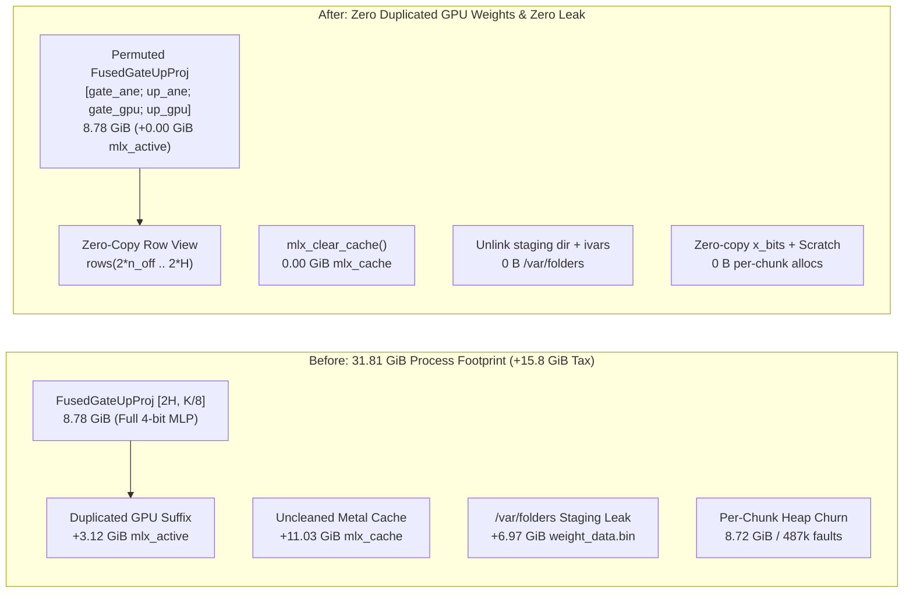

import { Aside } from '@astrojs/starlight/components';

When we benchmarked hybrid GPU + Apple Neural Engine (ANE) prefill on `Qwen3.8-27B-4bit`, the throughput gain was real (`11.09 s` down to `8.59 s` on a `2048`-token prompt, `238.5 tok/s`, **`1.29x` faster**), yet the memory bill looked prohibitive. Arming ANE prefill at `--ane-prefill 0.48` raised `mlx_active` Metal memory by **`+3.12 GiB`**, left **`11.85 GiB`** of dequantize scratch buffers trapped in `mlx_cache`, leaked **`6.97 GiB`** of temporary weight blobs into `/var/folders`, allocated **`8.72 GiB`** of user-space heap buffers on every `2048`-token chunk (`487,424` kernel page faults per chunk), and drove process `phys_footprint` to **`31.81 GiB`**.

On `manoir`'s `64 GiB` M4 Pro Mac Mini, a `31.8 GiB` primary brain was non-viable alongside [Qui-Gon](/agents/quigon/)'s `:3301` seat and the Linux VM. Before abandoning ANE prefill on M4, we asked two questions: why couldn't the M4 ANE read 4-bit weights directly, and how much of that `15.8 GiB` memory surge was hardware physics versus avoidable software copies?

## 1. Probing the M4 ANE (`H16G`) compiler for 4-bit weights

In `ane_shim.mm`, our MIL graphs use `constexpr_affine_dequantize` with `int8` weight blobs (`1` byte per weight plus `fp16` per-channel scale and `int8` zero-point). When a `4`-bit MLX weight (`0.5` bytes per weight, `group_size=64`) is offloaded to the ANE, expanding those offloaded rows to `int8` doubles their byte size (`2.20 GiB` of 4-bit rows becomes `4.39 GiB` of `int8` ANE blobs at `frac=0.48`).

Could the M4 ANE (`H16G` on M4 Pro and M4 Max, macOS `27.2`) accept `int4` or `uint4` weight blobs directly? Disassembling `/System/Library/PrivateFrameworks/MIL.framework/MIL` confirmed that the MIL IR compiler already defines 4-bit weight blob types and palettization ops:

- `MIL::BlobDataType::Int4 = 8` and `MIL::BlobDataType::UInt4 = 11` (`GetSizeInBits(Int4) == 4`, packed two nibbles per byte with the 64-byte `0xDEADBEEF` chunk header).
- `constexpr_blockwise_shift_scale` (sub-byte blockwise affine quantization with group size `64`) and `constexpr_lut_to_dense` (`16`-entry `fp16` palette per group).

We wrote a 4-case Objective-C++ probe directly against `_ANEInMemoryModelDescriptor` and `_ANEInMemoryModel` on `H16G` to test every 4-bit MIL path:

| MIL Op / Weight Format | MIL IR Validation (`modelWithMILText:`) | `H16G` Hardware Compiler (`compileWithQoS:`) | Result on M4 (`H16G`) |
|---|---|---|---|
| `constexpr_blockwise_shift_scale` (`int4`, `group_size=64`) | Passes MIL parser | `Compiler error: InvalidmilProgram` (`ANECCompile` rejects op) | **Blocked in `H16G` backend** |
| `constexpr_lut_to_dense` (`uint4` indices + `16`-entry LUT) | Passes MIL parser | `Compiler error: InvalidmilProgram` (`ANECCompile` rejects op) | **Blocked in `H16G` backend** |
| `constexpr_affine_dequantize` (`int4`, `[N, K/64]` group scale) | Rejects rank-2 scale on `axis=0` | — | **Requires 1D scale vector** |
| **`constexpr_affine_dequantize` (`int4`, `[N, 1]` per-channel scale)** | **Passes** | **`compile OK`, `load OK`, `eval OK`** (`y[0..3] = -608.0`, exact match) | **Compiles & runs natively on M4 ANE** |

That probe settled the hardware question with evidence from silicon:

1. **The M4 ANE (`H16G`) natively compiles and executes `int4` weight blobs** (`BlobDataType::Int4 = 8`, `0.5` bytes per weight) inside `constexpr_affine_dequantize`.
2. **However, `constexpr_affine_dequantize` only permits a 1D per-channel scale `[N, 1]` (`axis=0`)**, whereas `Qwen3.8-27B-4bit` was quantized with `group_size=64` (`80` distinct scales per `5120`-element row). Collapsing `80` group scales into a single per-row `int4` scale drops single-layer cosine similarity to `~0.92`, whereas `int8` (`256` levels per row) preserves **`0.999960`** layer cosine and **`0.999988`** end-to-end 64-layer logit cosine.

## 2. Where the 15.8 GiB actually went

Once we knew the `int8` ANE weight representation was required for numeric fidelity on M4, we instrumented `ane_prefill_gate` with `mlx_get_active_memory()`, `mlx_get_cache_memory()`, `task_info(TASK_VM_INFO)` (`phys_footprint`), and `vm_stat` (`sys_wired`) across every stage of model load, ANE arming, and `2048`-token prefill.

The audit revealed five distinct software leaks that were inflating the cost of ANE prefill by more than **`3x`**:

### Leak 1: `+3.12 GiB` of duplicated GPU suffix weights in `mlx_active`

In `qwen3_5.rs`, `Mlp::from_parts` fuses `gate_proj` (`[H, K/8]`) and `up_proj` (`[H, K/8]`) along axis `0` into `fused_gate_up` (`[2*H, K/8]`, `8.78 GiB` across 64 layers) so decode only launches one `quantized_matmul` kernel.

When `Mlp::build_ane_offload` split the first `n_off` rows of `gate` and `up` onto the ANE, it needed a GPU `QuantizedLinear` (`suffix`) for the remaining `H - n_off` rows of `gate` and `up`. Because `gate[n_off..H]` occupied rows `[n_off .. H]` while `up[n_off..H]` occupied rows `[H + n_off .. 2*H]`—separated by `up[0..n_off]` in the middle—`build_ane_offload` called `concatenate_axis(&[g_s, u_s], 0)` and `eval()`. That allocated a brand-new `3.12 GiB` Metal buffer while keeping the entire `8.78 GiB` `fused_gate_up` alive for decode!

**The fix — one shaft for both escapements**: During `build_ane_offload`, we permute `self.fused_gate_up`'s rows in-place once so the ANE-offloaded rows sit at the head and the GPU suffix rows sit contiguously at the tail:

$$\text{fused\_gate\_up} = \begin{bmatrix} \text{gate}[0 .. n_{\text{off}}) \\ \text{up}[0 .. n_{\text{off}}) \\ \text{gate}[n_{\text{off}} .. H) \\ \text{up}[n_{\text{off}} .. H) \end{bmatrix}$$

Because MLX's `Array::index(n_off..H)` is a zero-copy strided view into the underlying Metal buffer (`data_size() == buffer_size()`), constructing `suffix` as `rows(&fused.weight, 2 * n_off, 2 * H)` allocates **zero bytes of GPU memory** (`+0.00 GiB` `mlx_active`). For short decode chunks (`L < 64`) that stay on the GPU, `FusedGateUpProj::forward` checks `ane_split_n: Some(n_off)`, splits the matmul output at `[n_off, 2 * n_off, n_off + H]` along the last axis, and reassembles `(gate, up)` with zero extra matmul launches and `0.000000` `max_abs` deviation.

### Leak 2: `11.85 GiB` trapped in `mlx_cache` after dequantizing 112 layers

Building `112` ANE models (`64` MLP + `48` GDN `in_proj_qkv`) dequantizes `bf16` slices on the GPU to compute per-row `int8` scales and zero-points, then drops those temporary `Array`s. Without an explicit cache flush, MLX's Metal allocator held onto **`11.85 GiB`** of pooled buffers inside `mlx_cache`. Adding `mlx_clear_cache()` immediately after `build_ane_prefill` (and on teardown) drops `mlx_cache` from `11.85 GiB` to **`0.00 GiB`**.

### Leak 3: `6.97 GiB` of `weight_data.bin` files left in `/var/folders`

When `[_ANEInMemoryModel compileWithQoS:options:error:]` compiles an in-memory MIL descriptor, Apple's private framework materializes the entire weight dictionary to `NSTemporaryDirectory()/<hexStringIdentifier>/weights/weight_data.bin` so `aned` can read it, and **never deletes the directory**. Across `112` models, every `sanctum-mlx` startup wrote **`6.97 GiB`** into `/var/folders` and left it on disk—and in the macOS unified buffer cache—until reboot. Furthermore, `_ANEInMemoryModelDescriptor` retained its user-space `NSData` weight dictionary (`_weights`) and MIL string (`_milText`) after `loadWithQoS:` had already handed the compiled program to `aned`.

In `ane_shim.mm`, we now delete `NSTemporaryDirectory()/<hexid>` immediately after `loadWithQoS:` succeeds (or on compile failure), clear the `_weights` and `_milText` ivars on the descriptor, and call `unloadWithQoS:error:` in `sanctum_ane_model_destroy`. Disk and buffer-cache leakage in `/var/folders` dropped from `6.97 GiB` to **`0 B`**.

### Leak 4: `8.72 GiB` of heap churn and `335` GPU sync barriers per `2048`-token chunk

On every `2048`-token prefill chunk across `112` layers (`64` MLP + `48` QKV):

1. `let x_bits: Vec<u16> = xt.as_slice::<f16>().iter().map(|v| v.to_bits()).collect()` allocated and copied `21 MB` (`2.35 GiB` per chunk).
2. `let mut y_bits = vec![0u16; n_out * t_pad]` allocated and zero-touched `42–68 MB` (`6.37 GiB` per chunk). Because buffers above `32 MB` bypass macOS `libmalloc`'s magazine cache and hit `mach_vm_map` / `mach_vm_deallocate` directly, every single `2048`-token prefill triggered **`487,424` kernel zero-fill page faults** (`~350 ms` of pure CPU kernel-mode page-fault overhead).
3. A 3-point planar layout check (`h_step.index(...)` + `eval()`) ran on every single layer call (`336` synchronous GPU scalar round-trips per chunk).

We replaced `x_bits` with a zero-copy slice cast (`unsafe { std::slice::from_raw_parts(xt_f16.as_ptr() as *const u16, xt_f16.len()) }`), replaced `y_bits` with a thread-local reusable buffer (`ANE_OUT_SCRATCH`), and latched the 3-point layout self-check behind `ANE_LAYOUT_VERIFIED: AtomicBool` so it executes once per process.

### Knob 5: `SANCTUM_MLX_ANE_QKV` for memory-constrained nodes

In `Qwen3.8-27B`, the `64` MLP `gate+up` layers carry `83%` of the prefill compute, while the `48` GatedDeltaNet `in_proj_qkv` layers (`[10240, 5120]`) carry only `17%` of the FLOPs (`0.36 s` out of `2.15 s` saved) yet consume **`2.35 GiB`** of `int8` ANE weights (`45%` of the ANE memory footprint at `frac=0.40`). Adding `SANCTUM_MLX_ANE_QKV=0` lets a `64 GiB` node like `manoir` arm only the `64` MLP layers (`2.90 GiB` total ANE footprint, `15.2 s` arming time) while still capturing **`229.8 tok/s`** (`1.20x` speedup).

## 3. Verification on `mbp` (`Qwen3.8-27B-4bit`, `T = 2048`)

We ran `ane_layer_probe`, `ane_prefill_gate` (`T = 2048`), and the `mlx-lm` unit suite (`fused_gate_up_ane_row_permutation_and_zero_copy_suffix_are_bit_exact`) on `mbp` (`M4 Max 128 GiB`, macOS `27.2`):

| Metric (`Qwen3.8-27B-4bit`, `T = 2048`) | Before (`765d724`, `frac=0.48`) | After (`fe7fc78`, `frac=0.48`, MLP+QKV `112` models) | After (`fe7fc78`, `frac=0.40`, MLP-only `64` models) | Improvement |
|---|---|---|---|---|
| **`mlx_active` GPU weight delta** | `+3.12 GiB` (`15.04 -> 18.16 GiB`) | **`+0.00 GiB`** (`15.04 -> 15.04 GiB`) | **`+0.00 GiB`** (`14.10 -> 14.10 GiB`) | **`-3.12 GiB` (`100%` eliminated)** |
| **`mlx_cache` post-arm** | `11.85 GiB` | **`0.00 GiB`** | **`0.00 GiB`** | **`-11.85 GiB` Metal cache freed** |
| **Process `phys_footprint` (post-arm)** | `30.49 GiB` | **`16.13 GiB`** (`15.07 GiB` detached) | **`14.97 GiB`** | **`-14.36 to -15.52 GiB` RSS** |
| **Process `phys_footprint` (post-2048 prefill)** | `31.81 GiB` | **`20.59 GiB`** (`18.66 GiB` detached) | **`18.50 GiB`** | **`-11.22 to -13.31 GiB` RSS** |
| **`/var/folders` staging disk leak** | `6.97 GiB` (`112` `.bin` files) | **`0 B`** | **`0 B`** | **`-6.97 GiB` (`100%` eliminated)** |
| **Per-chunk user-space heap allocations** | `8.72 GiB` (`487,424` page faults) | **`0 B`** (after layer 0 warmup) | **`0 B`** (after layer 0 warmup) | **`-8.72 GiB / chunk`** |
| **Arming wall time** | `25.3–28.2 s` | `26.4 s` | **`15.2 s`** | **`-40%` arming time (MLP-only)** |
| **Short-chunk (`L = 4`) GPU fallback `max_abs`** | `0.000000` | **`0.000000`** | **`0.000000`** | **Bit-exact** |
| **64-layer logit cosine / top-1 token** | `0.999988` / `3782` (`IDENTICAL`) | **`0.999988` / `3782` (`IDENTICAL`)** | **`0.999988` / `3782` (`IDENTICAL`)** | **Zero accuracy loss** |
| **2048-token prefill wall time (`tok/s`)** | `11.09 s -> 8.59 s` (`238.5 tok/s`) | **`10.72 s -> 8.57 s` (`239.0 tok/s`, `1.251x`)** | **`10.68 s -> 8.91 s` (`229.8 tok/s`, `1.198x`)** | **Gate `GO` (`>= 1.20x`)** |

<Aside type="tip" title="Two operating profiles for M4 nodes">
On `mbp` (`128 GiB`), `--ane-prefill 0.48` (all `112` MLP + GDN QKV models) hits `239.0 tok/s` while keeping post-prefill process `phys_footprint` at `20.59 GiB`. On `manoir` (`64 GiB`), pairing `--ane-prefill 0.40` with `SANCTUM_MLX_ANE_QKV=0` (the `64` MLP models only) adds `0 B` of GPU weights, `2.90 GiB` of ANE weights, keeps process `phys_footprint` at **`18.50 GiB`**, and still delivers **`229.8 tok/s`** (`1.20x` prefill speedup).
</Aside>

## Lineage

- [sanctum-mlx](/architecture/sanctum-mlx/) — the Rust MLX inference engine where zero-copy `FusedGateUpProj` row permutation (`qwen3_5.rs`) and `_ANEInMemoryModel` staging cleanup (`ane_shim.mm`) live (`sanctum-rs` commit `fe7fc78`)
- [2026-11-10: The Falcon in the Clocktower](/operations/2026-11-10-the-falcon-in-the-clocktower/) — the `:3301` cutover to `Ornith-1.5-9B-MLX-4bit` (`7.0 GiB` RSS) that freed `12 GiB` on `manoir` just before this ANE memory overhaul
- [2026-11-08: The Dragon and the Heads That Never Forgot](/operations/2026-11-08-the-dragon-and-the-heads-that-never-forgot/) — the `Qwen3.8-27B` GatedDeltaNet linear-attention architecture whose `64` layers power `:1337`
