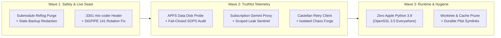

import { Aside } from '@astrojs/starlight/components';

Every mature autonomous haus accumulates quiet drift at the seams. Individual cutovers succeed—[Ornith-1.5-9B-MLX-4bit](/operations/2026-11-10-the-falcon-in-the-clocktower/) lands on `:3301`, [ANE prefill](/operations/2026-11-10-one-shaft-two-escapements/) cuts `:1337` memory in half, [Ahsoka](/agents/ahsoka/) upgrades at the [pine outpost](/operations/2026-11-11-the-falcon-at-the-pine-outpost/)—yet the surrounding sentinels, healers, backup bridges, and LaunchAgents keep carrying assumptions from three architectures ago.

So we audited the whole watchtower. Across `234` LaunchAgents, `51` service-graph manifests, `sanctum-cli`, the `sanctum-vm` continuity bridge, secret rotation, and disk hygiene on `manoir`, fourteen seams surfaced. None had brought the cathedral down. Several safety nets, however, were failing in silence or reporting green for the wrong reason. Three waves closed all fourteen.

## 1. Closing the silent safety seams

The highest-priority findings were places where a security boundary or a live inference seat had drifted beneath the floorboards:

1. **Nested submodule history hygiene**: After `sanctum-docs` rewrote its git history to scrub legacy personal telemetry, the primary documentation checkout was reset cleanly, but a nested submodule inside the workspace umbrella still held the pre-rewrite commit graph in its local object pack. A stray push from that submodule would have reintroduced the excised blobs. Resetting the submodule to `origin/main`, expiring reflogs immediately, and running `git gc --prune=now` eliminated the orphan objects permanently.
2. **State backup redaction and `git-lfs` under `cron`**: On `sanctum-vm`, `backup.sh` sealed credential files inside an AES-256 `vault.enc` archive, yet also copied unredacted configuration JSON and container environment inventories into the plain `backup/state/` tree—right where the pre-commit secret scanner rightly refused every 04:00 bridge commit. Compounding the jam, `qui_gon_backup_bridge.sh` ran under `cron`'s minimal `/usr/bin:/bin` `PATH`, hiding Homebrew's `git-lfs` hook, while a `tee` wrapper duplicated every log line and exited `0` even when `git push` failed. Staging full configs strictly inside `vault.enc`, deterministically redacting `22` credential fields in `backup/state/` before manifest hashing, guarding stale `Neo4j` dumps, and enforcing non-zero exit tracking flushed the five-day queue cleanly.
3. **Restoring `:3301` supervision and curing `SIGPIPE` (`141`)**: [Qui-Gon](/agents/quigon/)'s fast coding seat (`haus.sanctum.mlx-coder`, serving `Ornith-1.5-9B-MLX-4bit` on `:3301`) had been unloaded after a clean shutdown, and both `services/codestral.yaml` and the R2-D2 healer script still targeted the retired `haus.sanctum.mlx-codestral` label. Updating the manifest and healer brought `service-graph.py check-all` back to **`51/51` healthy**. Meanwhile, `haus.sanctum.rotate-secrets` was exiting `141` (`128 + SIGPIPE`) because `rotate-secrets.sh` piped multi-line command output into `head -1` under `set -euo pipefail` from an untracked script outside git. Moving the script into `~/.sanctum/scripts/secret-rotator/rotate-secrets.sh`, symlinking the legacy path, and replacing early-closing `head` pipes with `awk 'NR==1'` turned rotation green.

## 2. Teaching monitors to refuse false green

A monitor that says `OK` without reading the real substrate is worse than no monitor at all. Wave 2 eliminated four false-green and false-red blind spots across the watchtower:

- **Measuring APFS `/System/Volumes/Data` instead of `/`**, so the morning briefing reports actual storage consumption on macOS's writable data volume rather than the `9%` sealed OS snapshot.
- **Failing closed in `sync-secrets-audit.sh`**: Over non-interactive SSH, `sops -d` on `sanctum-vm` missed `SOPS_AGE_KEY_FILE`, returned an empty string, and caused key comparisons to skip silently with `0` drift. Passing the explicit age key path with `ConnectionAttempts=3` and incrementing `DRIFT` whenever decryption is empty ensures [Windu](/agents/windu/) only certifies parity when ciphertext actually opens.
- **Routing `sanctum-cli` Gemini probes through `:6543`**: `sanctum doctor` previously demanded a metered Google AI Studio keychain credential even though the haus runs subscription-first through `sanctum-agy-proxy` on `127.0.0.1:6543`. Adding `via: proxy` support to `GeminiProvider` and parallelizing `--compact` restic snapshot checks with a `25 s` cloud timeout turned both `sanctum doctor` and `sanctum status` green at `$0` marginal cost.
- **Scoping `leak_sentinel.py` by file path and tolerating Latin-1 history**: Previously, `git log --all -p` crashed with `UnicodeDecodeError` on `11` repositories containing historical non-UTF-8 bytes, while deliberate unit-test PEM headers in scanner test suites tripped nightly alerts. Decoding history streams with `errors="replace"`, anchoring the `AKIA` pattern against base64 substrings, and introducing `<provider>:path:<repo>:<file>` fixture rules gave `leak-sentinel` complete `48`-repo history coverage with zero false positives.

<Aside type="tip" title="Never global-allowlist a PEM header">
A PEM detector matches the literal `BEGIN ... PRIVATE KEY` banner, which hashes to the exact same redacted hint for every SSH key on earth. Allowlisting that hint globally would blind the scanner forever; scoping `private_key:path:<repo>:<test_file>` silences the unit-test fixture while keeping `private_key` armed everywhere else—and keeping non-PEM detectors armed inside that very test file.
</Aside>

## 3. Hardening Triage, PSTN canaries, and Chaos Forge

With secret and backup telemetry truthful, we turned to the active resilience loops:

- **Eliminating ghost `Docker.app` probes and Castellan socket churn**: `sanctum-triage` (`sanctum-rs` commit `5485c9f`) retired its legacy macOS `docker inspect` sleeper loop (containers live on `sanctum-vm` under Lima `vz`), switched Health Center recovery to `launchctl kickstart`, and hardened Castellan `:2189/status` polling with `pool_max_idle_per_host(0)` and bounded retries so transient memory-pressure ticks never masquerade as daemon outages. Note that deploying rebuilt Mach-O binaries on arm64 macOS requires writing to a fresh inode (`cp` to `.new`, `codesign -s - -f`, then atomic `mv`) so the kernel vnode signature cache never `SIGKILL`s (`-9`) the daemon on respawn.
- **Unpoisoning [Yoda](/agents/yoda/)'s PSTN canary and SSH multiplex capacity**: Removing placeholder `SET_BEFORE_BOOTSTRAP` environment overrides from `haus.sanctum.yoda-canary-pstn.plist` let `canary_pstn.py` read `~/.sanctum/secrets/yoda-config.sh` cleanly (`answered_calls_14d=13`), while raising `MaxStartups 64:30:128` in `/etc/ssh/sshd_config.d/99-sanctum-tuning.conf` on `sanctum-vm` stopped concurrent tunnel probes from dropping `haus.sanctum.health-tunnel`.
- **Modernizing Chaos Forge**: `fire-drill.sh` (`openclaw-skills` commit `babd72b`) had been failing since November 1 because `chaos-verify.sh` interpolated bash `false` into Python (`NameError`) and its scenarios still targeted retired `sanctum-admit`, `bridge100`, and `50 GiB` `/tmp` `dd` writes. All four scenarios now exercise live Castellan `:2189` admission refusal, SQLite `anomaly-detect.py` thresholds, and isolated `service-graph.py` root-cause and crash-loop quarantine gates in `8 s`.

## 4. Retiring Apple Python 3.9 and reclaiming the workbench

Wave 3 swept out the last structural cobwebs across the workstation:

| Seam | Before Audit | After Wave 3 |
| :--- | :--- | :--- |
| **`sanctum doctor`** | `234` agents: `5` degraded, `2` failed; Gemini `FAILED` | `234` agents, `3` providers, `2` repos: **`0` degraded, `0` failed** |
| **`service-graph.py check-all`** | `50/51` (`:3301` down, retired healer label) | **`51/51` healthy** |
| **Apple `/usr/bin/python3` (`3.9.6`)** | `10` live LaunchAgents on `LibreSSL 2.8.3` | **`0` LaunchAgents** (`OpenSSL 3.5+` on Python `3.12`/`3.14`) |
| **Git worktrees & board claims** | `14` stale worktrees; `139` epoch-`0` board ghosts | **`0` redundant worktrees**; live `board` view clean |
| **Coding harness default** | Metered OpenRouter fallback documented in `AGENTS.md` | **`$0` local Claude Max bridge (`:3456`)** everywhere |

Upgrading those ten LaunchAgents exposed a subtle trap. `haus.sanctum.reranker` imported `sentence_transformers` from `~/Library/Python/3.9`'s user site-packages, so pointing it blindly at Homebrew Python would have crashed on the first rerank request. We provisioned a dedicated Python `3.12` `reranker-venv` (`OpenSSL 3.5.4`) first. Every import stayed intact. On disk, pinning two detached experimental commits to an archive branch ref before pruning fourteen merged git worktrees, clearing intermediate `sanctum-rs` debug artifacts, and sweeping stale runner upgrades reclaimed over **`32 GiB`** on `/System/Volumes/Data` without touching a single model weight.

[Tommy](/agents/tommy/) never moved from the blueprint. A cathedral earns its calm not on the day a new model lands, but on the afternoon someone checks every bolt behind the wainscoting and proves—from disk—that nothing is pretending.
