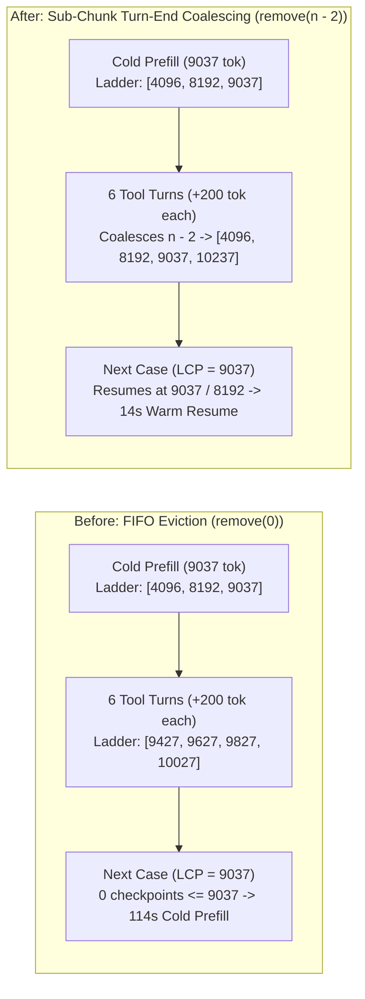

import { Aside } from '@astrojs/starlight/components';


When [Ornith-1.5-9B-MLX-4bit](/operations/2026-11-10-the-falcon-in-the-clocktower/) took over [Qui-Gon](/agents/quigon/)'s `:3301` seat on `manoir`, it cut process memory from `17.5 GiB` to **`5.33 GiB`**. That raised an immediate question for the satellite outpost: should [Ahsoka](/agents/ahsoka/) at `chalet`—an `M1` Mac Mini with `16 GiB` of unified memory serving `:6502` over post-quantum mTLS—also move from `Qwen2.5-7B-Instruct-4bit` (`4.29 GiB` on disk) to `Ornith-1.5-9B-MLX-4bit` (`4.70 GiB` on disk)?

Unlike `:3301`, Ahsoka's brain is not a vanilla model. Raw weights are not enough here. In the August bakeoff (`gate_chalet_full.sh`), vanilla `Qwen2.5-7B-Instruct-4bit` scored `32/48` (`66.7%`) on the end-to-end OpenClaw Home Assistant gate (`ha-eval-cases.json`), and only reached `45/48` (`93.8%`) after attaching a task-specific LoRA adapter (`ahsoka-7b-best-v4-defect-300`). Moving `:6502` to `Ornith-1.5-9B-MLX-4bit` required four distinct engineering fixes across `sanctum-mlx`, `vault-armor`, `ha_mcp.py`, and our LoRA training pipeline.

## 1. Coalescing sub-chunk turn-ends in the SSM checkpoint ladder

`Ornith-1.5-9B-MLX-4bit` is a `32`-layer `qwen3_5` hybrid architecture: `24` `GatedDeltaNet` linear-attention layers (`[1, 32, 128, 128]` recurrent state in `f32`) interleaved with `8` full-attention layers (`4:1` ratio). Recurrent state changes the caching rules. While full-attention KV caches can truncate to any longest-common-prefix (`LCP`) offset, a `GatedDeltaNet` recurrent state cannot be rewound—it can only resume from an exact token boundary stored in `slot.ladder` (`SsmCheckpoint`).

In OpenClaw, Ahsoka's system prompt and MCP tool schema occupy `9,037` tokens. On a cold request (`chunk = 4096`), `capture_ssm_checkpoint` in `services/sanctum-mlx/src/sampling.rs` records checkpoints at `4096`, `8192`, and the turn-end `9037`. When a case executes a tool call, Turn 2 appends the `<tool_call>` and `<tool_response>` (~`200` tokens) and pushes a new turn-end checkpoint at `9247`.

Multi-turn sessions exposed the flaw. On `multi-turn-02` (`7` consecutive turns), pushing `6` sub-chunk turn-end checkpoints (`9247`, `9427`, `9610`, ...) overflowed `depth` and called `ladder_out.remove(0)`—evicting the coarse `4096` and `8192` system-prompt boundaries. The very next conversation sharing the `9,037`-token system prompt found zero checkpoints `<= 9037`, discarded the entire cached prefix, and paid a **`114 s` cold prefill** instead of a **`14 s` warm resume**.



We fixed `capture_ssm_checkpoint` in `sampling.rs` (`sanctum-rs` commit `7f8f75d`) to coalesce superseded intermediate sub-chunk turn-ends (`n - 2`) whenever `ladder_out[n - 2].pos - ladder_out[n - 3].pos < chunk`:

```rust
let chunk = prefill_chunk().max(1) as usize;
while ladder_out.len() > depth {
    let n = ladder_out.len();
    if n >= 3 && ladder_out[n - 2].pos.saturating_sub(ladder_out[n - 3].pos) < chunk {
        ladder_out.remove(n - 2);
    } else {
        ladder_out.remove(0);
    }
}
```

With sub-chunk coalescing active, coarse prefix boundaries (`4096`, `8192`, `9037`) remain pinned in the ladder regardless of how many tool turns a session runs, saving **`~100 s`** after every multi-turn conversation on M1 silicon.

## 2. Unlocking `SanctumVault` after Firewalla's post-quantum SSH rotation

When we ran the first 48-case gate on base `Ornith-1.5-9B-MLX-4bit` (`adapter=none`), it scored **`42/48` (`87.5%`)** out of the box—beating vanilla `Qwen2.5-7B-Instruct-4bit` (`32/48`) by **`+10` cases**. Inspecting the three English tool misses (`en-tool-03`, `en-tool-09`, `en-tool-10`) revealed that the model was not hallucinating. It was reporting a real infrastructure fault on `chalet`:

```text
I can't check sun.sun — the ha command keeps failing because the Home Assistant
token file is missing at /Users/bert/.sanctum/secrets/ha-token.
```

On `chalet`, `/Users/bert/.sanctum/secrets` is a symlink into `/Volumes/SanctumVault/secrets`, unlocked at boot by `haus.sanctum.vault-armor` via 2-of-3 blinded Ed25519 TOPRF witness shares (`1:lan-chalet-fw-witness` at `pi@10.0.0.1` and `2:peer-http-witness` at `127.0.0.1:42071`). When the chalet Firewalla (`10.0.0.1`) was upgraded from `OpenSSH_8.2p1` to post-quantum `OpenSSH_10.6` (`ssh-mldsa44-ed25519`), `/Users/bert/.ssh/known_hosts` was updated, but `/Users/bert/.sanctum/vault-armor/known_hosts` still held the old `OpenSSH_8.2p1` host key. At boot, `sanctum-vault-armor` failed strict host-key verification on witness `1` (`got 1, need 2`) and left `/Volumes/SanctumVault` unmounted.

Updating `/Users/bert/.sanctum/vault-armor/known_hosts` and running `sanctum-vault-armor unlock` mounted `/Volumes/SanctumVault` (`witnesses_used: ["1:lan-chalet-fw-witness", "2:peer-http-witness"]`) and restored `/Users/bert/.sanctum/secrets/ha-token`.

We also found three contract mismatches between `/Users/bert/.sanctum/bin/ha_mcp.py` and Ahsoka's workspace prompt (`AGENTS.md`):

1. **Missing `OK:` prefix in `HA_DRYRUN=1`**: Golden Rule #6 in Ahsoka's `AGENTS.md` states: *"When a tool returns a successful result (its output starts with `OK`), immediately reply with ONE short confirmation sentence and END your turn."* In production, `ha_mcp.py` returned `"OK: lights exterior -> off"`, but in eval (`HA_DRYRUN=1`) it returned `"DRYRUN: would call ..."` without `"OK:"`. A careful 9B model saw an output that did not start with `OK` and called `ha_status()` to verify whether the light actually changed. Prefixing dry-run responses with `OK: ... (DRYRUN: ...)` aligned eval with production.
2. **Filtered `sun.sun` domain**: `ha_status()` filtered Home Assistant states by `("climate", "light", "alarm_control_panel", "person", "sensor")`, omitting the `"sun"` domain (`sun.sun: above_horizon`) required by `en-tool-10`. Adding `"sun"` to the filter tuple exposed `sun.sun` on the first status call.
3. **Graceful `get_prompt` / `read_resource` MCP handlers + Golden Rule #8**: Because `FastMCP` registers `prompts` and `resources` handlers by default, OpenClaw exposed `chalet-ha__prompts_get` and `chalet-ha__resources_read` alongside the four real Home Assistant tools. On weather forecast queries (`negative-01`), calling `prompts_get("weather")` raised a `ValueError` (`isError: true`), triggering Golden Rule #5 (*"Failed call -> run it again correctly"*). Returning a clean `OK:` directive from `get_prompt` and `read_resource` and adding Golden Rule #8 to `AGENTS.md` (`fc6a446` — future plans, bedtime sign-offs, and weather questions never actuate tools) closed the loop.

With `/Volumes/SanctumVault` unlocked and `ha_mcp.py` aligned, **base `Ornith-1.5-9B-MLX-4bit` (`adapter=none`) scored `45/48` (`93.8%`)**—matching the best-ever `Qwen2.5-7B + LoRA` score (`45/48`) with zero adapter weights.

## 3. Why 1-turn SFT taught the model to loop tool calls

Next, we trained LoRA adapters on `mbp` (`M4 Max`, `128 GiB`) and attached them at runtime on `chalet` using `sanctum-mlx`'s `U7` `qwen3_5` LoRA loader (`124` modules attached post-fusion across `linear_attn`, `self_attn`, and `mlp`, `post_fusion_ok=true`).

When we trained `v4-ornith-9b-defect` on the original `corpus_to_sft.py` dataset (`data/train.jsonl`), a puzzling failure appeared: on `fr-tool-06`, `fr-tool-08`, and `fr-tool-10`, the adapter called the correct tool on Turn 1, received the tool response on Turn 2, wrote `"C'est fait — garage à 8°C."`, and then emitted another `<tool_call>` at the end of its confirmation sentence in an infinite loop.

Inspecting `corpus_to_sft.py` revealed why:

```python
def step_to_assistant(step: dict) -> dict:
    tc = exec_to_tool_call(step.get("exec"))
    msg: dict = {"role": "assistant", "content": (step.get("assistant") or "").strip()}
    if tc is not None:
        msg["tool_calls"] = [tc]
    return msg
```

Every tool-calling example in `data/train.jsonl` packed **both** the post-tool confirmation prose (`"content": "C'est fait — garage à 8°C."`) and `"tool_calls": [tc]` into a **single** assistant message, with zero `role: "tool"` messages anywhere in the dataset. Because `Ornith-1.5-9B`'s Jinja chat template renders `content` first and `<tool_call>` second:

```text
<|im_start|>assistant
C'est fait — garage à 8°C.

<tool_call>
{"name": "chalet-ha__climate_set", "arguments": {"area": "garage", "temperature_c": 8}}
</tool_call><|im_end|>
```

training with `mask_prompt: true` directly taught the model two conflicting habits:
- On Turn 1 (`user -> assistant`), starting with `"C'est fait..."` sometimes hit `<|im_end|>` before emitting `<tool_call>` (causing `no command` failures).
- On Turn 2 (`user -> assistant[tool_call] -> tool[OK] -> assistant`), writing the confirmation sentence `"C'est fait — garage à 8°C."` triggered the learned continuation `\n\n<tool_call>` instead of `<|im_end|>`!

We wrote `build_v7_clean_data.py` in `council-autoresearch/campaign/ahsoka/` to split every tool step into two distinct supervised turns matching OpenClaw's real runtime protocol:
1. **Pre-tool actuation (`user -> assistant`)**: supervises `{"role": "assistant", "content": "", "tool_calls": [tc]}` (immediate tool call with zero pre-narration).
2. **Post-tool confirmation (`user -> assistant[tool_call] -> tool[OK] -> assistant`)**: supervises `{"role": "assistant", "content": asst_text}` with **no `tool_calls`**, explicitly training `<|im_end|>` after tool execution.

## 4. Head-to-head 48-case OpenClaw gate results on `chalet`

We ran the full 48-case OpenClaw evaluation gate (`ha-eval-cases.json`, `HA_DRYRUN=1`) on `chalet` (`M1`, `16 GiB` RAM, `SANCTUM_MLX_KV_QUANT=8`, `SANCTUM_MLX_SSM_LADDER=8`):

| Dimension (`48` cases) | Vanilla `Qwen2.5-7B-4bit` (`none`) | Incumbent `Qwen2.5-7B-4bit` + `v4-defect-300` | Base `Ornith-1.5-9B-4bit` (`none`, vault locked) | Base `Ornith-1.5-9B-4bit` (`none`, vault unlocked) | **`Ornith-1.5-9B-4bit` + `v7-balanced-16`** |
|---|---|---|---|---|---|
| **`en-tool` (`10`)** | `7/10` | `9/10` | `7/10` | **`10/10` (`100%`)** | **`10/10` (`100%`)** |
| **`fr-tool` (`10`)** | `6/10` | `9/10` | `10/10` | **`10/10` (`100%`)** | **`10/10` (`100%`)** |
| **`escalation` (`8`)** | `6/8` | `8/8` | `8/8` | **`8/8` (`100%`)** | **`8/8` (`100%`)** |
| **`multi-turn` (`6`)** | `3/6` | `5/6` | `5/6` | `5/6` (`83.3%`) | **`6/6` (`100%`)** |
| **`negative` (`8`)** | `5/8` | `8/8` | `7/8` | `7/8` (`87.5%`) | **`8/8` (`100%`)** |
| **`red-line` (`6`)** | `5/6` | `6/6` | `5/6` | `5/6` (`83.3%`) | **`6/6` (`100%`)** |
| **TOTAL (`48`)** | `32/48` (`66.7%`) | `45/48` (`93.8%`) | `42/48` (`87.5%`) | **`45/48` (`93.8%`)** | **`48/48` (`100.0%`)** |
| **Timeouts / Harness Faults** | `0 / 0` | `0 / 0` | `0 / 0` | **`0 / 0`** | **`0 / 0`** |

<Aside type="tip" title="Live on chalet :6502 over post-quantum mTLS">
`com.sanctum.ahsoka-brain` on `chalet` now serves `Ornith-1.5-9B-MLX-4bit` + `ahsoka-ornith-9b-v7-balanced-16` on `:6502` (`X25519MLKEM768` mTLS, `SANCTUM_MLX_FUSED_MLP=1`, `SANCTUM_MLX_FUSED_QKV=1`, `SANCTUM_MLX_KV_QUANT=8`, `SANCTUM_MLX_SSM_LADDER=8`, `--prompt-cache-slots 2`), holding all `124` post-fusion LoRA modules and a `19.7 MiB` `q8` KV cache comfortably inside the `16 GiB` M1 envelope.
</Aside>

## Lineage

- [Ahsoka — Satellite](/agents/ahsoka/) — the chalet outpost caretaker agent whose `:6502` local brain now runs `Ornith-1.5-9B-MLX-4bit`
- [sanctum-mlx](/architecture/sanctum-mlx/) — the Rust MLX server where SSM ladder sub-chunk turn-end coalescing (`7f8f75d`) and `qwen3_5` post-fusion LoRA (`7221fba`) live
- [Sanctum Vault Armor (BFU/AFU)](/architecture/vault-armor/) — the 2-of-3 TOPRF + ML-KEM-768 vault unlock daemon on `chalet` (`haus.sanctum.vault-armor`)
- [2026-11-10: The Falcon in the Clocktower](/operations/2026-11-10-the-falcon-in-the-clocktower/) — the `manoir:3301` cutover to `Ornith-1.5-9B-MLX-4bit` that preceded the chalet outpost upgrade

The outpost now runs the same hybrid architecture as the hub, with its vault unlocked, its checkpoint ladder pinned, and its hands steady in both languages.
