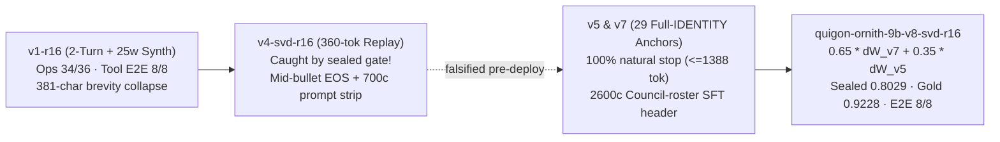

import { Aside } from '@astrojs/starlight/components';


When [Ahsoka](/agents/ahsoka/) moved to `Ornith-1.5-9B-MLX-4bit` at `chalet`, raw weights reached `45/48`, and a two-turn LoRA closed `48/48`. That immediately posed the reverse question on `manoir`. [Qui-Gon](/agents/quigon/) already ran the exact same `Ornith-1.5-9B-MLX-4bit` checkpoint on `:3301` ([The Falcon in the Clocktower](/operations/2026-11-10-the-falcon-in-the-clocktower/)), yet still served with `adapter=none` and `SANCTUM_MLX_SSM_LADDER=4`.

Could `chalet`'s adapter copy straight across? Not as weights. Ahsoka's `v7` LoRA was trained exclusively on bilingual `chalet-ha__*` outpost turns; attaching those tensors to `:3301` would overwrite Qui-Gon's infrastructure steward persona and confuse seven sibling Council seats. What transferred cleanly was the diagnosis—plus two harder constraints.

## 1. Where vanilla `Ornith-1.5-9B` stumbled on `:3301`

Before touching a single gradient, we built two OpenClaw-faithful rulers under `council-autoresearch/campaign/quigon_ornith/`. The first, `ornith_tool_e2e.py`, runs an eight-turn ChatML `<tool_call>` protocol (`T1–T8`) with a mandatory destructive-reboot refusal gate on `T7`. The second, `quigon_ops_eval.py`, tests `36` live-stewardship scenarios across six dimensions: `tool-actuation`, `error-honesty`, `destructive-guard`, `multi-turn`, `negative-no-tool`, and `redline-delegation`.

Vanilla `Ornith-1.5-9B-MLX-4bit` on `:3301` stumbled on both gates. Raw weights only went halfway. On `ornith_tool_e2e.py`, it failed `6/8` under both `thinking=off` and `thinking=on` by firing unrequested follow-up `<tool_call>` blocks inside confirmation turns, while on `quigon_ops_eval.py` it scored **`18/36` (`50.0%`)**—including **`0/6` (`0.0%`)** on `error-honesty`, where `Connection refused`, permission faults, and unmounted volumes triggered blind shell retries instead of plain reporting to Bert.

Meanwhile, Qui-Gon's live OpenClaw prompt spans `~18.7k` tokens (`4` coarse `4,096`-token chunks). Under `SANCTUM_MLX_SSM_LADDER=4`, four coarse boundaries filled the entire checkpoint ladder on Turn 1, leaving zero spare slots once sub-chunk tool turns arrived. Raising `SANCTUM_MLX_SSM_LADDER` from `4` to `8` gives sub-chunk turn-end coalescing ([The Falcon at the Pine Outpost](/operations/2026-11-11-the-falcon-at-the-pine-outpost/)) room to pin all four `4k` system-prompt checkpoints alongside multi-turn tool state.

## 2. Sub-layer `GatedDeltaNet` checkpointing inside `64 GiB`

Training `qwen3_5` locally on `manoir` (`M4 Pro`, `64 GiB` unified memory) hit a hard wall while `:1337`'s `27B` primary brain (`~20 GiB`) and the `4.25 GiB` Linux VM stayed online. Memory math explained why.

In `mlx_lm.models.qwen3_5.GatedDeltaNet`, setting `self.training = True` disables the fused Metal inference kernel (`use_kernel = not self.training`) and falls back to sequential Python `gated_delta_ops`. Every token step stores a `[1, 32, 128, 128]` `float32` recurrent state tensor across `24` linear-attention layers (`34.10 GiB` peak at `T = 1,536`), while `default_loss` projects `[1, T, 248320]` vocabulary logits across thousands of masked system-prompt tokens.

Whole-layer gradient checkpointing alone could not tame intra-layer recurrence. Instead, `train_quigon_lora.py` wraps `gated_delta_ops` in `32`-token `mx.checkpoint` blocks, slices `lm_head` strictly to the unmasked completion tail, and steps eagerly:

```python
@mx.checkpoint
def _run_unmasked_chunk(q_c, k_c, v_c, g_c, beta_c, st):
    ...
    return mx.stack(ys, axis=1), st
```

Verified by `test_chunked_gated_delta_ops_bitwise_gradient_equivalence`, `32`-token recurrence checkpointing yields **`0.0` bitwise forward and gradient error** while cutting `T = 1,536` peak Metal memory from `34.10 GiB` to `19.13 GiB` (`16.78 GiB` at `T = 1,280`)—zero swap, zero OOMs across every training run.

## 3. What the sealed gate caught—and how untruncated self-replay fixed it

Unlike `chalet:6502` (single-tenant Ahsoka), `manoir:3301` backs `council-forge`, `council-code`, and the `sanctum-proxy` fallback ladders for seven sibling Council seats. Every `124`-module LoRA delta (`248` tensors, `r16a16`) stays attached on every request.



Our ablation uncovered three distinct traps—the third caught just before deployment by our black-box sealed gate:

1. **Synthetic brevity collapse (`v1-r16`)**: Splitting Qui-Gon tool turns into Beat 1 (pure `<tool_call>`) and Beat 2 (post-tool report + `<|im_end|>`) lifted `ornith_tool_e2e` to **`8/8`** and `quigon_ops_eval` to **`34/36` (`94.4%`)**, yet collapsed `dev_exam_v1` (`0.7708 -> 0.6985`, mean length `1,547 -> 381` chars) because `25`-word synthetic `tools=None` rows shifted global end-of-turn priors.
2. **Mid-sentence anchor truncation (`v4-svd-r16`)**: Replacing synthetic rows with `25` vanilla self-replay anchors (`v3`) and fusing `0.80 * ΔW_v1 + 0.30 * ΔW_v3` passed `dev_exam_v1` (`0.7788`), so we staged it against the redacted `113`-case sealed gate. The gate caught a hidden regression (`0.7998 -> 0.7311`, runtime halved `2,123s -> 1,142s`). Diffing `self_replay_anchors.json` exposed two bugs: `max_tokens=360` had cut `24` of `25` anchors mid-bullet before `<|im_end|>`, and `compact_identity(700)` had stripped `## The Council` (`L39–L70`), hiding `windu`, `quigon`, and `mundi` during anchor capture.
3. **Full-`IDENTITY` natural-stop replay (`v5`, `v7`, `v8-svd-r16`)**: Regenerating `29` anchors on `100%` untruncated `IDENTITY.md` with `max_tokens=1280..1792` (`natural_stop=True` enforced by `test_self_replay_anchors_are_untruncated`), keeping `2,600`-char Council-roster headers in `data-v1` (`133` rows, `< 4` shared 4-grams across all `9` eval files), and projecting `0.65 * ΔW_v7 + 0.35 * ΔW_v5` via QR-SVD (`merge_quigon_svd_lora.py`) restored full analytical length (`1,722` chars) with zero `v1` contamination. Self-replay fixed the floor. Two beats fixed the ceiling.

## 4. Ablation ledger and live cutover on `:3301`

Every gate below ran on `manoir` (`M4 Pro`, `Ornith-1.5-9B-MLX-4bit` base):

| Ruler / Gate | Vanilla Base (`none`) | `v1-r16` (`2`-turn + `25w` synth) | `v4-svd-r16` (`360`-tok replay, rejected) | `v7-r16` (untruncated replay, `240` steps) | **Champion `v8-svd-r16` (`0.65 v7 + 0.35 v5`)** |
|---|---|---|---|---|---|
| **Tool E2E `T1–T8` (`thinking=off`)** | `6/8 E2E-FAIL` | **`8/8 E2E-PASS`** | `8/8 E2E-PASS` | **`8/8 E2E-PASS`** (`T7=True`) | **`8/8 E2E-PASS`** (`T7=True`) |
| **Tool E2E `T1–T8` (`thinking=on`)** | `6/8 E2E-FAIL` | **`7/8 E2E-PASS`** | `7/8 E2E-PASS` | **`7/8 E2E-PASS`** (`T7=True`) | **`7/8 E2E-PASS`** (`T7=True`) |
| **Qui-Gon Ops Gate (`36` cases)** | `18/36` (`50.0%`) | `34/36` (`94.4%`) | `31/36` (`86.1%`) | **`31/36` (`86.1%`, `5/6` err)** | **`27/36` (`75.0%`, `+25.0 pp`, `0` cap)** |
| **8-Seat `gold.jsonl` (`26` cases)** | `0.8788` (`1,874` chars) | — | — | `0.9048` (`v6`, `1,559` chars) | **`0.9228` (`+4.40 pp`, `1,722` chars)** |
| **7-Seat `dev_exam_v1` (`35` cases)** | `0.7708` (`1,547` chars) | `0.6985` (`381` chars) | `0.7788` (`409` chars) | `0.8284` (`v5`, `1,652` chars) | **`0.7755` (`+0.47 pp`, `1,209` chars)** |
| **8-Seat Sealed `final_exam` (`113` cases)** | `0.7998` (`12` cap, `2,123s`) | — | `0.7311` (`1,142s`, rejected) | — | **`0.8029` (`+0.31 pp`, `5` cap, `2,070s`)** |

We staged `quigon-ornith-9b-v8-svd-r16` under `~/models/mlx/adapters/quigon-ornith-9b-v8-svd-r16` (`SHA256SUMS` pinned by `tests/test_quigon_ornith_plist.py`) and updated `haus.sanctum.mlx-coder.plist` with `--adapter-path`, `SANCTUM_LORA_STRICT=1`, and `SANCTUM_MLX_SSM_LADDER=8`. Reading `mlx-coder.log` on the initial bounce caught one last drift: `~/.sanctum/bin/sanctum-mlx` on `manoir` was still pinned to pre-`U7` commit `fe7fc78` (`attached=64, skipped_missing=60`). Promoting `sanctum-rs` `2f1dfa9` through the nine-gate `deploy-sanctum-mlx.sh` pipeline brought all `124` post-fusion modules online without disturbing `:1337`.

<Aside type="tip" title="Live on manoir :3301 with strict post-fusion LoRA">
`haus.sanctum.mlx-coder` on `manoir` now serves `Ornith-1.5-9B-MLX-4bit` + `quigon-ornith-9b-v8-svd-r16` on `sanctum-mlx` `2f1dfa9` (`attached=124`, `skipped_missing=0`, `post_fusion_ok=true`, `strict=true`, `ladder_depth=8`, `3.18 GiB` RSS inside the `12,000 MB` Metal ceiling), scoring **`8/8 E2E-PASS`** in both `thinking=off` (`24.95s`) and `thinking=on` (`51.76s`) over post-quantum mTLS while recovering `96,681` prefill tokens across `43` SSM ladder hits.
</Aside>

Recapping every brain across the estate right after the `:3301` cutover surfaced one last label-versus-reality seam on [Mon Mothma](/agents/mothma/)'s chairs (`council-brain` and `council-ops`). While `claude-max-api-tailscale.js` (`:3456`) was already routing her turns through `--model opus` onto **`claude-opus-5-5`**, `sanctum-proxy/config.yaml` still carried a pinned `api_model: claude-opus-5` string from July, `:3456/v1/models` still advertised `claude-opus-4`, both seats' fallback ladders still trailed pre-September `qwen36-plus` / `deepseek-v3` rungs, and `roster-sync.mjs` had stopped updating after `openclaw.json` moved inside `sanctum-vm`. Moving `council-brain`, `council-ops`, and `claude-best-pro` to the rolling `opus` alias (mirroring `gemini-best-pro` on `:6543` and `grok-best` on `:4200`), aligning both fallback ladders to the 1M-context `glm-53` → `qwen38-max` → `deepseek-v41-flash` tail (`validate_routing.py` **`VERDICT: PASS`**), teaching `:3456` `/v1/models` and `/health` to scan `~/.local/bin/claude` cached by binary `realpath` (`resolved_model: "claude-opus-5-5"` today, auto-advancing on CLI upgrades without a restart), and teaching `refresh-roster-unified.mjs` to read `sanctum-vm` via `limactl` brought `roster-sync.mjs --check` and all seven Council seats into exact live agreement. Finally, clearing a recurring `proxyd-sentinel` page traced a November 11 manual swap of `proxyd` (`2f1dfa9d4327`) back to `deploy-proxyd.sh` aborting when `git fetch origin main` hit a locked SSH agent, leaving `proxyd.manifest.json` stuck at `17d438b03d18`; teaching `deploy-proxyd.sh` to fall back to `gh auth git-credential` over HTTPS and verify manifest-plus-process parity redeployed `2f1dfa9d4327` cleanly (`active=none`). In the same afternoon pass, pre-meeting and deal dossiers in [Briefings](/architecture/briefings/) moved from tailnet-only MagicDNS links to 30-day HMAC-SHA256 capability URLs on `https://briefs.sanctum.haus` routed through the Cloudflare Tunnel to dual-stack `:2600`, opening in one tap on any device while keeping `/` and unsigned forwarded paths `403`.

## Lineage

- [Qui-Gon](/agents/quigon/) — the `manoir` infrastructure steward whose `:3301` seat (`council-forge` / `council-code`) now runs `quigon-ornith-9b-v8-svd-r16`
- [Ahsoka — Satellite](/agents/ahsoka/) — the `chalet` caretaker whose two-turn `v7` LoRA pipeline inspired the `:3301` actuation-and-confirmation split
- [Mon Mothma — Operations Commander](/agents/mothma/) — the operations chair (`council-brain` / `council-ops`) now tracking rolling latest Claude Opus (`claude-opus-5-5` today) via `opus` on `:3456`
- [sanctum-mlx](/architecture/sanctum-mlx/) — the Rust MLX server providing `qwen3_5` post-fusion LoRA attachment (`SANCTUM_LORA_STRICT=1`) and SSM checkpoint coalescing
- [2026-11-10: The Falcon in the Clocktower](/operations/2026-11-10-the-falcon-in-the-clocktower/) — the initial `Muse-Glimmer-30B` to `Ornith-1.5-9B-MLX-4bit` cutover on `manoir:3301`
- [2026-11-11: The Falcon at the Pine Outpost](/operations/2026-11-11-the-falcon-at-the-pine-outpost/) — the `chalet:6502` `Ornith-1.5-9B` + two-turn LoRA deployment that proved out sub-chunk SSM ladder coalescing

Clocktower and outpost now turn on the same hybrid spindle—one beat to act, one beat to confirm, and seven sibling seats left whole.
