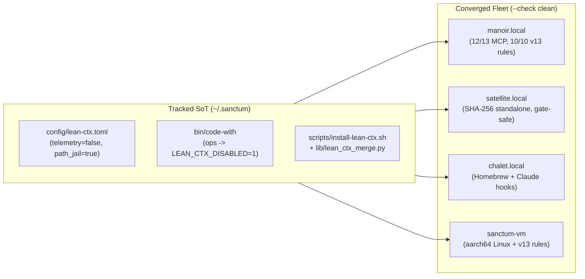

import { Aside } from '@astrojs/starlight/components';


`lean-ctx status` on `manoir.local` reported `doctor: 6/6` and `mcp: 11/13 configured`. By the numbers on the dashboard, context compression across the haus looked finished. It was not. Just days after closing [fourteen seams in the watchtower](/operations/2026-11-11-fourteen-seams-in-the-watchtower/), a direct disk audit of our [operations tooling](/operations/tooling/) told a very different story. Our primary `$0` feature harness was parsing `mcp_servers: None`. Our operations launcher was exporting the compression trigger into sessions explicitly marked `--no-lean-ctx`. Antigravity CLI booted two copies of the same MCP server on every turn. Anonymous telemetry had flipped back on after a binary upgrade, and neither the road-warrior laptop nor the pine-outpost Mini had the binary installed at all.

Nothing teaches humility quite like an efficiency layer whose status command gives itself six out of six while indented under Spotify.

We paused before the evening deploy window. Every harness configuration file across all four machines was read straight from disk. Then we built `~/.sanctum/scripts/install-lean-ctx.sh` plus `lean_ctx_merge.py`—modeled directly on the haus Memory Vault kit—so the entire fleet converges idempotently and fails closed on drift.



## 1. Two spaces between `mcp_servers` and nothing

Under our subscription-first coding doctrine, `sanctum-code --efficient` routes feature work to Hermes over the local Claude Max bridge on `127.0.0.1:3456`. Hermes was supposed to lean on `lean-ctx` (`ctx_compose`, `ctx_search`, `ctx_read`) to keep discovery turns tight.

Opening `~/.hermes/config.yaml` showed why Hermes had been reading files the long way:

```yaml
# Before: ~/.hermes/config.yaml (lines 178-184)
mcp_servers:
known_plugin_toolsets:
  cli:
    - spotify
  lean-ctx:
    command: "/opt/homebrew/bin/lean-ctx"
```

Because `lean-ctx:` sat two spaces beneath `known_plugin_toolsets:` instead of `mcp_servers:`, `yaml.safe_load` parsed `mcp_servers` as `None` and quietly filed our context engine beside the music player. Worse, `lean-ctx status` scanned `~/.hermes/config.yaml` by substring rather than YAML AST, saw `lean-ctx`, and marked Hermes `configured`. Meanwhile, `~/.hermes/HERMES.md` carried two stacked rule blocks—a current `version: 13` block above a leftover `version: 8` wrapper advertising retired tool names.

`lean_ctx_merge.py` repairs `~/.hermes/config.yaml` surgically line-by-line—preserving every comment and credential line without round-tripping secrets through a serializer—re-homes `lean-ctx` under top-level `mcp_servers:` pointing at `~/.local/bin/lean-ctx`, and strips the legacy `v8` wrapper out of `HERMES.md`.

## 2. Teaching `--no-lean-ctx` to actually mean no

Sanctum separates feature coding from haus operations for a reason: token compression is welcome when exploring a codebase, and intolerable when reading daemon logs or verifying gate hashes where a summarized line can hide a fault. Both `sanctum-code.yaml` and `coding-harnesses.yaml` set `lean_ctx: false` on the `ops` route.

Yet `code-with` (`~/.sanctum/bin/code-with`) previously exported `LEAN_CTX_AGENT=${harness}` unconditionally on every launch and omitted `LEAN_CTX_DISABLED=1` when `--ops` or `--no-lean-ctx` was passed. Because Claude Code's `PreToolUse` hooks (`rewrite`, `redirect`, `write-guard`) live globally in `~/.claude/settings.json` and shell compression keys off `shell_activation = "agents-only"`, every Claude `ops` session still ran full `lean-ctx` interception. And when `lean=true` *was* requested, `ensure_lean_ctx()` ran `lean-ctx init --agent` inside the caller's working directory—dropping `.vscode/mcp.json`, `.github/hooks/`, and `.codebuddy/` artifacts straight into product repositories.

```bash
# ~/.sanctum/bin/code-with — explicit env split
if [[ "$lean" == "true" ]]; then
  env_exports+=("LEAN_CTX_AGENT=${harness}")
else
  # Hard bypass: global PreToolUse hooks + agents-only shell hook exit 0 with {}
  env_exports+=("LEAN_CTX_DISABLED=1")
fi
```

Piping synthetic `Read` and `Bash` payloads into `LEAN_CTX_DISABLED=1 ~/.local/bin/lean-ctx hook redirect` and `rewrite` confirmed both return `{}` with exit code `0`. Moving `ensure_lean_ctx` after `--print` and delegating setup to `install-lean-ctx.sh` eliminated working-tree pollution for good.

<Aside type="caution" title="Substring checks lie; AST and env checks tell the truth">
Never trust a setup probe that greps a config file for its own binary name, and never assume omitting `--lean-ctx` disables a global `PreToolUse` hook. Verify the parsed dictionary in Python and export `LEAN_CTX_DISABLED=1` explicitly whenever an operations session needs raw ground truth.
</Aside>

## 3. Retiring the twin in Antigravity and closing telemetry

Three quieter drifts showed up on the same pass:

1. **Duplicate MCP servers in Antigravity CLI (`agy`)**: Every `agy` conversation was spawning both `lean-ctx` and `lean-ctx_lean-ctx`—fifty-one duplicate lazy tool schemas per turn. An early July import had left a `v3.9.13` bundle under `~/.gemini/config/plugins/lean-ctx` enabled in `~/.gemini/config/config.json`, which Antigravity namespaced alongside the global `~/.gemini/config/mcp_config.json` entry. Archiving that legacy plugin into `~/.sanctum/backups/`, pruning `plugins.lean-ctx` and the stale `mcp/lean-ctx_lean-ctx` schema cache, and splicing an explicit `<!-- sanctum-lean-ctx-mode -->` block into `GEMINI.md`, `grok/AGENTS.md`, and `HERMES.md` stopped the twin server and documented truthfully that MCP-only hosts require explicit `ctx_*` calls rather than hook-driven shadow routing.
2. **Telemetry re-enabled on upgrade**: Our strict posture in `coding-harness.md` and the header comment of `config/lean-ctx.toml` both state `No telemetry`, yet `[telemetry] enabled = false` had never been written to the TOML body. Upgrading to `3.12.5` turned anonymous daily counts on by default. Adding `[telemetry]\nenabled = false\npreference = "explicitly_disabled"` to tracked `config/lean-ctx.toml` and checking `NO_COLOR=1 lean-ctx telemetry status` inside `install-lean-ctx.sh --check` locked `Preference: disabled` into git.
3. **Outdated rules and host-vs-VM safety**: `~/.copilot/instructions.md`, `~/.openclaw/rules/lean-ctx.md`, and workspace `LEAN-CTX.md` still carried `version: 8` rules (`8/10` up to date). Converging them brought `manoir.local` to **`10/10` rules up to date** and **`12/13` MCP targets configured**—deliberately leaving `~/.openclaw/openclaw.json` absent on the macOS host because OpenClaw runs inside `sanctum-vm` and host rotation scripts treat a plaintext `openclaw.json` as an active host gateway.

## 4. Converging all four machines without breaking a freeze

The remaining gap was geographical: `manoir.local` had `lean-ctx`, while `satellite.local`, `chalet.local`, and `sanctum-vm` had none. Each machine had a different constraint:

| Node | Binary Path & Method | Constraint Respected | Post-Rollout `--check` |
| :--- | :--- | :--- | :--- |
| **`manoir.local`** | `/opt/homebrew/bin/lean-ctx` (`3.12.6`) -> `~/.local/bin/lean-ctx` | Preserves encrypted host `openclaw.json.enc`; `0` drift with `install-cli-vault.sh` | **`clean`** (`12/13` MCP, `10/10` rules) |
| **`satellite.local`** | SHA-256 verified Darwin `arm64` release (`3.12.6`) -> `~/.local/bin/lean-ctx` | Homebrew (`cmake 4.4.4`), `.zshrc`, and live controller `~/.claude/settings.json` untouched | **`clean`** (`claude` MCP-only + `codex`/`agy`/`grok`) |
| **`chalet.local`** | Homebrew `yvgude/lean-ctx/lean-ctx` (`3.12.6`) -> `~/.local/bin/lean-ctx` | Wired into `chalet/deploy-harness-fixes.sh` for unattended re-provisioning | **`clean`** (Claude hooks + symlinked TOML) |
| **`sanctum-vm`** | SHA-256 verified Linux `aarch64` release (`3.12.6`) -> `~/.local/bin/lean-ctx` | Gateway `openclaw.json` untouched; `v13` rules + `telemetry=disabled` | **`clean`** (`Preference: disabled`) |

On `satellite.local`, a multi-day release controller session was live on disk and Homebrew was frozen to protect `cmake 4.4.4`. Because `otool -L` confirmed `lean-ctx` links only against macOS system frameworks (`libSystem`, `Security`, `CoreFoundation`), `install-lean-ctx.sh` fetched the official `aarch64-apple-darwin` tarball, verified its digest against `SHA256SUMS`, installed directly to `~/.local/bin/lean-ctx` without touching Homebrew or `.zshrc`, and automatically engaged `claude_mcp_only` mode so `~/.claude.json` gained MCP discovery while the live symlinked `~/.claude/settings.json` stayed byte-identical. When upstream published `3.12.6` mid-rollout, adding an explicit `version_ge` floor to `install-lean-ctx.sh --check` flagged every `3.12.5` binary as drift and converged all four machines onto `3.12.6`.

Six hermetic `pytest` suites in `tests/test_lean_ctx_kit.py` now verify YAML repair, duplicate-plugin retirement, gate-safe laptop mode, `code-with` environment isolation, minimum binary version enforcement, and zero-drift coexistence with `cli_vault_merge.py`. Running `install-lean-ctx.sh --check --all` returns `clean` across all three macOS nodes in four seconds. Even a context compressor works better once it is no longer filed under Spotify.
