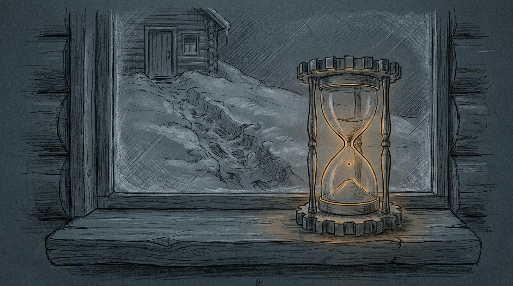

import { Aside } from '@astrojs/starlight/components';

`Failed to evaluate LAContext, bail.` The chalet wrote that line 174 times in eight days. Each time, something had logged in from the manoir and asked it, with `sudo`, to install macOS and restart. Each time, macOS asked for the owner's password, nobody was there to type it, and the install gave up.

The one time somebody did supply it, on the first of November, the chalet restarted and its vault stayed locked for most of the next three weeks. That was the night's biggest finding. It was not the only one.

## Seven auditors and a verdict

The chalet was audited on Sunday afternoon by seven read-only passes, each run on the chalet itself: its launchd jobs, its file system, its hardening, its readiness for Sanctum 1.0, its standing against the EETISMAD bar, Yoda's four requests, and a last pass that filled the gaps the others left. Nothing changed while they worked. The engine got only GET requests, and nobody went near [Ahsoka](/agents/ahsoka/)'s brain, which was still inside its soak.

The verdict had two halves. Enforcement works: the chalet runs the hub's exact Force Flow build, its gate, policy and fleet receiver are byte-identical to the landed code, and the suites were green again that afternoon, 201 gate tests, 85 broker tests and 33 fleet tests. Everything else was unfinished. None of the nine hardening steps had landed. Only the fleet-managed build met the Deployed letter; seven of the nine system job definitions on the box had no tracked copy anywhere. And the installed `sanctum-cli` still rejected the chalet's own configuration, because the 1.0 that understands it had not been cut.

The inventory that came out of it is now a chapter of its own, [Satellite Runtime: the Chalet](/architecture/satellite-runtime/).

## A hundred and seventy-four knocks

The gap-filling pass followed the logins. About once an hour, six sessions arrived from the manoir on the hub's general automation key, the lane the boundary design keeps for a human at a keyboard. They ran `tailscale`, Homebrew, `softwareupdate --schedule`, `defaults`, `colima status` and `softwareupdate -l`, and left a stamp in `/tmp` named for [Windu](/agents/windu/).

On the manoir, Windu's hourly doctor runs `--armed`, and its runtime check hands off to the threat watch's patcher. For the remote Macs, that patcher upgrades security formulae, rolls pinned runtimes such as `node` and `restic` with Homebrew's cleanup off, re-enables macOS update settings with `sudo`, realigns `tailscaled`, and for one host in a set of one, `REMOTE_MACOS_RESTART_HOSTS = frozenset({"chalet"})`, installs any recommended macOS update with `--restart`, provided FileVault is off and the Mac is on wall power. Both were true.

From 14 November it tried every hour. It also moved the chalet's runtimes outside fleet parity: two `node` builds on the 15th, the second of them the one the Firewalla bridge has run since the reboot, a new `restic` on the 19th, and, most likely, three in-place swaps of `tailscaled` earlier in the month. Fleet parity checks the build the hub deploys. It had no field for the runtime underneath it, so nobody compared.

## The first of November

At 19:52 on Sunday, 1 November, the same kind of install ran with the operator's password fed on standard input, `--stdinpass`, from a session with nobody logged in. macOS accepted it, scheduled a restart for after logout, and went down a few minutes later. The vault did not open again until 11 November, and after another reboot on the 12th it stayed shut until the 20th, behind a one-shot unlock that had already given up.

That install is now the recorded root cause of the November outage. Which job fed the password is not proven: the sessions of that evening have aged out of the chalet's logs. Where the password came from is the open question. The plan's answer is to change the password either way, and that call is the operator's.

The fix belonged to the hub, and it landed that night, in `sanctum-config` `565b0e5`: the chalet left Windu's installs and runtime rolls. Its read-only version checks move to a forced-command lane of their own in a later pass.

## The key with a thirty-day clock

In July both hauses moved their floor heating to the `nuheat_conductor` integration after the vendor retired its old API ([The Cloud That Moved Out](/operations/2026-07-24-the-cloud-that-moved/)). The audit found both links dead.

The manoir's dates tell the story. Its NuHeat entry was created on 24 July at 23:03 UTC. It last saved a token on 23 August at 22:45 UTC, 29.99 days later, and never again. A refresh token that dies thirty days after its login, however often it is refreshed, is almost certainly the rule, and every NuHeat link the haus makes dies on that schedule. The manoir's floors have most likely been dark in Home Assistant since late August; the 17 November change on their record was a Home Assistant restart. The chalet's copy last saved a token on 27 July. Its refresh now gets an HTTP 400 from the vendor's identity server, and all nine of its climate entities read `unavailable` across everything the recorder kept.

Nobody noticed, for the reason the July note gave: an `unavailable` entity is a state, not an error. The thermostats kept running on their own; only the haus lost sight of them.

The fix is in two parts. A human signs NuHeat in again, and will have to every thirty days until the vendor changes the rule.
The second part, a doctor for the chalet's Home Assistant that Ahsoka owns, waits for its own landing.

## Two changes nobody can trace

At 00:59 and 02:38 that morning the operator asked [Yoda](/agents/yoda/), on Signal, to give the chalet's TV two hours and a child one minute. Yoda answered correctly, and the chalet's gate carried out both. The hub broker recorded both as caller `operator`, provenance `waived`, not as caller `vm`.

That should not be possible. The VM's one road to the broker can only produce caller `vm` for the chalet. The operator path runs only on a host whose `.node_id` says `manoir`. And Yoda's sandbox had no `ssh` at all: the evening before, his own transcript read `ssh: command not found`. The audit ruled out an OpenClaw node service, the Jocasta, Firewalla and Green MCP servers and the VM bridge's forwards. The path is not found.

It matters for the last lock. No Signal sender has ever been recorded, so the chalet cannot move from `sender` mode to `enforce`, where only a named parent changes anything. Until Yoda's requests reach the hub as caller `vm` with their sender, a change he relays is one the hub cannot attribute.

## The reboot that was Apple's

The chalet rebooted at 03:31 that morning, and this time the hub was innocent. macOS's own automatic install armed itself at 02:54 and committed at 03:21. The vault unlocked itself six and a half minutes after boot through both witnesses, the engine and bridge came up the moment their tokens could be read, and the hub's fleet pulls resumed every 15 minutes.
On the operator's decision, the kit switched automatic macOS installs off on the satellite that night: OS updates belong in an operator sitting, outside curfew, with the unlock drill.

## What landed tonight

| Piece | Where | State |
|---|---|---|
| Gate 1.1: `devices`, `curfews` and `house`, all read-only | `openclaw-skills` `7dbdaa5`; K1 `p03` | In place |
| A root-owned watchdog that writes the enforcement ledger and never counts a kick as a heal | `sanctum-config` `fb63840`; K1 `p02` | In place |
| Ahsoka's Home Assistant doctor | `sanctum-config` `fb63840`; K1 `pH` | Waits |
| Yoda's requests reach the hub as caller `vm`, with their Signal sender | the VM: an `ssh` shim in his sandbox and a relay | Waits |
| The maintenance window: the operator asks Yoda, with a one-time code, and the hub opens a tunnel so the operator at the chalet can reach it | `openclaw-skills` `7dbdaa5`; `sanctum-config` `fb63840`; K1 `pM` | Waits |
| A fleet page when the engine answers while its loop is stale or it reports enforcement not ready during a curfew | `sanctum-config` `fb63840` | In place |
| Hardening, phase by phase, as the [runtime chapter](/architecture/satellite-runtime/#hardening-and-its-kits) lists it | K1 | `p01,p02,p03,p04,p06,p07,p09,p10,p12` |
| Five orphan jobs retired (Q5) | K1 `p10` | In place |
| The phonebook made a system job | K1 `p10` | In place |
| Automatic macOS installs off (Q13) | K1 `p12` | In place |
| Time zone pinned, stealth mode on, Spotlight off on the vault (Q20) | K1 `p12` | Waits |
| The chalet out of Windu's installs and rolls | `sanctum-config` | In place |

## What waits

| Waits | Why | Whose move |
|---|---|---|
| `tailscaled` on a root path (C9b) | Swapping it drops the tailnet for a moment | The operator, on site Monday |
| A planned reboot drill | It measures the unlock, the engine start, the phonebook without a login and a clean Home Assistant stop | The operator, on site Monday |
| NuHeat sign-in | Only a human can do it, every thirty days | The operator |
| The floor reader and the travelling screens | They need fleet v1.2 and an engine release on the hub | K2, this week |
| The bridge under fleet parity | A watched apply, outside any curfew | K2, this week |
| `enforce` mode for the chalet | No Signal sender recorded: Yoda's sandbox has no road to the hub that carries one | The sandbox route on the VM, then the operator |
| Windu's read-only lane | Version checks on a forced-command lane, not the automation key | Pass 2 |
| Sanctum 1.0 on the chalet | After Tuesday's cut, with the upgrade stop rule | The launch-prep sessions, then the operator |

## Status

**Landed, 2026-11-22.** K1's runs installed phases `p01,p02,p03,p04,p06,p07,p09,p10,p12`, and K1-check printed `CLEAN pins=c8d098a9b1dae784eaa0c888e2898a100dcb72d73d59749c7e6f577592ccf468`. The gate, the watchdog and the kits behind them are merged in `openclaw-skills` `7dbdaa5` and `sanctum-config` `fb63840`, the chalet stays in fleet parity, and every row in the last table has an owner.

## Lineage

- [2026-11-21: Thirteen Knocks From the Pine Outpost](/operations/2026-11-21-thirteen-knocks-from-the-pine-outpost/) — the wall, the lanes, and the night before
- [2026-07-24: The Cloud That Moved Out](/operations/2026-07-24-the-cloud-that-moved/) — the NuHeat migration whose logins expired in August
- [2026-10-22: The Sentinel That Patches the Fleet](/operations/2026-10-22-the-sentinel-that-patches-the-fleet/) — where Windu's patching across nodes began
- [Satellite Runtime: the Chalet](/architecture/satellite-runtime/) — the inventory this audit produced
- [Vault Armor](/architecture/vault-armor/) — the unlock that waits for the hub
- [Windu](/agents/windu/), [Yoda](/agents/yoda/) and [Ahsoka](/agents/ahsoka/) — the three agents in this story

Thirteen knocks went out from the pine outpost the night before, and none came back. This count ran the other way: a hundred and seventy-four from the manor, each asking the chalet to restart, each stopped by a password prompt with nobody in front of it. The rule was always that the hub opens the doors. It never said that every hand on the hub's side should be free to knock.
