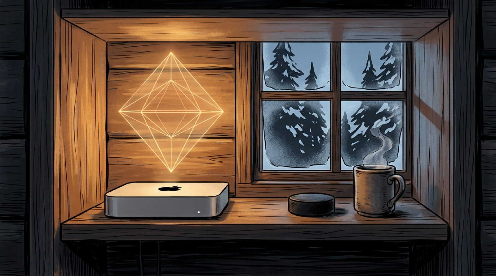

import { Card, CardGrid, Aside, Tabs, TabItem } from '@astrojs/starlight/components';

Les lumières du corridor viennent de s'allumer toutes seules. Le thermostat pense qu'on est en juillet à Miami. La seule affaire entre toi pis le sommeil, c'est un NAS qui a décidé — par conviction philosophique — qu'il croit pus au DNS. Bravo : t'as pas bâti une maison intelligente. Tu t'es engagé sur un quart de nuit pas payé qui planifie ses propres urgences pis qui paye exclusivement en cortisol.

Sanctum, c'est la plateforme qui te met à la porte de ce quart-là. Un Mac Mini caché dans le garde-robe, un seul fichier YAML, un dashboard. Domotique, conseil d'agents AI légèrement intense, défense réseau pis voix locale — tout ça sur du hardware que tu possèdes pour vrai, sans aucun milliardaire de la tech dans la boucle. Fait pour le genre de famille où « redémarre le routeur » est pas une joke, c'est du préliminaire un mardi soir.

*Aussi disponible en anglais : [What Is Sanctum?](/getting-started/what-is-sanctum/).*

## Le problème

Tu le connais déjà, le problème. Tu vis dedans.

Ta cabane intelligente est un monstre de Frankenstein cousu avec douze services qui se sont jamais parlé. Home Assistant gère les lumières. Un NAS à part ramasse tes photos. Le monitoring réseau dort dans une app dont t'as oublié le mot de passe. Pis ton assistant AI dans le cloud ship gentiment tes conversations en Virginie. Quatre systèmes, quatre dashboards, quatre façons de te faire réveiller à 2 h du matin.

Pire encore : le jour où la startup pivote ou double son prix un mardi matin, tes lumières redeviennent plus niaiseuses qu'en 1994.

## La plateforme

Sanctum rassemble toute c'te patente-là sous un seul toit, sur du silicium que tu peux débrancher avec tes propres mains. Un seul fichier de config. Un seul coupable quand ça brise.

<CardGrid>
  <Card title="Domotique locale" icon="laptop">
    Home Assistant roule sur sa propre boîte dédiée sur ton réseau local, avec accès direct à Sonos, HomeKit pis tous tes appareils.
  </Card>
  <Card title="Agents AI spécialisés" icon="star">
    Un [Conseil Jedi](/qc/le-conseil/) gère la sécurité, l'infrastructure, la santé, les finances pis la mémoire de la famille, chacun sur son propre modèle.
  </Card>
  <Card title="Défense réseau" icon="setting">
    L'intégration Firewalla pilote les règles pare-feu, le DNS, le temps d'écran pis la topologie réseau directement depuis la plateforme.
  </Card>
  <Card title="Voix 100 % locale" icon="signal">
    Yoda te parle avec une voix clonée qui tourne sur le GPU Apple Silicon via Chatterbox-MLX. Zéro nuage pour la voix. Ta cabane parle juste à toi.
  </Card>
</CardGrid>

## Comment ça marche

Au cœur de Sanctum, y'a un seul fichier YAML (`instance.yaml`). Il déclare toute la cabane : quels services roulent, quels ports ils occupent, quels nœuds existent, pis où vivent les secrets. Chaque script, chaque LaunchAgent pis chaque panneau lit à la même source de vérité.

Un fichier pour les gouverner tous. Un seul fichier à engueuler quand une ligne est croche.

<Tabs>
  <TabItem label="Le Hub (Mac Mini)">
    Le Hub, c'est le cerveau principal. Il roule sur un Mac Mini Apple Silicon — une petite boîte d'aluminium grosse comme un grilled cheese qui fait la job d'un petit ministère :
    - La passerelle Sanctum et le tableau de bord
    - Le pont vers Home Assistant Green et Firewalla
    - Les LLM locaux via MLX (un siège conseil 27B et un siège code 9B sur GPU Apple Silicon)
    - La synthèse vocale locale (Sanctum TTS)
    - Le tunnel Cloudflare pour l'accès à distance sécurisé
  </TabItem>
  <TabItem label="La VM isolée (Ubuntu)">
    Une VM Ubuntu gérée par Lima sur Apple Virtualization (`vz`, zéro QEMU) fait tourner les workloads Linux :
    - L'orchestration des agents (Yoda, Windu, Qui-Gon, Cilghal, Mundi)
    - Le graphe de connaissances et la mémoire longue
    - Les secrets chiffrés avec SOPS et age
    - Une isolation réseau stricte via pont privé `10.10.10.0/24`

    La VM a pas d'accès direct non filtré sur ton LAN. C'est pas un bogue : c'est un caisson d'isolation de sécurité.
  </TabItem>
  <TabItem label="Les Satellites (Chalet)">
    Une deuxième résidence — le chalet, le bureau — roule un nœud satellite léger avec son propre `node_id`. Le Hub le rejoint par Tailscale. Quand l'internet rural plante en janvier, [Ahsoka](/qc/le-conseil/) continue de gérer le plancher chauffant en local sans broncher.
  </TabItem>
</Tabs>

## Pourquoi « Sanctum »

Le nom veut dire *chambre sacrée*. Le logo le montre noir sur ambre : un carré sombre qui protège un diamant doré au centre. Le monde que t'aimes le plus, dans une forteresse assez solide pour les protéger.

L'ambre est pas là par hasard. C'est la couleur du feu de foyer, de la chandelle — la plus vieille couleur qui dit *y'a quelqu'un dans la cabane*. Sur fond d'ardoise sombre, ça devient un foyer au cœur de l'architecture. Zéro boule fluo générée par AI, zéro dégradé mauve. La retenue frappe plus fort.

## Ce qui le distingue pour vrai

- **Un seul fichier de config.** Tout vit dans `~/.sanctum/instance.yaml`. Tu changes un port à une place, ça suit partout.
- **Auto-guérison intégrée.** Notre watchdog en Rust vérifie chaque service aux dix minutes et répare ce qu'il peut avant que tu te réveilles.
- **Secrets chiffrés en rotation.** Clés dans le trousseau macOS et SOPS sur la VM, tournées automatiquement.
- **AI locale d'abord.** `Qwen3.8-27B` et `Ornith-1.5-9B` tournent sur ton GPU Apple Silicon. Le cloud sert de renfort via tes abonnements fixes — zéro taximètre qui vire pendant que tu penses.

<Aside type="note">
  Sanctum, c'est le beau nom sur la porte. En dessous, tout s'appuie sur des briques open-source solides comme du béton (OpenClaw, Home Assistant, Rust, Tailscale, Firewalla). Zéro prison propriétaire. On bâtit pas un jardin clos bien poli : on bâtit une forteresse avec le béton open-source de tout le monde.
</Aside>

## C'est pour qui?

Sanctum est fait pour le monde technique qui veut posséder sa pile au complet, sans faire d'urticaire devant un terminal. Tu sais c'est quoi un `ssh`, tu lis du YAML sans pleurer, pis l'idée que ta cabane soit mieux architecturée que l'infra à la job te fait sourire? Tire-toi une bûche.

Si les mots « réseau Host-Only » te font cligner de l'œil gauche, aucun jugement : y'a plein de petites boîtes blanches au magasin qui vont se faire un plaisir de vendre ton horaire de thermostat à un courtier en Virginie.

Si tu es encore là, tu sais déjà à quel club tu appartiens. Un Mac Mini dans le garde-robe, un seul YAML, pis la paix d'esprit qui vient avec le fait de posséder les clés de ta propre cabane.

## Pour la suite

Poursuis le tour avec [Une journée dans la cabane](/qc/une-journee-dans-la-cabane/) pour voir tout ça tourner heure par heure, rencontre [Le Conseil Jedi](/qc/le-conseil/), ou saute direct dans le [Démarrage rapide (30 min)](/qc/demarrage-rapide/).
