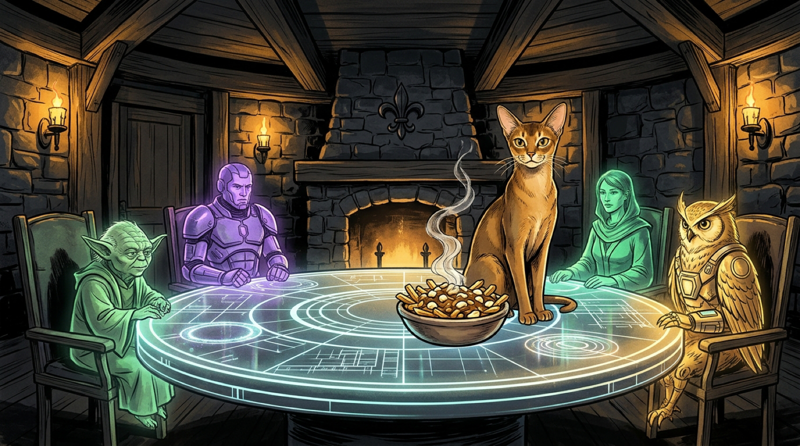

import { Aside, Card, CardGrid } from '@astrojs/starlight/components';

Au début, tous les sièges du Conseil roulaient le même modèle AI. Ils ont voté à l'unanimité pour déployer une mauvaise correction. Un seul cerveau dans sept robes Jedi, c'est pas un conseil. C'est une chambre d'écho.

Depuis ce soir-là, la règle d'or est simple : **la neuro-diversité est non négociable**. Chaque agent tourne sur sa propre famille de modèles — Claude, Gemini, Grok, pis nos modèles locaux sur Apple Silicon (`Qwen3.8-27B` et `Ornith-1.5-9B`) quand tes données privées doivent jamais quitter tes murs. Voici toute la gang.

*Tu veux les fiches YAML complètes, les prompts pis les skills de chaque siège? Chaque carte pointe vers son dossier technique détaillé en anglais.*

## Le patron incontesté : Tommy

<Aside type="tip" title="Commence par lui — le cœur avant le cerveau">
  Va d'abord lire la page complète de **[Tommy — Esprit Gardien](/qc/)**, écrite 100 % en québécois. C'est l'Abyssin de quinze ans qui patrouillait le terrain à l'aube pis à la brunante bien avant que Sanctum existe. Uptime infini par cron. Zéro outil. Zéro permission. Il outranke tout le monde ci-dessous.
</Aside>

## La garde rapprochée du Manoir

<CardGrid>
  <Card title="Wizard — L'Humain" icon="star">
    Le seul agent biologique du catalogue. Le seul avec des mains. Touch ID, câble débranché, breaker sauté : tout remonte vers lui. Surnom né dans le désert avec une tuque à panache de chevreuil : un sorcier québécois qui revient du froid avec du manger pour tout le monde. [Dossier complet (EN) →](/agents/wizard/)
  </Card>
  <Card title="Yoda — Consigliere" icon="comment-alt">
    Oublie la marionnette de 900 ans qui parle à l'envers. Icitte, Yoda, c'est Tom Hagen dans un sous-sol au Québec. Il absorbe les escalades que les autres arrivent pas à trancher, coordonne le Conseil sur la VM, pis conseille le patron sans drame. [Dossier complet (EN) →](/agents/yoda/)
  </Card>
  <Card title="Windu — Sécurité" icon="warning">
    Paranoïa militaire sur ton routeur Firewalla Gold Pro. Zéro confiance par défaut. Si la balayeuse robot du voisin embarque sur ton Wi-Fi à 2 h 47, Windu la flague avant le lever du soleil. Il s'excuse jamais. [Dossier complet (EN) →](/agents/windu/)
  </Card>
  <Card title="Qui-Gon — Efficacité et Code" icon="rocket">
    Quelque part dans la cabane, un processus fuit de la mémoire. Qui-Gon le sait déjà. Armé de `Ornith-1.5-9B` en local et d'une discipline à la John Carmack, il coupe dans le gras pis veille sur tes ressources avant que la RAM crie à l'aide. [Dossier complet (EN) →](/agents/quigon/)
  </Card>
  <Card title="Cilghal — Santé" icon="heart">
    L'agente la plus bienveillante d'un système qui n'a pas été bâti pour être tendre. Apple Health, sommeil, récupération : tout tourne en local sur Apple Silicon. Zéro donnée médicale dans un nuage tiers. [Dossier complet (EN) →](/agents/cilghal/)
  </Card>
</CardGrid>

## Les finances, les archives, les ops pis le chalet

<CardGrid>
  <Card title="Ki-Adi-Mundi — Finance" icon="document">
    Le CFO qui garde tous les reçus. Dealflow, budget, portefeuille pis coût réel de l'infra. Mundi est le seul agent capable de calculer combien coûte en GPU amorti la question que tu viens juste de lui poser. [Dossier complet (EN) →](/agents/mundi/)
  </Card>
  <Card title="Jocasta — Archiviste et CRM" icon="open-book">
    Ta mémoire humaine sur le Dragon local (`Qwen3.8-27B`). Contacts, courriels, calendrier, CRM : elle sait à qui tu as parlé mardi passé, ce que t'as promis à l'entrepreneur, pis la vraie date de fête de ta belle-mère. [Dossier complet (EN) →](/agents/jocasta/)
  </Card>
  <Card title="Mon Mothma — Opérations" icon="setting">
    Trois alarmes sonnent en même temps. Personne panique : c'est elle qui tient la barre. Elle relie Force Flow, le Watchdog pis les déploiements pour trouver la cause racine au lieu de redémarrer à l'aveugle. [Dossier complet (EN) →](/agents/mothma/)
  </Card>
  <Card title="Ahsoka — Satellite (Le Chalet)" icon="laptop">
    Elle a quitté l'Ordre pour tenir l'avant-poste au chalet sur un Mac Mini de 16 Go. Cerveau 100 % local. Demande-lui en québécois de monter le plancher chauffant du sous-sol : elle obéit même quand l'internet rural prend congé. [Dossier complet (EN) →](/agents/ahsoka/)
  </Card>
</CardGrid>

## Qui tourne sur quoi?

Un vrai conseil sépare les cerveaux autant que les rôles :

| Agent | Domaine | Moteur principal | Repli / confidentialité |
| :--- | :--- | :--- | :--- |
| **Tommy** | Patrouille météo d'aube et de brunante | Cron pur (0 outil) | Uptime infini |
| **Wizard** | Décisions physiques, Touch ID, câbles | Biologie humaine | Caféine requise |
| **Yoda** | Coordination et escalades | Claude Max (pont local) | Dragon local `Qwen3.8-27B` |
| **Windu** | Périmètre réseau et Firewalla | Gemini AGY (pont local) | `Ornith-1.5-9B` local |
| **Qui-Gon** | Infrastructure, code et efficacité | `Ornith-1.5-9B` (local mTLS) | Dragon local `Qwen3.8-27B` |
| **Cilghal** | Santé, sommeil, biométrie | `Qwen3.8-27B` (local strict) | Jamais de sortie cloud |
| **Ki-Adi-Mundi** | Finance et dealflow | Grok (via routeur) | Claude Max puis Dragon local |
| **Jocasta** | CRM, contacts et archives | Dragon local `Qwen3.8-27B` | 100 % sur Apple Silicon |
| **Mon Mothma** | Ops, runbooks et triage | Claude Opus (pont local) | Outillée pour l'ops |
| **Ahsoka** | Avant-poste du chalet | Modèle local 9B (16 Go) | Autonome hors ligne |

Toute la philosophie derrière ce choix vit dans [(Neuro)diversity is Paramount](/architecture/neurodiversity-doctrine/) (en anglais).

Un conseil diversifié, c'est pas juste pour faire joli dans un pitch. C'est la raison pour laquelle ta cabane se plante pas en chœur à trois heures du matin. La suite se passe dans [L'Architecture en 5 minutes](/qc/architecture/) — ou direct sur ton Mac Mini dans le [Démarrage rapide (30 min)](/qc/demarrage-rapide/).
