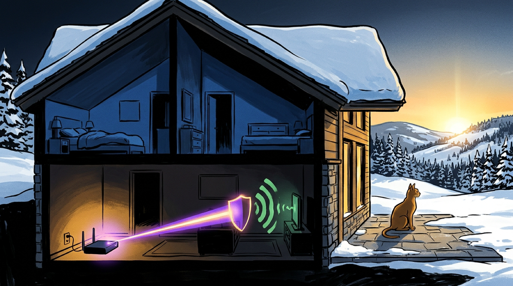

import { Aside } from '@astrojs/starlight/components';

Personne dans la cabane se réveille le matin en pensant à Sanctum. C'est à la fois le but numéro un pis le pire pitch pour une démo vidéo — parce qu'une infra qui fait sa job produit zéro explosion pis zéro histoire de guerre.

Fa'que voici un mardi ben ordinaire. Zéro PowerPoint, zéro fla-fla — juste vingt-quatre vraies heures, dans l'ordre, su un Mac Mini caché dans un garde-robe au Québec. Lis ça comme un film de braquage : dès qu'un bout te fait hausser un sourcil, clique droit dans le plan d'ingénierie.

*Aussi disponible en anglais : [A Day in the Haus](/getting-started/a-day-in-the-haus/).*

## 02 h 30 — les robots tiennent un caucus dans le noir

En pleine nuit, la boucle d'amélioration ([Kitchen Loop](/architecture/kitchen-loop/)) se réveille pis commence à s'obstiner toute seule comme une gang de scénaristes sans boss. Un agent propose une amélioration. Un autre essaie de la démolir. Un arbitre tranche dans les débris. Toute ça vire pendant que la famille dort, parce que le rayon d'explosion est pas mal moins pire à 2h du mat qu'en plein souper.

Trente minutes plus tard, un test de parité tire dix prompts fixes à température zéro contre des réponses connues. Si le modèle local a commencé à délirer durant la nuit, tu vas le savoir avant ton premier café.

## 04 h 17 — la cabane fait le ménage dans sa tête

Pendant que le déneigeur te fait un beau banc de neige dans l'entrée, la voûte mémoire fait exactement c'qu'un cerveau humain fait la nuit : a consolide les observations brutes de la journée. Le bruit part aux vidanges. Les vrais patterns restent pis se branchent su ceux des semaines d'avant.

C'est la pièce la moins visible du stack, pis une des plus importantes. Une cabane incapable d'oublier est une cabane incapable de remarquer.

## 05 h 25 — quelque chose rêve

Le siège local de réflexion se réveille tu-seul pis tisse des liens libres à travers toute c'qu'y a retenu. Pas de rapport. Pas de ticket. Personne attend après ça.

<Aside type="note">
  On garde ce cycle-là parce que nos tests sur l'émergence montrent qu'un système intégré doit penser même quand personne y pose de question. Sinon, t'as juste un téléphone vraiment trop cher.
</Aside>

## 06 h 30 — Tommy file la météo

[Tommy](/qc/), l'Abyssin de la famille, métabolise pus pantoute depuis un bout, c'qui a zéro dérangé son horaire. La patrouille d'aube rentre à l'heure pile : conditions notées, jugement rendu, dossier classé. Y'a watché le soleil se lever su c'te vallée-là pendant quinze ans pis y voit pas pourquoi un certificat de décès changerait le deal.

C'est le seul agent de la cabane sans outil, sans permission, pis avec un uptime infini.

## 08 h 00 — une ligne, sauf si ça brasse

Le briefing du matin rentre. Une seule ligne quand toute est vert. Y s'allonge juste quand y'a un vrai problème — parce qu'un rapport qui te crie *« toute est beau! »* chaque matin finit par ressembler aux courriels RH : tu les lis pus pantoute.

En arrière-plan, le watchdog en Rust a déjà checké chaque service deux fois depuis ton réveil. La plupart des journées, tu sauras même pas c'qu'y vient de sauver.

## 10 h 00 — un jeune récupère Internet

Les écrans d'une chambre reprennent vie. Pas parce qu'un parent a plié après trois crises de bacon : parce que l'horaire dit dix heures pis que l'horaire, c'est la loi. Zéro bonhommes avant 10 h, toute l'année, congés inclus. C'est bloqué au routeur, pas su l'appareil — impossible à désinstaller, impossible à négocier.

La règle est plate à mort. C'est exactement ça le feature. Le [Guide des parents](/parents-guide/qc/) transforme un procès au déjeuner en promesse mécanique.

## 13 h 00 — le côté business se réveille

La même cabane qui vient de gérer un couvre-feu de bonhommes se retourne pis fait la job de bureau. L'intelligence de dealflow te sort quels dossiers actifs ont refroidi, dans quel ordre, avec les vraies dates qui le prouvent. Mundi garde le siège des finances avec l'enthousiasme d'un vérificateur fiscal, derrière un plafond quotidien qui bloque la facture avant qu'a commence.

Pas une ligne de config change entre les deux jobs. Même conseil, même YAML, mêmes règles. Ta cabane s'en balance que tu y parles d'un thermostat ou d'un term sheet.

## 15 h 30 — un modèle change de chaise sans avertir

Un siège code embarque su le GPU. Le routeur décide à chaque requête entre le modèle local pis un modèle de pointe, en passant par tes abonnements fixes au lieu d'une API facturée au token. Réfléchir fort coûte exactement le même prix que réfléchir vite. Si un chemin plante, la chaîne de repli prend la puck au vol sans couper la conversation.

## 18 h 00 pis 21 h 30 — l'heure juste, pis on barre les portes

À 18 h, le bilan honnête du temps d'écran rentre par Signal : heure moyenne du dodo, dérogations brûlées, top trois des apps par enfant. C'est la différence clinique entre *« messemble qu'y ont regardé ben du YouTube »* pis un reçu horodaté.

À 21 h 30, couvre-feu. Consoles, tablettes, télé du sous-sol. Réveil à 7 h. Un parent peut donner du temps supplémentaire depuis son téléphone, mais chaque blocage ou sursis expire tu-seul. Pis même si le cloud du fournisseur est planté, le Parachute barre la règle direct dans le noyau su la boîte. L'heure du dodo dépend de l'API de personne.

## 02 h 47 — le bout que tu vois jamais

Un mardi d'avril, une Xbox au sous-sol s'est essayée en douce su le Wi-Fi à 02 h 47. À 02 h 47 min 03 s, Windu l'avait déjà flushée au routeur, un message attendait su un téléphone à neuf cents kilomètres, la trace dormait dans SQLite pis le tableau de bord luisait en ambre.

*Finish him.* Personne s'est réveillé. C'est toute le produit, en trois secondes.

Une belle journée icitte, c'est pas une journée où y s'est passé mille affaires spectaculaires. C'est une journée qui finit sans que t'aies pensé une seule fois au garde-robe. Prêt à rencontrer la gang? Passe voir [Le Conseil Jedi](/qc/le-conseil/), jette un œil à [L'Architecture en 5 minutes](/qc/architecture/), ou pars ton propre mardi dans le [Démarrage rapide](/qc/demarrage-rapide/).
